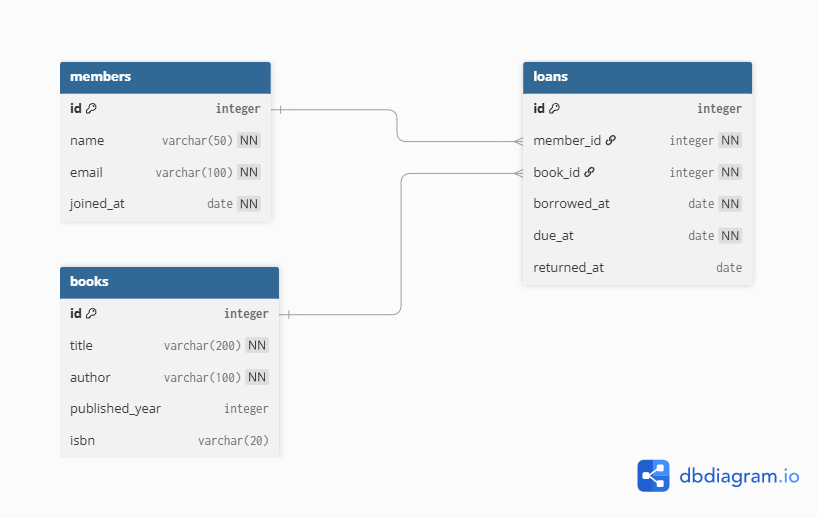
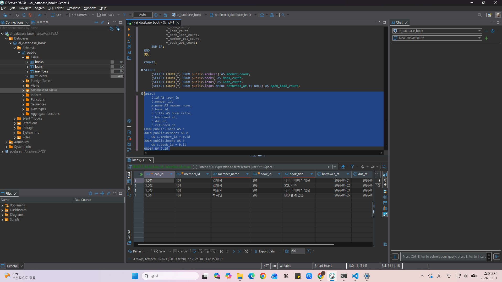
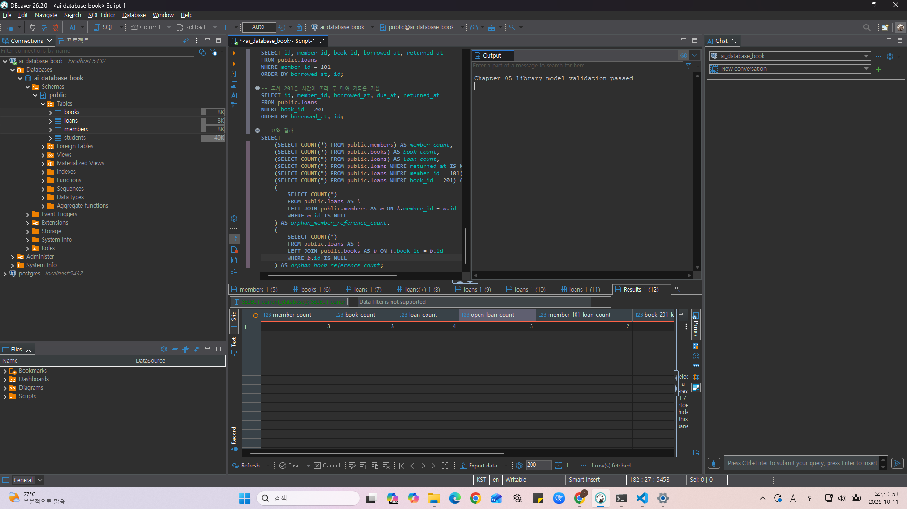
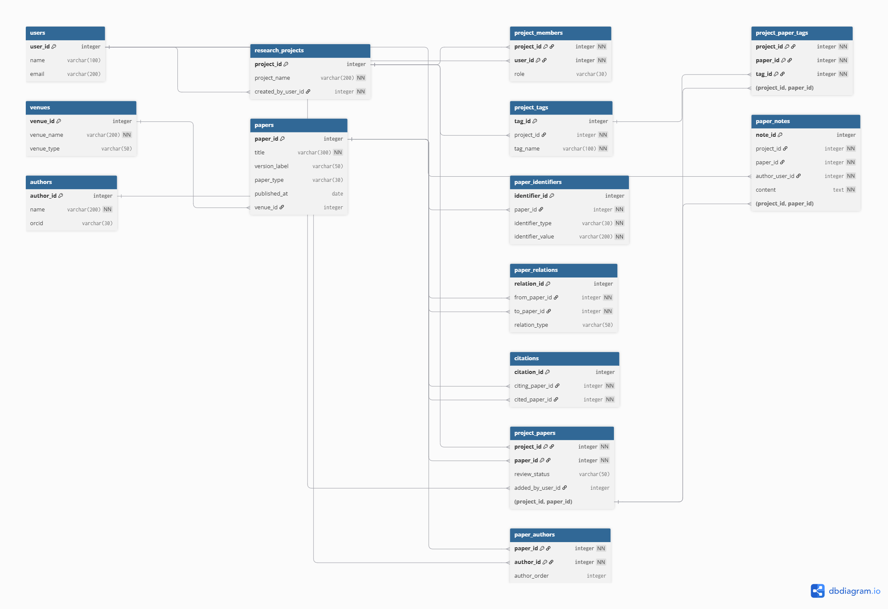

# Chapter 05 확장 실습 답안 템플릿

> **과제:** 요구사항에서 데이터 모델과 ERD 만들기  
> **사용 방법:** 이 파일을 내려받아 본인의 GitHub 저장소에 `chapter05_answer.md`라는 이름으로 저장한 뒤 실습하면서 바로 작성합니다.  
> **제출 방법:** LMS에는 파일을 직접 업로드하지 않고, **본인 GitHub 저장소의 `chapter05_answer.md` 파일 URL**을 제출합니다.

---

## 제출 전 주의

이 파일과 캡처 화면에는 실제 비밀번호, 전체 DB 접속 URL, API Key, 개인정보를 기록하지 않습니다.

```text
GitHub 계정 또는 별칭: youccode
과제 작성일: 2026.10.11
사용한 AI 도구: ChatGPT
```

---

# 1. Chapter 05 핵심 개념 복습

본문을 보지 않고 먼저 작성합니다.

```text
요구사항에서 바로 테이블부터 만들면 위험한 이유: 기록이 필요한 대상과 사건, 그 사이의 관계에 대해서 충분히 구분하지 않은 채
테이블을 만들게 되면, 실제로 필요한 기록이 빠지거나, 잘못된 제약 조건을 정할 수 있기 때문이다.

한 행의 의미를 먼저 정해야 하는 이유: 한 행의 의미에 따라서 PK, FK, 중복 여부, 조회 결과의 해석 등이 모두 달라지기 때문이다.

확정 요구사항과 미확정 정책을 구분해야 하는 이유: 아직 확정되지 않은 정책을 UNIQUE나 CHECK 등과 같은 조건으로 미리 강제하게 되면
실제 운영 방식과 충돌할 수 있기 때문이다.

PK와 업무상 고유값 후보의 차이: PK는 테이블 내부에서 각 행을 식별할 수 있도록 지정한 키를 말하고, 이메일이나 ISBN과 같이 업무상 고유값 후보들은
실제 서비스 정책을 확인한 뒤, 고유성 적용 여부를 결정해야 하는 후보 값들이다.

N:M 관계를 그대로 두지 않고 연결 테이블을 검토하는 이유: 서로 여러 번 연결 가능한 관계를 별도의 행으로 기록하고, 필요한 경우, 그 관계가
발생한 날짜나 상태와 같은 속성들도 함께 관리하기 위해서이다.
```

---

# 2. 도서 대여 요구사항 R-01~R-07 다시 분해

| 요구사항 | 관리 대상 / 사건 | 속성 후보 | 관계 / 규칙 후보 | 미확정 질문 |
| --- | --- | --- | --- | --- |
| R-01 | 회원(관리 대상) | 회원 식별자, 이름 등 | 도서관이 회원 정보를 관리해야 함 | 회원 탈퇴 뒤 대여 이력을 보존할 것인가? |
| R-02 | 회원(관리 대상) | 이름, 이메일, 가입일 | 회원의 세 가지 정보를 저장함 | 이메일을 고유값으로 강제할 것인가? |
| R-03 | 도서(관리 대상) | 제목, 저자, 출판연도, ISBN | 도서 관련 정보를 관리함 | 같은 ISBN의 실물 복본은 어떻게 구분할 것인가? |
| R-04 | 회원과 대여(반복 사건) | 회원 ID, 도서 ID, 대여 ID | 한 회원은 여러 권을 대여할 수 있음(회원 1 : 대여 N) | 동시에 빌릴 수 있는 최대 권수는 몇 권인가? |
| R-05 | 도서와 대여(반복 사건) | 도서 ID, 대여 ID, 대여일 | 한 도서는 시간에 따라 여러 번 대여될 수 있음(도서 1 : 대여 N) | 같은 도서를 동시에 여러 명이 대여할 수 있는가? |
| R-06 | 대여 기록(사건) | 대여일, 반납예정일, 실제반납일 | 대여 사건마다 날짜를 저장함 | 반납예정일의 산정 기준은 무엇인가? |
| R-07 | 대여 기록(사건) | 실제반납일(returned_at) | 아직 반납하지 않은 대여는 실제반납일이 비어 있을 수 있음 | 실제반납일 NULL 외에 별도의 대여 상태가 필요한가? |


### 본문과 비교한 뒤 수정한 내용

```text
처음에 놓친 부분: R-04에서 회원이 여러 도서를 대여할 수 있다는 요구사항을 분해하면서,
속성 후보에 도서 ID를 명시하지 않았다.

처음에 잘못 분류한 부분: 관리 대상과 반복 사건을 구분하는 과정에서는 본문과 비교했을 때
뚜렷하게 잘못 분류한 부분이 없었다.

수정한 이유: 본문에서는 회원과 도서를 단순히 연결하는 것이 아니라
대여 기록을 통해 관계를 표현하고 있다. 따라서 R-04의 속성 후보에 도서 ID를 추가하여 회원, 도서,
대여 기록 사이의 관계를 더욱 명확하게 나타내도록 수정하였다.
```

---

# 3. 확정 규칙과 미확정 정책 구분

## 3-1. 확정된 규칙

```text
1. 도서관은 회원 정보를 관리하며, 회원은 이름·이메일·가입일을 가진다.
2. 도서관은 도서의 제목·저자·출판연도·ISBN 정보를 관리한다.
3. 회원 한 명은 여러 권을 빌릴 수 있고, 도서 한 건도 시간에 따라 여러 번 대여될 수 있다.
4. 대여 기록은 특정 회원과 특정 도서를 연결하고 대여일·반납예정일·실제반납일을 저장한다.
5. 실제반납일은 반납하지 않은 대여에서 NULL일 수 있으며, 대여 기록은 반복되는 사건으로 관리한다.
```

## 3-2. 미확정 질문

최소 5개를 작성합니다.

```text
Q1.회원의 이메일은 반드시 고유해야 하는가? 대소문자는 동일하게 볼 것인가?
Q2.ISBN이 없는 도서도 등록 가능한가? ISBN은 어느 수준(서지 정보/복본)에서 유일해야 하는가?
Q3.같은 ISBN의 실물 복본을 여러 권 보유할 때 각 복본을 어떻게 구분할 것인가?
Q4.회원별 동시 대여 권수나 동일 도서의 동시 대여를 제한할 것인가?
Q5.반납예정일을 어떤 규칙으로 계산하며, 실제반납일이 대여일보다 빠른 입력을 막을 것인가?
Q6. 한 도서에 저자가 여러 명이면 저자 정보를 어떻게 저장할 것인가?
Q7. 회원 또는 도서를 삭제할 때 기존 대여 기록은 어떻게 처리할 것인가?
```

### 미확정 정책을 바로 `UNIQUE`, `CHECK`, 삭제 규칙으로 구현하면 위험한 이유

```text
이메일과 ISBN의 고유성 기준, 복본 관리 방식, 동시 대여 허용 여부, 삭제 후 이력 유지 정책은 아직 확정되지 않았다. 그런데 이를
DB 제약으로 미리 구현하게 되면 실제로 허용해야 할 데이터를 거부하거나 보존해야 할 기록을 삭제할 수 있다. 그렇기에, 확인된 요구사항에 따라
식별자 및 참조 관계를 먼저 표현하고, 미확정된 정책에 대해서는 질문으로 남긴 뒤 결정해야 한다.
```

---

# 4. 엔터티·속성·사건 후보 구분

| 후보 | 대상 엔터티 / 사건 엔터티 / 속성 | 판단 근거 | 독립 식별 필요? |
| --- | --- | --- | --- |
| 회원 | 대상 엔터티 | 여러 대여 기록에서 동일한 회원을 참조하므로 회원 자체의 식별이 필요하다. | 필요 (`members.id`) |
| 도서 | 대상 엔터티 | 여러 대여 사건이 같은 도서를 참조하므로 도서 정보와 대여 사건을 구분해야 한다. | 필요 (`books.id`) |
| 대여 기록 | 사건 엔터티 | 누가 어떤 도서를 언제 빌리고 반납하는지 매번 기록해야 한다. | 필요 (`loans.id`) |
| 이메일 | 속성 | 회원의 연락처·식별 후보이지 그 자체가 이 모델의 독립적인 관리 대상은 아니다. | 현재는 불필요 |
| ISBN | 속성 | 도서의 외부 서지 식별자 후보이며 실물 복본 식별자와는 다를 수 있다. | 현재는 불필요 |
| 반납예정일 | 속성 | 특정 대여 사건에 귀속되는 날짜이다. | 현재는 불필요 |

### “명사가 보이면 무조건 테이블”이 아닌 이유

```text
명사가 가리키는 항목이라도 독립적으로 여러 건을 식별하고 관리해야 하는 대상인지 먼저 확인해야 한다.
이메일·ISBN·반납예정일은 현재 요구사항에서 회원, 도서, 대여 기록의 속성에 해당한다.
반면 대여 기록은 회원과 도서의 관계가 반복되면서 날짜와 반납 상태를 따로 가지므로 사건 엔터티로 분리할 필요가 있다.
```

---

# 5. 테이블별 한 행의 의미와 키 후보

| 테이블 | 한 행의 의미 | PK 후보 | 업무상 고유값 후보 | FK 후보 |
| --- | --- | --- | --- | --- |
| `members` | 도서관에서 관리하는 회원 한 명 | `id` | `email` (미확정) | 현재 없음 |
| `books` | 도서관에서 관리하는 도서 기록 한 건. 복본 단위인지는 미확정 | `id` | `isbn` (미확정) | 현재 없음 |
| `loans` | 특정 회원이 특정 도서를 빌린 대여 사건 한 건 | `id` | 현재 미확정 (별도 대여 번호 후보) | `member_id → members.id`, `book_id → books.id` |

### `members.email`을 지금 바로 UNIQUE라고 확정하지 않는 이유

```text
요구사항에는 회원의 이메일을 저장한다는 사실만 있고, 동일 이메일을 여러 회원이 공유할 수 없는지,
대소문자 차이를 동일하게 처리할지 등에 대한 규칙은 없다. 따라서 이메일은 업무상 고유값 후보로만 두고
현재는 UNIQUE를 확정하지 않는다.
```

### `books.isbn`을 지금 바로 NOT NULL + UNIQUE라고 확정하지 않는 이유

```text
ISBN이 없는 도서를 관리할 수 있는지, 같은 ISBN의 실물 복본을 여러 권 등록할 수 있는지가 정해지지 않았다.
ISBN을 필수이자 고유값으로 정하면 ISBN이 없는 도서나 여러 복본을 표현하기 어려워질 수 있으므로
지금은 nullable한 업무 식별자 후보로 관리한다.
```

---

# 6. 관계를 양방향 문장으로 작성

## 6-1. `members ↔ loans`

```text
회원 한 명은 시간에 따라 대여 기록을 여러 건 가질 수 있다.

대여 기록 한 건은 정확히 한 회원에 속한다.

카디널리티: members 1 : N loans
선택성에서 확인할 점: 회원의 대여 기록이 0건이어도 되는지, 대여 기록이 반드시 회원을 참조해야 하는지 확인한다. 교재에 따르면 회원의 대여 기록은 0건일 수 있지만, 대여 기록의 회원 참조는 필수이다.
```

## 6-2. `books ↔ loans`

```text
도서 한 건은 시간에 따라 대여 기록을 여러 건 가질 수 있다.

대여 기록 한 건은 정확히 한 도서를 대상으로 한다.

카디널리티: books 1 : N loans
선택성에서 확인할 점: 도서의 대여 기록이 0건이어도 되는지, 대여 기록이 반드시 도서를 참조해야 하는지 확인한다. 교재에 따르면 도서의 대여 기록은 0건일 수 있지만, 대여 기록의 도서 참조는 필수이다.
```

## 6-3. `members ↔ books`를 직접 N:M으로 저장하지 않고 `loans`를 두는 이유

```text
같은 회원이 같은 도서를 시간 차를 두고 여러 번 빌릴 수 있으므로 회원 ID와 도서 ID만 연결하면
개별 대여 시점을 구분하기 어렵다. loans를 별도 테이블로 두면 매 대여 건의 시간과 상태를 보존할 수 있다.
```

### `loans`가 단순 연결표가 아니라 사건 엔터티라고 볼 수 있는 이유

```text
loans는 회원과 도서의 연결뿐 아니라 borrowed_at, due_at, returned_at과 같은 사건 고유 속성을 저장하고 있다.
즉, 같은 회원과 도서가 연결되더라도 대여 시점이 다르면 별개의 사건 행으로서 기록되므로 하나의 사건 엔터티라고 볼 수 있다.
```

---

# 7. 도서 대여 ERD 초안

아래 항목이 보이도록 ERD를 작성합니다.

```text
members
books
loans
PK
FK
주요 속성
1:N 관계
```

권장 이미지 경로:

```text
assignments/chapter05/images/step07_library_erd.png
```

Markdown 예시:




### ERD를 그린 뒤 수정한 부분

```text
dbdiagram.io를 이용하여 members, books, loans 테이블의 PK와 FK 및
1:N 관계를 ERD로 표현하였다.

대여 기록은 단순한 회원-도서 연결 관계가 아니라 고유한 식별자와
대여일, 반납예정일, 실제반납일을 가지는 사건 엔터티로 설계하였다.

ERD를 요구사항과 비교한 결과, 필요한 테이블과 관계가 모두 반영되어
있어 추가적인 구조 수정은 하지 않았다.

이메일과 ISBN의 UNIQUE 여부 등 미확정 업무 정책은 제약조건으로 확정하지 않았다.
```

---

# 8. PostgreSQL로 도서 대여 모델 구현 확인

## 8-1. 현재 환경 확인

```sql
SELECT current_database();
SELECT current_user;
SELECT current_schema();
SHOW search_path;
SHOW transaction_read_only;
```

```text
현재 DB: ai_database_book
현재 사용자: postgres
현재 스키마: public
search_path: public, "$user"
읽기 전용 여부: off
```

- [x] 현재 DB가 `ai_database_book`이다.
- [x] 실행 범위를 확인했다.
- [x] Auto-commit 상태를 확인했다.

## 8-2. 스키마 생성 SQL 실행

사용 파일:

```text
code/chapter05/01_library_schema.sql
```

실행 전 예상:

```text
생성될 테이블 수: 3개
생성 순서: members -> books -> loans
각 테이블 예상 행 수: members 0행, books 0행, loans 0행 
```

실행 후 실제:

```text
members 존재: 확인 (public.members)
books 존재: 확인 (public.books)
loans 존재: 확인 (public.loans)
각 테이블 행 수: members 0행, books 0행, loans 0행
```

### `loans`를 마지막에 만드는 이유

```text
loans 테이블은 members 테이블의 id와 books 테이블의 id를 FK로 참조하기 때문에 참조 대상인 두 테이블을 먼저 생성해야
외래키 관계를 정상적으로 정의할 수 있으므로 loans를 마지막에 생성한다.
```

---

# 9. 샘플 데이터 입력과 관계 관찰

사용 파일:

```text
code/chapter05/02_library_seed.sql
```

## 9-1. 실행 전 예상

```text
members 예상 행 수: 3
books 예상 행 수: 3
loans 예상 행 수: 4 
미반납 예상 건수: 3
회원 101 대여 예상 건수: 2
도서 201 대여 예상 건수: 2
```

## 9-2. 실제 결과

```text
members 실제 행 수: 3
books 실제 행 수: 3
loans 실제 행 수: 4
미반납 실제 건수: 3
회원 101 대여 실제 건수: 2
도서 201 대여 실제 건수: 2
```

### 샘플 데이터에서 확인한 1:N 관계

```text
회원 101은 2건의 대여 기록을 가지고 있으므로, 한 회원이 여러 대여 기록과 연결되는 members와 loans의 1:N 관계를 확인할 수 있다.
도서 201도 시간에 따라 2건의 대여 기록을 가지고 있으므로, 한 도서가 여러 대여 기록과 연결되는 books와 loans의 1:N 관계를 확인할 수 있다.
```

### `returned_at = NULL`이 의미하는 것

```text
returned_at이 NULL이라는 것은 해당 대여 기록에 실제 반납일이 아직 기록되지 않았다는 것을 의미한다. 
```

### 증거 화면

권장 경로:

```text
assignments/chapter05/images/step09_seed_result.png
```



---

# 10. 검증 SQL 실행

사용 파일:

```text
code/chapter05/03_library_validation.sql
```

## 10-1. 결과 기록

```text
members = 3
books = 3 
loans = 4
미반납 건수 = 3
회원 101 대여 이력 = 2
도서 201 대여 이력 = 2
회원 참조 고아 행 = 0
도서 참조 고아 행 = 0
loans FK 개수 = 2
검증 최종 메시지 = Chapter 05 library model validation passed
```

### 단순히 테이블 3개가 생성되었다고 설계 검증이 끝난 것이 아닌 이유

```text
테이블이 생성되었다는 사실만으로는 요구사항에서 정의한 데이터와 관계가 올바르게 구현되었는지 확인할 수 없다.
샘플 데이터를 입력한 후 각 테이블의 행 수, 회원과 도서의 반복 대여 관계, 미반납 상태의 NULL 허용 여부, 외래키 참조 무결성 등을
직접 검증해야 한다. 해당 조건들을 검증 SQL을 통해 확인하였고, 최종적으로 검증 성공 메시지가 출력되는 것을 확인하였다.
```

### 증거 화면

권장 경로:

```text
assignments/chapter05/images/step10_validation.png
```



---

# 11. 작은 시나리오로 모델 검증

아래 시나리오를 현재 모델이 표현할 수 있는지 판단합니다.

| 시나리오 | 표현 가능? | 이유 | 추가 확인할 정책 |
| --- | --- | --- | --- |
| 회원 A가 서로 다른 책 2권을 대여 | 가능 | 동일한 `member_id`와 서로 다른 `book_id`를 가진 대여 기록 2건으로 표현할 수 있다. | 회원별 최대 동시 대여 권수 |
| 같은 책을 시간 차를 두고 다시 대여 | 가능 | 동일한 `book_id`를 참조하는 여러 대여 기록을 날짜별로 구분할 수 있다. | 재대여 제한 및 허용 기준 |
| 아직 반납하지 않은 대여 | 가능 | `loans.returned_at`에 NULL을 저장할 수 있다. | 연체 판정 기준 및 별도 대여 상태 필요 여부 |
| 회원은 있지만 대여 기록이 없음 | 가능 | `members`는 `loans`에 연결된 기록이 없어도 독립적으로 존재할 수 있다. | 대여 이력이 없는 회원의 관리 정책 |
| ISBN이 없는 도서 | 가능 | `books.isbn`은 NULL을 허용하도록 정의되어 있다. | ISBN이 없는 도서의 식별 방법 |
| 같은 ISBN의 실물 복본 2권 | 제한적 | 동일한 ISBN으로 도서 행 2개를 저장할 수는 있지만, 각각의 실물 복본을 구분하는 구조가 명확하지 않다. | 서지 정보와 실물 복본의 분리 여부 |
| 한 도서에 저자 2명 | 제한적 | `books.author`는 단일 문자열이므로 저자 이름을 함께 적을 수는 있지만, 각 저자를 독립적으로 관리하기 어렵다. | 저자 테이블과 연결 테이블의 추가 여부 |
| 같은 도서를 두 명이 동시에 대여 | 구조적으로 가능 | 같은 `book_id`에 대해 미반납 대여 기록을 여러 건 저장하는 것을 현재 제약조건이 막지 않는다. | 동일 도서의 동시 대여 허용 여부와 복본 관리 방식 |

### 현재 Chapter 05 모델의 한계 3가지

```text
1. 도서의 서지 정보와 실제 소장 복본을 별도로 구분하지 않으므로, 동일한 ISBN을 가진 실물 복본 여러 권을 명확하게 관리하기 어렵다.
2. 저자 정보를 books.author라는 하나의 문자열 속성으로 관리하므로, 한 도서의 여러 저자를 독립적으로 식별하고 관리하기 어렵다.
3. 대여일과 반납일의 선후 관계, 동일 도서의 동시 대여 제한, 회원별 최대 대여 권수 등의 업무 정책이 아직 제약조건으로 구현되어 있지 않다.
```

---

# 12. Chapter 01~04 개인 서비스 요구사항 작성

지금까지 선택한 개인 서비스 아이디어를 사용합니다.

```text
서비스 이름: 논문 인용 관계 탐색 및 공동 문헌 조사 서비스
서비스 목적: 논문 사이의 인용 관계와 동일 연구의 여러 공개 판본을 관리하여 선행·후속 연구 탐색을 지원하고, 연구팀이 공동 프로젝트 안에서 논문 목록과 검토 상태, 태그, 메모를 함께 관리할 수 있도록 하는 웹 서비스이다.
```

## 12-1. 요구사항

최소 8개를 작성합니다.

```text
P05-R01. 서비스는 공개된 논문의 개별 판본 또는 출판 기록을 관리해야 한다. 각 논문 기록에는 제목, 공개·출판일 등의 정보를 저장하고, 학회·학술지 등 발표 또는 출판 매체와의 관계를 관리할 수 있어야 한다.
P05-R02. 논문의 DOI, arXiv ID와 같은 외부 식별자는 내부 논문 식별자와 구분하여 저장해야 한다. 논문 한 건에 여러 종류의 외부 식별자가 연결될 수 있어야 한다.
P05-R03. 같은 연구의 arXiv 버전, 학회본, 저널본은 각각 별도의 논문 기록으로 관리하고, 해당 기록 사이의 업데이트·출판 판본 관계를 저장할 수 있어야 한다.
P05-R04. 저자 정보를 논문과 구분하여 관리하고, 논문과 저자 사이의 다대다 관계를 기록해야 한다. 한 논문에 여러 저자가 참여하거나 한 저자가 여러 논문에 참여할 수 있으며, 저자 표시 순서도 관리할 수 있어야 한다.
P05-R05. 한 논문이 다른 논문을 인용하는 방향 있는 관계를 저장해야 한다. 인용하는 논문과 인용되는 논문을 구분하고, 하나의 논문이 여러 논문을 인용하거나 여러 논문으로부터 인용될 수 있어야 한다.
P05-R06. 서비스 사용자 정보를 관리하고, 사용자가 공동 문헌 조사를 위한 연구 프로젝트를 생성할 수 있어야 한다. 프로젝트 생성자를 식별할 수 있어야 한다.
P05-R07. 사용자와 연구 프로젝트 사이의 다대다 참여 관계를 관리해야 한다. 프로젝트별 구성원과 각 구성원의 역할을 기록할 수 있어야 한다.
P05-R08. 연구 프로젝트는 여러 논문을 공동 문헌 목록에 포함할 수 있어야 하고, 하나의 논문도 여러 프로젝트에 포함될 수 있어야 한다. 프로젝트에 등록된 논문별 검토 상태를 관리해야 한다.
P05-R09. 프로젝트별 태그를 관리하고, 프로젝트에 등록된 논문에 여러 태그를 연결할 수 있어야 한다.
P05-R10. 프로젝트 구성원은 공동 문헌 목록의 논문에 메모를 작성할 수 있어야 한다. 메모는 해당 프로젝트의 논문 항목 및 작성 사용자와 연결되어야 한다.
```

> 화면 기능보다 **저장해야 할 사실, 반복 사건, 상태와 관계**를 중심으로 작성합니다.

## 12-2. 미확정 질문

최소 3개를 작성합니다.

```text
P05-Q01. DOI와 arXiv ID의 고유성은 어떤 범위에서 적용해야 하는가? 동일 연구의 여러 판본이 식별자를 공유하거나 외부 식별자가 누락된 경우에는 어떻게 처리할 것인가?
P05-Q02. 동일 연구의 판본 관계를 어떤 유형으로 구분하고, 관계의 방향과 중복 여부는 어떤 기준으로 결정할 것인가?
P05-Q03. 저자 이름이 같거나 ORCID가 없는 경우 서로 다른 저자를 어떻게 구분할 것인가? ORCID를 업무상 고유값으로 강제할 것인가?
P05-Q04. 프로젝트 구성원의 역할별로 논문 추가·삭제, 검토 상태 변경, 태그 및 메모 수정 권한을 어떻게 구분할 것인가?
P05-Q05. 논문 검토 상태는 어떤 단계로 구분하며, 동일 논문이 여러 프로젝트에 등록된 경우 프로젝트별로 독립적인 상태를 유지할 것인가?
P05-Q06. 외부 학술 데이터에서 논문 정보나 인용 관계가 누락되거나 서로 다르게 제공되는 경우, 이를 어떤 기준으로 저장하고 갱신할 것인가?
```

---

# 13. 개인 서비스 모델 초안

## 13-1. 엔터티·사건 후보표

| 후보 | 대상 / 사건 | 한 행의 의미 | 주요 속성 | PK 후보 | 업무 식별자 후보 |
| --- | --- | --- | --- | --- | --- |
| `users` | 대상 | 서비스를 이용하는 연구자 한 명 | `user_id`, `email`, `name` | `user_id` | 이메일 (UNIQUE 여부 미확정) |
| `research_projects` | 대상 | 공동 문헌 조사를 수행하는 연구 프로젝트 하나 | `project_id`, `project_name`, `created_by_user_id` | `project_id` | 프로젝트명 (고유성 미확정) |
| `project_members` | 관계(프로젝트 참여) | 특정 사용자가 특정 프로젝트에 참여하는 관계 한 건 | `project_id`, `user_id`, `role` | (`project_id`, `user_id`) | 복합 PK로 참여 관계 식별 |
| `project_papers` | 관계(공동 문헌 등록) | 특정 프로젝트가 특정 논문 기록을 공동 문헌 목록에 포함한 관계 한 건 | `project_id`, `paper_id`, `review_status`, `added_by_user_id` | (`project_id`, `paper_id`) | 복합 PK로 등록 관계 식별 |
| `papers` | 대상 | 공개된 논문의 개별 판본 또는 출판 기록 한 건 | `paper_id`, `title`, 판본 정보, 공개·출판일, `venue_id` | `paper_id` | DOI, arXiv ID (별도 식별자 테이블에서 관리) |
| `paper_identifiers` | 외부 식별자 기록 | 특정 논문 기록에 연결된 DOI 또는 arXiv ID 등의 외부 식별자 한 건 | `identifier_id`, `paper_id`, `identifier_type`, `identifier_value` | `identifier_id` | (`identifier_type`, `identifier_value`) (고유성 범위 미확정) |
| `paper_relations` | 관계(판본 연결) | 같은 연구의 서로 다른 논문 기록 사이에 존재하는 판본 관계 한 건 | `relation_id`, `from_paper_id`, `to_paper_id`, `relation_type` | `relation_id` | 판본 쌍과 관계 유형의 조합 (미확정) |
| `authors` | 대상 | 서비스에서 관리하는 저자 한 명 | `author_id`, `name`, `orcid` | `author_id` | ORCID (UNIQUE 여부 미확정) |
| `paper_authors` | 관계(저자 참여) | 특정 저자가 특정 논문 기록의 저자로 참여한 관계 한 건 | `paper_id`, `author_id`, `author_order` | (`paper_id`, `author_id`) | 복합 PK로 저자 참여 관계 식별 |
| `venues` | 대상 | 논문이 발표되거나 출판된 학회 또는 학술지 한 건 | `venue_id`, `venue_name`, `venue_type` | `venue_id` | 발표·출판 매체명 (고유성 미확정) |
| `citations` | 관계(논문 인용) | 특정 논문 기록이 다른 논문 기록을 인용하는 방향 있는 관계 한 건 | `citation_id`, `citing_paper_id`, `cited_paper_id` | `citation_id` | (`citing_paper_id`, `cited_paper_id`) (UNIQUE 후보) |
| `project_tags` | 대상(프로젝트별 태그) | 특정 프로젝트에서 관리하는 태그 한 건 | `tag_id`, `project_id`, `tag_name` | `tag_id` | (`project_id`, `tag_name`) (고유성 미확정) |
| `project_paper_tags` | 관계(태그 연결) | 프로젝트의 특정 논문 항목에 태그를 연결한 관계 한 건 | `project_id`, `paper_id`, `tag_id` | (`project_id`, `paper_id`, `tag_id`) | 복합 PK로 태그 연결 관계 식별 |
| `paper_notes` | 기록(메모 작성) | 프로젝트의 특정 논문 항목에 구성원이 작성한 메모 한 건 | `note_id`, `project_id`, `paper_id`, `author_user_id`, `content` | `note_id` | 현재 별도 업무 식별자 없음 |

## 13-2. 관계 문장

최소 3쌍을 양방향으로 작성합니다.

```text
관계 1: papers ↔ paper_identifiers
논문 기록 한 건은 여러 개의 외부 식별자를 가질 수 있다.
외부 식별자 기록 한 건은 특정 논문 기록 한 건을 참조한다. (1:N)

관계 2: papers ↔ paper_authors
논문 기록 한 건은 여러 건의 저자 참여 관계를 가질 수 있다.
저자 참여 관계 한 건은 정확히 한 논문 기록을 참조한다. (1:N)

관계 3: authors ↔ paper_authors
저자 한 명은 여러 논문의 저자 참여 관계를 가질 수 있다.
저자 참여 관계 한 건은 정확히 한 저자를 참조한다. (1:N)

관계 4: papers ↔ citations (인용하는 논문)
논문 기록 한 건은 다른 논문을 인용하는 관계를 여러 건 가질 수 있다.
인용 관계 한 건은 인용하는 논문 기록을 정확히 한 건 참조한다. (1:N)

관계 5: papers ↔ citations (인용되는 논문)
논문 기록 한 건은 다른 논문으로부터 인용되는 관계를 여러 건 가질 수 있다.
인용 관계 한 건은 인용되는 논문 기록을 정확히 한 건 참조한다. (1:N)

관계 6: papers ↔ paper_relations
논문 기록 한 건은 다른 판본과 연결되는 관계를 여러 건 가질 수 있다.
판본 관계 한 건은 연결의 출발점과 대상이 되는 논문 기록을 각각 한 건씩 참조한다.
두 참조는 모두 papers를 대상으로 하지만 서로 다른 역할을 가진다. (각 역할별 1:N)

관계 7: users ↔ research_projects
사용자 한 명은 여러 연구 프로젝트를 생성할 수 있다.
연구 프로젝트 한 건은 생성자에 해당하는 사용자 한 명을 참조한다. (1:N)

관계 8: users ↔ project_members
사용자 한 명은 여러 프로젝트의 구성원으로 참여할 수 있다.
프로젝트 참여 관계 한 건은 정확히 한 사용자를 참조한다. (1:N)

관계 9: research_projects ↔ project_members
연구 프로젝트 한 건은 여러 건의 구성원 참여 관계를 가질 수 있다.
프로젝트 참여 관계 한 건은 정확히 한 연구 프로젝트를 참조한다. (1:N)

관계 10: research_projects ↔ project_papers
연구 프로젝트 한 건은 여러 논문을 공동 문헌 목록에 등록할 수 있다.
프로젝트 논문 등록 관계 한 건은 정확히 한 연구 프로젝트를 참조한다. (1:N)

관계 11: papers ↔ project_papers
논문 기록 한 건은 여러 연구 프로젝트의 공동 문헌 목록에 포함될 수 있다.
프로젝트 논문 등록 관계 한 건은 정확히 한 논문 기록을 참조한다. (1:N)

관계 12: research_projects ↔ project_tags
연구 프로젝트 한 건은 여러 태그를 관리할 수 있다.
프로젝트 태그 한 건은 정확히 한 연구 프로젝트에 속한다. (1:N)

관계 13: project_papers ↔ project_paper_tags
프로젝트에 등록된 논문 항목 한 건은 여러 태그 연결 관계를 가질 수 있다.
태그 연결 관계 한 건은 특정 프로젝트의 논문 항목 한 건을 참조한다. (1:N)

관계 14: project_tags ↔ project_paper_tags
프로젝트 태그 한 건은 여러 논문 항목에 연결될 수 있다.
태그 연결 관계 한 건은 정확히 한 프로젝트 태그를 참조한다. (1:N)

관계 15: project_papers ↔ paper_notes
프로젝트에 등록된 논문 항목 한 건에는 여러 메모가 작성될 수 있다.
메모 한 건은 특정 프로젝트의 논문 항목 한 건을 참조한다. (1:N)

관계 16: users ↔ paper_notes
사용자 한 명은 여러 메모를 작성할 수 있다.
메모 한 건은 작성자에 해당하는 사용자 한 명을 참조한다. (1:N)

추가 관계: venues ↔ papers
학회 또는 학술지 한 건에는 여러 논문 기록이 연결될 수 있다.
논문 기록 한 건은 해당하는 발표·출판 매체를 하나 참조할 수 있으며,
미출판 프리프린트에서는 venue_id가 NULL일 수 있다. (1:N, 논문 측 선택적 참조)
```

## 13-3. N:M 관계 검토

```text
N:M 관계 후보: papers ↔ authors
연결 테이블 후보: paper_authors
연결 테이블 한 행의 의미: 특정 저자 한 명이 특정 논문 기록 한 건에 참여한 관계
연결 테이블 자체에 필요한 사건 속성: 저자 표시 순서(author_order)를 관리한다. 별도의 참여 발생일은 현재 요구사항에서 정해지지 않았다.

추가 N:M 관계 후보 1: users ↔ research_projects
연결 테이블 후보: project_members
연결 테이블 한 행의 의미: 특정 사용자가 특정 연구 프로젝트에 구성원으로 참여하는 관계
관계 자체의 속성: 프로젝트 내 구성원 역할(role)

추가 N:M 관계 후보 2: research_projects ↔ papers
연결 테이블 후보: project_papers
연결 테이블 한 행의 의미: 특정 프로젝트가 특정 논문 기록을 공동 문헌 목록에 포함한 관계
관계 자체의 속성: 논문 검토 상태(review_status), 추가한 사용자(added_by_user_id) 후보

추가 N:M 관계 후보 3: project_papers ↔ project_tags
연결 테이블 후보: project_paper_tags
연결 테이블 한 행의 의미: 프로젝트의 특정 논문 항목에 프로젝트 태그 하나를 연결한 관계
관계 자체의 속성: 현재 확정된 추가 속성 없음. 논문 항목과 태그가 같은 프로젝트에 속하는지 확인하는 참조 제약이 필요하다.

추가 N:M 관계 후보 4: papers ↔ papers
연결 테이블 후보: citations
연결 테이블 한 행의 의미: 특정 논문 기록이 다른 논문 기록을 인용한다는 방향 있는 관계
관계 자체의 속성: 인용하는 논문과 인용되는 논문을 구분한다. 동일한 논문 기록 쌍의 중복 허용 여부는 미확정이다.

추가 관계 후보: papers ↔ papers (판본 관계)
연결 테이블 후보: paper_relations
연결 테이블 한 행의 의미: 같은 연구의 서로 다른 공개 판본 또는 출판 기록 사이의 연결 관계
관계 자체의 속성: 판본 관계 유형(relation_type) 후보
주의할 점: paper_relations는 실제 참고문헌 인용 관계를 나타내는 citations와 구분하여 관리한다.
```

---

# 14. 개인 서비스 ERD 초안

ERD에 최소 다음을 표시합니다.

```text
테이블 3개 이상
각 테이블 PK
주요 속성
필요한 FK
관계선
카디널리티
```

권장 이미지 경로:

```text
assignments/chapter05/images/step14_my_erd.png
```



### ERD의 각 테이블이 어떤 요구사항에서 나왔는지 설명

| 테이블 | 근거 요구사항 ID | 한 행의 의미 |
| --- | --- | --- |
| `users` | P05-R06, P05-R07, P05-R10 | 서비스를 이용하는 연구자 한 명 |
| `research_projects` | P05-R06, P05-R07, P05-R08 | 공동 문헌 조사 프로젝트 하나 |
| `project_members` | P05-R07 | 한 사용자가 한 프로젝트에 참여하는 관계 한 건 |
| `project_papers` | P05-R08 | 한 프로젝트에 특정 논문을 공동 문헌으로 등록한 관계 한 건 |
| `papers` | P05-R01, P05-R03, P05-R05 | 공개된 논문의 개별 판본 또는 출판 기록 한 건 |
| `paper_identifiers` | P05-R02 | 논문 기록에 연결된 외부 식별자 한 건 |
| `paper_relations` | P05-R03 | 동일 연구의 논문 판본 사이의 관계 한 건 |
| `authors` | P05-R04 | 저자 한 명 |
| `paper_authors` | P05-R04 | 특정 저자가 특정 논문 기록에 참여한 관계 한 건 |
| `venues` | P05-R01 | 논문이 발표되거나 출판된 학회 또는 학술지 한 건 |
| `citations` | P05-R05 | 논문 기록 한 건이 다른 논문 기록을 인용하는 관계 한 건 |
| `project_tags` | P05-R09 | 프로젝트에서 사용하는 태그 한 건 |
| `project_paper_tags` | P05-R09 | 프로젝트의 논문 항목에 태그를 연결한 관계 한 건 |
| `paper_notes` | P05-R10 | 프로젝트 논문 항목에 작성된 메모 한 건 |

---

# 15. 요구사항 추적표

| 요구사항 ID | 데이터 모델 반영 위치 | 검증 방법 | 상태 |
| --- | --- | --- | --- |
| P05-R01 | `papers.paper_id`, `title`, `published_at`, `venue_id`, `venues` | 개별 논문 판본을 저장하고 발표·출판 매체를 연결할 수 있는지 확인 | 설계 반영 |
| P05-R02 | `paper_identifiers.paper_id`, `identifier_type`, `identifier_value` | 한 논문에 DOI와 arXiv ID 등 복수의 외부 식별자를 연결하는 시나리오 검토 | 설계 반영, 고유성 정책 미확정 |
| P05-R03 | `papers.version_label`, `paper_relations.from_paper_id`, `to_paper_id`, `relation_type` | 같은 연구의 arXiv 버전과 학회·저널본을 별도 기록으로 저장하고 판본 관계를 연결할 수 있는지 확인 | 설계 반영, 판본 관계 규칙 미확정 |
| P05-R04 | `authors`, `paper_authors.paper_id`, `author_id`, `author_order` | 논문 한 편에 저자 여러 명, 저자 한 명에 논문 여러 편을 연결하고 저자 순서를 기록할 수 있는지 확인 | 설계 반영 |
| P05-R05 | `citations.citing_paper_id`, `cited_paper_id` | 논문 X → Y와 Y → X를 구별하고 하나의 논문에 여러 인용·피인용 관계를 연결할 수 있는지 확인 | 설계 반영, 중복 정책 미확정 |
| P05-R06 | `users`, `research_projects.created_by_user_id` | 사용자 한 명이 여러 연구 프로젝트를 생성하고 프로젝트별 생성자를 식별할 수 있는지 확인 | 설계 반영 |
| P05-R07 | `project_members.project_id`, `user_id`, `role` | 한 사용자가 여러 프로젝트에 참여하고 프로젝트별 역할을 기록할 수 있는지 확인 | 설계 반영, 권한 정책 미확정 |
| P05-R08 | `project_papers.project_id`, `paper_id`, `review_status`, `added_by_user_id` | 같은 논문을 여러 프로젝트에 등록하고 프로젝트마다 별도의 검토 상태를 기록할 수 있는지 확인 | 설계 반영, 상태값 정책 미확정 |
| P05-R09 | `project_tags`, `project_paper_tags.project_id`, `paper_id`, `tag_id` | 프로젝트별 태그를 생성하고 공동 문헌 항목에 여러 태그를 연결할 수 있는지 확인 | 설계 반영, 프로젝트 일치 제약 검토 필요 |
| P05-R10 | `paper_notes.project_id`, `paper_id`, `author_user_id`, `content` | 동일한 프로젝트 논문 항목에 여러 메모를 작성하고 작성자를 구분할 수 있는지 확인 | 설계 반영, 작성 권한 정책 미확정 |

### ERD 그림만으로 요구사항 누락을 발견하기 어려운 이유

```text
ERD는 테이블의 구조와 PK, FK 및 관계를 보여주지만, 서비스의 모든 요구사항이 반영되었는지
자동으로 확인해 주지는 않는다.

예를 들어 논문의 판본 관계와 실제 인용 관계를 구분해야 한다는 요구사항이나,
같은 논문이라도 프로젝트별로 검토 상태를 다르게 관리해야 한다는 요구사항은
단순히 테이블과 관계선만 살펴봐서는 누락 여부를 판단하기 어려울 수 있다.

따라서 각 요구사항 ID를 해당 테이블 및 속성과 연결하고,
가상 데이터 시나리오를 통해 요구사항을 표현할 수 있는지 검증해야 한다.
```

---

# 16. 개인 서비스 작은 데이터 시나리오 검증

가상 데이터만 사용합니다.

```text
사용자/대상 A: 가상 연구자 최하늘 (users의 사용자 A)
사용자/대상 B: 가상 연구자 박지우 (users의 사용자 B)
대상 X: 가상 논문 「Transformer 기반 문서 분류 연구」 (papers의 논문 X)
대상 Y: 가상 논문 「Attention 메커니즘 비교 연구」 (papers의 논문 Y)
사건 1: 최하늘이 공동 문헌 조사 프로젝트 P1을 생성하고, 박지우가 구성원으로 참여한다 (research_projects, project_members).
사건 2: 논문 X가 논문 Y를 인용한다는 관계를 기록한다 (citations: X → Y).
사건 3: 최하늘이 논문 X와 Y를 프로젝트 P1의 공동 문헌 목록에 추가하고, 각 논문의 검토 상태를 기록한다 (project_papers).
사건 4: 박지우가 프로젝트 P1의 논문 X에 '핵심 문헌' 태그를 연결하고 검토 메모를 작성한다 (project_tags, project_paper_tags, paper_notes).
```

### 이 시나리오를 현재 ERD로 저장할 수 있는가?

```text
가능하다. 사용자 A와 B는 users, 공동 문헌 조사 프로젝트 P1은 research_projects에 저장할 수 있다.
프로젝트에 참여하는 구성원 정보는 project_members를 통해 관리할 수 있다.

논문 X와 Y는 papers에 각각 저장하고, 논문 X가 Y를 인용하는 관계는 citations의
citing_paper_id와 cited_paper_id를 통해 방향을 구분하여 기록할 수 있다.

프로젝트 P1에 논문 X와 Y를 등록하고 각 논문의 검토 상태를 관리하는 것은
project_papers를 통해 가능하다. 또한 project_tags와 project_paper_tags를 통해
논문 X에 태그를 연결하고, paper_notes를 통해 작성자와 메모 내용을 저장할 수 있다.

따라서 현재 ERD는 제시한 네 가지 사건을 표현할 수 있다.
다만 이는 설계 구조를 바탕으로 검토한 결과이며, 실제 DB에 데이터를 입력해 검증한 것은 아니다.
```

### 저장하기 어려운 상황 또는 모호한 부분

```text
프로젝트 구성원의 역할에 따라 논문 추가, 검토 상태 변경, 태그 및 메모 작성 권한을
어떻게 제한할 것인지 아직 확정되지 않았다.

또한 project_paper_tags에서 사용한 태그가 해당 논문 항목과 같은 프로젝트에 속하는지
확인할 수 있도록 추가적인 참조 무결성 제약을 검토해야 한다.

논문 검토 상태의 구체적인 종류와 변경 규칙도 아직 정해지지 않았다.

이번 시나리오는 공동 문헌 조사와 인용 관계를 중심으로 구성했으므로,
동일 연구의 여러 판본을 연결하는 paper_relations 등의 기능은 별도 시나리오에서
추가로 검증할 필요가 있다.
```

### 시나리오 검증 후 수정한 ERD 내용

```text
가상 시나리오를 통해 사용자와 연구 프로젝트의 참여 관계, 논문 간 인용 관계,
프로젝트별 공동 논문 목록, 태그 및 메모 관리 구조를 검토하였다.

각 사건을 현재 ERD의 테이블과 관계로 표현할 수 있음을 확인했으며,
검토 과정에서 별도의 테이블 구조 수정은 하지 않았다.

다만 프로젝트 구성원의 권한, 논문 검토 상태의 허용값,
프로젝트별 태그의 참조 무결성은 추후 구체적인 제약조건을 설계할 때
보완할 사항으로 남겼다.
```

---

# 17. AI를 설계자가 아니라 리뷰어로 활용

## 17-1. AI에게 전달한 핵심 자료

```text
요구사항: P05-R01~R10을 기준으로 논문의 개별 판본, 외부 식별자, 판본 관계, 저자 참여,
인용 관계, 사용자, 연구 프로젝트, 구성원 참여, 공동 문헌 목록,
검토 상태, 태그 및 메모를 관리하는 서비스를 설계하였다.

미확정 질문: DOI·arXiv ID의 고유성 범위, 판본 관계의 방향과 유형, 저자 식별 기준,
프로젝트 구성원별 권한, 검토 상태의 종류와 변경 규칙,
외부 학술 데이터의 누락 및 불일치 처리 방식이 미확정이다.

테이블별 한 행 의미:
users: 연구자 한 명
research_projects: 공동 문헌 조사 프로젝트 하나
project_members: 사용자와 프로젝트의 참여 관계 한 건
project_papers: 프로젝트의 공동 문헌 목록에 등록된 논문 한 건
papers: 공개 논문의 개별 판본 또는 출판 기록 한 건
paper_identifiers: 논문에 연결된 외부 식별자 한 건
paper_relations: 동일 연구의 판본 사이의 관계 한 건
authors: 저자 한 명
paper_authors: 논문과 저자의 참여 관계 한 건
venues: 학회 또는 학술지 한 건
citations: 논문 사이의 방향 있는 인용 관계 한 건
project_tags: 프로젝트에서 관리하는 태그 한 건
project_paper_tags: 프로젝트 논문과 태그의 연결 관계 한 건
paper_notes: 프로젝트 논문에 작성한 메모 한 건

관계 문장: 논문과 저자는 paper_authors를 통해 N:M 관계를 가진다.
논문 사이의 인용 관계는 citations로 표현한다.
동일 연구의 판본 관계는 paper_relations로 별도 관리한다.
사용자와 프로젝트는 project_members를 통해 N:M 관계를 가진다.
프로젝트와 논문은 project_papers를 통해 N:M 관계를 가진다.
프로젝트 논문과 태그는 project_paper_tags로 연결한다.
프로젝트 논문 한 건에는 여러 메모가 작성될 수 있다.

ERD 설명: 최종 기획안의 14개 테이블을 dbdiagram.io에서 ERD로 작성하였다.
각 테이블의 PK와 필요한 FK를 표시하고, 연결 테이블을 통해 N:M 관계를 표현하였다.
논문 인용 관계와 동일 연구의 판본 관계는 서로 다른 테이블로 구분하였다.
아직 확정되지 않은 고유성, 권한, 상태 변경 정책은 추가 검토 대상으로 남겼다.
```
  
## 17-2. AI 검토 요청

실제로 사용한 프롬프트 또는 핵심 내용을 기록합니다.

```text
최종 프로젝트 기획안과 Chapter 05의 개인 서비스 요구사항 및 ERD를 바탕으로
데이터 모델을 검토해 주세요.

새로운 서비스 기능이나 테이블을 임의로 추가하는 것이 아니라,
다음 항목을 중심으로 기존 설계를 검토해 주세요.

1. 각 테이블의 한 행 의미가 명확한지
2. 요구사항에 필요한 엔터티나 관계가 누락되지 않았는지
3. PK, FK 및 N:M 연결 관계가 올바르게 표현되었는지
4. 서로 다른 프로젝트의 데이터가 잘못 연결될 가능성이 있는지
5. 요구사항에 명시되지 않은 UNIQUE, NOT NULL, 권한 및 상태 정책을
   임의로 확정한 부분이 있는지

발견한 문제와 개선 제안을 구분하고, 근거 요구사항을 함께 제시해 주세요.
미확정 정책은 확정하지 말고 추가 확인이 필요한 질문으로 남겨 주세요.
```

## 17-3. AI 제안 검토

| AI 제안 또는 질문 | 수용 / 수정 / 보류 / 거절 | 실제 근거 요구사항 | 나의 판단 이유 |
| --- | --- | --- | --- |
| `project_paper_tags`에서 서로 다른 프로젝트의 태그가 연결될 수 있으므로, 프로젝트 일치를 보장하는 복합 FK를 검토해야 한다. | 수용 | P05-R09 | 프로젝트별 태그를 관리한다는 요구사항과 직접 관련된 참조 무결성 문제이다. 개선 필요성을 수용하되, 복합 FK와 관련 제약조건의 실제 구현은 후속 설계 단계에서 진행한다. |
| `paper_notes`의 메모 작성자가 해당 프로젝트의 구성원인지 확인할 수 있도록 복합 FK를 검토해야 한다. | 보류 | P05-R07, P05-R10 | 프로젝트 구성원 여부를 확인할 필요성은 인정하지만, 구성원 탈퇴 이후 메모를 어떻게 보존할지 정해지지 않았다. 해당 정책을 확인한 뒤 제약조건 적용 여부를 결정한다. |
| `project_papers.added_by_user_id`가 반드시 해당 프로젝트의 구성원이어야 하는지 확인해야 한다. | 보류 | P05-R07, P05-R08 | 논문 추가자의 구성원 여부를 제한하는 정책이 확정되지 않았다. 따라서 현재 단계에서 NOT NULL이나 추가 FK 제약을 강제하지 않는다. |
| 외부 식별자, 판본 관계, 인용 관계의 중복 허용 범위와 방향 규칙을 명확히 해야 한다. | 보류 | P05-R02, P05-R03, P05-R05 | 필요한 테이블과 관계는 이미 표현되어 있으나 중복 판정 기준과 판본 관계의 세부 규칙은 미확정이다. 해당 정책을 확정하기 전까지 기존 구조를 유지한다. |
| 가상 시나리오에 논문 판본, 외부 식별자, 다중 저자 및 출판 매체 관계를 추가하여 검증 범위를 확대할 수 있다. | 보류 | P05-R01~P05-R05 | 현재 시나리오는 인용 탐색과 공동 문헌 조사라는 핵심 흐름을 검토하기 위한 것이다. 추가 검증은 유용하지만 필수 구조 수정 사항은 아니므로 후속 검증 단계에서 진행한다. |

### AI가 요구사항에 없는 정책을 임의로 확정한 부분이 있었나요?

```text
이번 AI 검토에서는 요구사항에 없는 업무 정책을 임의로 확정하지 않았다.

AI는 프로젝트별 태그 연결과 메모 작성자의 프로젝트 참여 여부에 관한
참조 무결성 문제를 지적했지만, 새로운 제약조건을 즉시 적용하지 않고
검토 대상으로 제안하였다.

또한 DOI·arXiv ID의 고유성, 판본 및 인용 관계의 중복 허용 여부,
프로젝트 구성원의 권한과 검토 상태 규칙은 미확정 정책으로 유지하도록 하였다.

따라서 AI의 제안을 모두 확정된 규칙으로 받아들이지 않고,
실제 요구사항과 미확정 정책을 구분하여 판단하였다.
```

### AI 검토를 받고도 채택하지 않은 제안 하나와 그 이유

```text
AI가 제안한 가상 데이터 시나리오의 검증 범위 확대는 이번 단계에서 채택하지 않았다.

현재 16번 시나리오는 프로젝트 생성과 구성원 참여, 논문 간 인용 관계,
공동 논문 목록, 검토 상태, 태그 및 메모 관리라는 핵심 흐름을 검토하고 있다.

논문의 여러 판본, 외부 식별자 및 다중 저자 관계를 추가로 검증하는 것은 유용하지만,
현재 ERD의 필수적인 구조 수정 사항은 아니다.

따라서 Chapter 05에서는 기존 시나리오를 유지하고,
추가적인 관계 검증은 이후 데이터베이스 설계 및 구현 단계에서 진행하기로 하였다.
```

---

# 18. 선택 — PostgreSQL DDL 초안

> 이 단계는 완성된 구현이 아니라 **현재 데이터 모델을 SQL 구조로 옮겨 보는 연습**입니다. Chapter 06에서 정규화와 제약조건을 더 엄격하게 검토합니다.

```sql
-- 개인 서비스 DDL 초안
-- 1. 사용자
CREATE TABLE public.users (
    user_id INTEGER GENERATED BY DEFAULT AS IDENTITY PRIMARY KEY,
    name VARCHAR(100),
    email VARCHAR(200)
);

-- 2. 학회 및 학술지
CREATE TABLE public.venues (
    venue_id INTEGER GENERATED BY DEFAULT AS IDENTITY PRIMARY KEY,
    venue_name VARCHAR(200) NOT NULL,
    venue_type VARCHAR(50)
);

-- 3. 논문 판본 및 출판 기록
CREATE TABLE public.papers (
    paper_id INTEGER GENERATED BY DEFAULT AS IDENTITY PRIMARY KEY,
    title VARCHAR(300) NOT NULL,
    version_label VARCHAR(50),
    paper_type VARCHAR(30),
    published_at DATE,
    venue_id INTEGER REFERENCES public.venues(venue_id)
);

-- 4. 논문 외부 식별자
CREATE TABLE public.paper_identifiers (
    identifier_id INTEGER GENERATED BY DEFAULT AS IDENTITY PRIMARY KEY,
    paper_id INTEGER NOT NULL REFERENCES public.papers(paper_id),
    identifier_type VARCHAR(30) NOT NULL,
    identifier_value VARCHAR(200) NOT NULL
);

-- 5. 논문 판본 관계
CREATE TABLE public.paper_relations (
    relation_id INTEGER GENERATED BY DEFAULT AS IDENTITY PRIMARY KEY,
    from_paper_id INTEGER NOT NULL REFERENCES public.papers(paper_id),
    to_paper_id INTEGER NOT NULL REFERENCES public.papers(paper_id),
    relation_type VARCHAR(50)
);

-- 6. 저자
CREATE TABLE public.authors (
    author_id INTEGER GENERATED BY DEFAULT AS IDENTITY PRIMARY KEY,
    name VARCHAR(200) NOT NULL,
    orcid VARCHAR(30)
);

-- 7. 논문과 저자 참여 관계
CREATE TABLE public.paper_authors (
    paper_id INTEGER NOT NULL REFERENCES public.papers(paper_id),
    author_id INTEGER NOT NULL REFERENCES public.authors(author_id),
    author_order INTEGER,
    PRIMARY KEY (paper_id, author_id)
);

-- 8. 논문 인용 관계
CREATE TABLE public.citations (
    citation_id INTEGER GENERATED BY DEFAULT AS IDENTITY PRIMARY KEY,
    citing_paper_id INTEGER NOT NULL REFERENCES public.papers(paper_id),
    cited_paper_id INTEGER NOT NULL REFERENCES public.papers(paper_id)
);

-- 9. 연구 프로젝트
CREATE TABLE public.research_projects (
    project_id INTEGER GENERATED BY DEFAULT AS IDENTITY PRIMARY KEY,
    project_name VARCHAR(200) NOT NULL,
    created_by_user_id INTEGER NOT NULL REFERENCES public.users(user_id)
);

-- 10. 프로젝트 구성원 참여 관계
CREATE TABLE public.project_members (
    project_id INTEGER NOT NULL REFERENCES public.research_projects(project_id),
    user_id INTEGER NOT NULL REFERENCES public.users(user_id),
    role VARCHAR(30),
    PRIMARY KEY (project_id, user_id)
);

-- 11. 프로젝트 공동 논문 목록
CREATE TABLE public.project_papers (
    project_id INTEGER NOT NULL REFERENCES public.research_projects(project_id),
    paper_id INTEGER NOT NULL REFERENCES public.papers(paper_id),
    review_status VARCHAR(50),
    added_by_user_id INTEGER REFERENCES public.users(user_id),
    PRIMARY KEY (project_id, paper_id)
);

-- 12. 프로젝트별 태그
CREATE TABLE public.project_tags (
    tag_id INTEGER GENERATED BY DEFAULT AS IDENTITY PRIMARY KEY,
    project_id INTEGER NOT NULL REFERENCES public.research_projects(project_id),
    tag_name VARCHAR(100) NOT NULL
);

-- 13. 프로젝트 논문과 태그의 연결 관계
CREATE TABLE public.project_paper_tags (
    project_id INTEGER NOT NULL,
    paper_id INTEGER NOT NULL,
    tag_id INTEGER NOT NULL REFERENCES public.project_tags(tag_id),

    PRIMARY KEY (project_id, paper_id, tag_id),

    FOREIGN KEY (project_id, paper_id)
        REFERENCES public.project_papers(project_id, paper_id)
);

-- 14. 프로젝트 논문 메모
CREATE TABLE public.paper_notes (
    note_id INTEGER GENERATED BY DEFAULT AS IDENTITY PRIMARY KEY,
    project_id INTEGER NOT NULL,
    paper_id INTEGER NOT NULL,
    author_user_id INTEGER NOT NULL REFERENCES public.users(user_id),
    content TEXT NOT NULL,

    FOREIGN KEY (project_id, paper_id)
        REFERENCES public.project_papers(project_id, paper_id)
);
```

### 아직 구현하지 않은 미확정 정책

```text
1. 사용자 이메일, 저자 ORCID, 논문의 DOI·arXiv ID 및 인용 관계의 중복 허용 기준이 확정되지 않았으므로 관련 UNIQUE 제약조건을 구현하지 않았다.
2. 논문 판본 관계의 유형과 방향, 인용 관계의 중복 판정 기준 및 자기 인용 허용 여부 등 세부 업무 규칙이 확정되지 않았으므로 관련 CHECK 및 추가 UNIQUE 제약조건을 구현하지 않았다.
3. 프로젝트 구성원의 역할별 권한, 논문 검토 상태의 허용값과 변경 규칙, 구성원 탈퇴 후 메모 보존 정책이 확정되지 않아 관련 제약조건을 구현하지 않았다. 또한 AI 검토에서 지적된 프로젝트별 태그의 일치 여부와 메모 작성자의 프로젝트 참여 관계도 후속 설계 단계에서 보완할 예정이다.
```

---

# 19. 최종 성찰

아래 문장은 반드시 본인의 말로 작성합니다.

```text
1. 요구사항에서 바로 테이블을 만들지 않고 중간 설계 과정을 거쳐야 하는 이유는
   관리 대상과 반복되는 사건, 관계를 먼저 구분하지 않으면 필요한 정보가 누락되거나
   잘못된 제약조건을 설정할 수 있기 때문이다.

2. 테이블의 한 행 의미가 중요한 이유는
   한 행이 무엇을 나타내는지에 따라 PK와 FK의 설정, 데이터 중복 여부,
   다른 테이블과의 관계 및 조회 결과의 해석이 달라지기 때문이다.

3. 미확정 정책을 그대로 남겨 두는 것이 좋은 설계 활동일 수 있는 이유는
   아직 결정되지 않은 정책을 임의로 제약조건에 반영하면 실제 서비스에서
   허용해야 할 데이터를 거부하거나 운영 방식과 충돌할 수 있기 때문이다.

4. N:M 관계에서 연결 엔터티가 필요한 이유는
   서로 여러 건씩 연결되는 관계를 독립적인 행으로 관리하고,
   저자 표시 순서나 프로젝트별 논문 검토 상태와 같이
   관계 자체에 속하는 정보도 함께 저장할 수 있기 때문이다.

5. AI가 ERD를 만들어 주더라도 사람이 반드시 확인해야 하는 것은
   실제 요구사항이 빠짐없이 반영되었는지, PK와 FK 및 테이블 간 관계가
   적절한지, 미확정 정책을 임의로 확정하지 않았는지 등의 사항이다.
```

---

# 20. 제출 체크리스트

- [x] `chapter05_answer.md`를 본인 저장소에 만들었다.
- [x] R-01~R-07을 직접 재분해했다.
- [x] 확정 규칙과 미확정 질문을 구분했다.
- [x] `members/books/loans`의 한 행 의미를 설명했다.
- [x] 관계를 양방향 문장으로 작성했다.
- [x] 도서 대여 ERD를 작성했다.
- [x] `01_library_schema.sql`을 실행했다.
- [x] `02_library_seed.sql`을 실행했다.
- [x] `03_library_validation.sql` 결과를 확인했다.
- [x] 작은 시나리오로 모델의 한계를 확인했다.
- [x] 개인 서비스 요구사항을 8개 이상 작성했다.
- [x] 개인 서비스 미확정 질문을 3개 이상 작성했다.
- [x] 개인 서비스 ERD를 작성했다.
- [x] 요구사항 추적표를 작성했다.
- [x] 개인 서비스 작은 데이터 시나리오를 검증했다.
- [x] AI 제안을 수용/수정/보류/거절로 판단했다.
- [x] 핵심 캡처 또는 ERD 이미지 3~4장 이내로 정리했다.
- [x] 이미지가 GitHub 웹 화면에서 실제로 보인다.
- [x] 답안 파일을 commit/push했다.

---

# 21. LMS 제출 URL

아래 형식의 **본인 GitHub 파일 URL**을 LMS에 제출합니다.

```text
https://github.com/<본인-GitHub-ID>/<본인-저장소>/blob/main/assignments/chapter05/chapter05_answer.md
```

내 제출 URL:

```text
https://github.com/youccode/database-course-2026-2/blob/main/assignments/chapter05/chapter05_answer.md
```

> 저장소 메인 URL, 교수자 템플릿 URL, Raw URL이 아니라 **작성 완료된 본인 `chapter05_answer.md` 파일 화면 URL**을 제출합니다.
