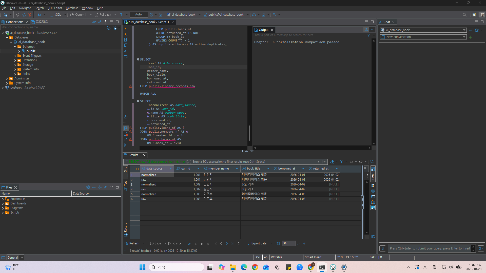
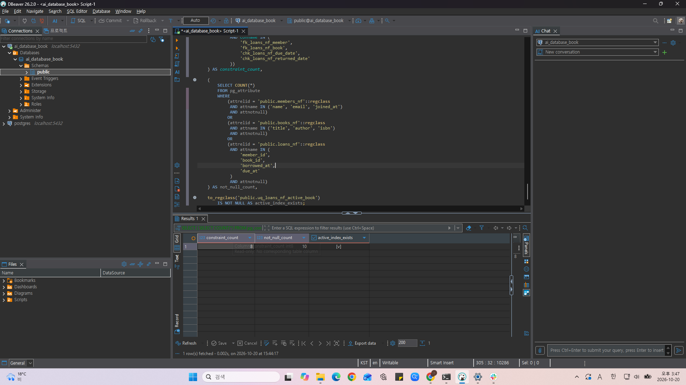
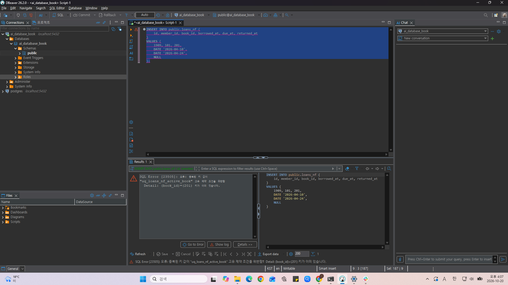
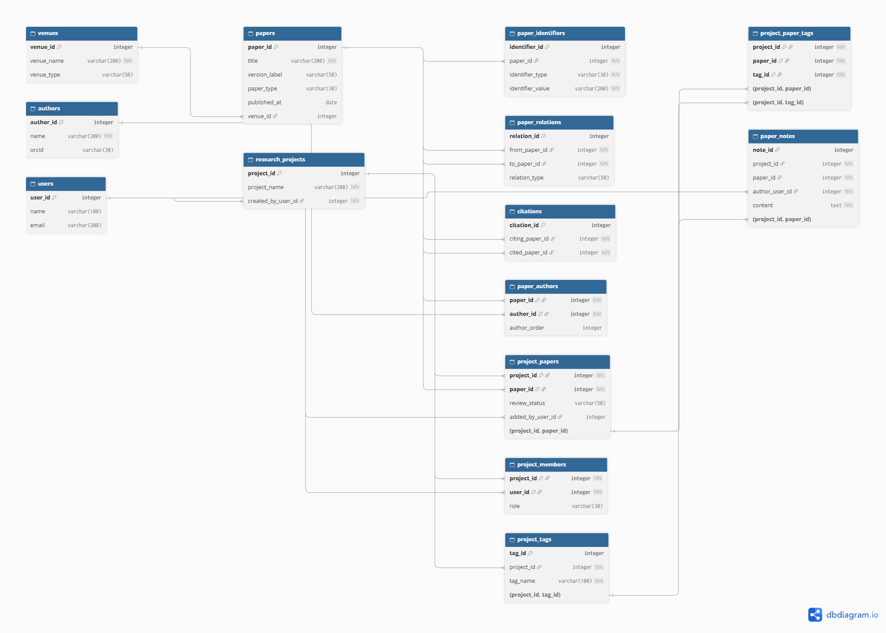

# Chapter 06 확장 실습 답안 템플릿

> **과제:** 정규화와 데이터 무결성으로 좋은 테이블 만들기  
> **사용 방법:** 이 파일을 내려받아 본인의 GitHub 저장소에 `chapter06_answer.md`라는 이름으로 저장한 뒤 실습하면서 바로 작성합니다.  
> **제출 방법:** LMS에는 파일을 직접 업로드하지 않고, **본인 GitHub 저장소의 `chapter06_answer.md` 파일 URL**을 제출합니다.

---

## 제출 전 주의

이 파일과 캡처 화면에는 실제 비밀번호, 전체 DB 접속 URL, API Key, 개인정보를 기록하지 않습니다.

```text
GitHub 계정 또는 별칭: youccode
과제 작성일: 2026.10.20
사용한 AI 도구: chatgpt
```

---

# 1. 실습 환경과 시작 상태 확인

다음을 실행합니다.

```sql
SELECT current_database();
SELECT current_user;
SELECT current_schema();
SHOW search_path;
SHOW transaction_read_only;
```

| 확인 항목 | 실제 결과 | 의미 |
| --- | --- | --- |
| `current_database()` | `ai_database_book` | 현재 SQL을 실행하고 있는 데이터베이스의 이름이다. |
| `current_user` | `postgres` | 현재 PostgreSQL에 접속하여 SQL을 실행하고 있는 사용자이다. |
| `current_schema()` | `public` | 현재 기본적으로 사용되는 스키마이다. |
| `search_path` | `public, "$user"` | 스키마 이름을 생략했을 때 PostgreSQL이 객체를 검색하는 순서이다. |
| `transaction_read_only` | `off` | 현재 트랜잭션이 읽기 전용 상태가 아님을 의미한다. 다만 실제 객체 변경 권한까지 보장하는 것은 아니다. |

- [x] 현재 DB가 `ai_database_book`이다.
- [x] 변경 가능한 연결인지 확인했다.
- [x] Auto-commit 상태를 확인했다.
- [x] Chapter 06 번호형 SQL 파일을 사용한다.

---

# 2. 정규화 전 큰 테이블의 문제 찾기

본문의 `library_records_raw` 구조를 기준으로 생각합니다.

```text
library_records_raw 한 행
→ 대여 사건 한 건이지만 회원·도서의 현재 사실까지 함께 저장된 구조
```

## 2-1. 위험한 중복과 의미 있는 반복 구분

| 반복되는 값/상황 | 위험한 중복 / 의미 있는 반복 | 판단 이유 |
| --- | --- | --- |
| 회원 이메일이 여러 대여 행에 반복 | 위험한 중복 | 이메일은 회원에 속하는 현재 정보인데, 이를 대여 기록마다 저장하면 이메일 변경 시 여러 행을 수정해야 한다. 일부 행만 수정되면 같은 회원의 이메일이 서로 다르게 저장될 수 있다. |
| 도서 제목이 여러 대여 행에 반복 | 위험한 중복 | 도서 제목은 도서 자체에 속하는 정보이다. 이를 대여 기록마다 반복 저장하면 제목을 수정할 때 여러 행을 변경해야 하며, 일부 행이 수정되지 않으면 데이터 불일치가 발생할 수 있다. |
| `loans_nf.member_id = 101` 반복 | 의미 있는 반복 | 한 회원은 여러 번 도서를 대여할 수 있으므로 서로 다른 대여 사건에서 동일한 회원 ID가 나타나는 것은 정상이다. 이는 회원 정보를 중복 저장하는 것이 아니라 각 대여 기록이 어떤 회원을 참조하는지 나타내는 FK이다. |
| 사건 당시 가격 같은 이력값 반복 | 의미 있는 반복 | 사건 당시의 가격은 현재 상품 가격과 달리 개별 사건의 과거 사실을 나타낸다. 서로 다른 사건에서 같은 가격이 나타나더라도 각각의 사건에 속하는 기록이므로 단순히 값이 같다는 이유만으로 제거해서는 안 된다. |

## 2-2. 이상 현상 설명

### 삽입 이상

```text
아직 한 번도 대여되지 않은 새 도서를 등록하려 할 때 생기는 문제:
도서 정보와 대여 정보를 하나의 테이블에서 관리한다면, 새로운 도서를 등록할 때 대여 기록에 필요한 회원 ID나 대여일 등의 정보가 없어서 도서만 독립적으로 등록하기 어려울 수 있다.
이처럼 새로운 도서를 등록하기 위해 불필요한 대여 정보까지 요구되는 문제를 삽입 이상이라고 한다.
```

### 수정 이상

```text
회원 이메일이 변경될 때 생기는 문제:
회원 한 명이 여러 번 도서를 대여했다면 동일한 이메일이 여러 대여 기록에 반복해서 저장되어 있을 수 있다.
이 경우 이메일을 변경하려면 해당 회원의 모든 대여 기록을 수정해야 하며, 일부 행만 수정되면 같은 회원에 대해 서로 다른 이메일이 저장되는 문제가 발생한다.
이처럼 하나의 사실을 변경하기 위해 여러 행을 수정해야 하고, 수정 누락으로 데이터의 일관성이 깨질 수 있는 문제를 수정 이상이라고 한다.
```

### 삭제 이상

```text
마지막 대여 기록을 삭제할 때 생길 수 있는 문제:
어떤 도서의 마지막 대여 기록을 삭제할 때, 도서 정보가 대여 기록에만 저장되어 있다면 해당 도서의 제목이나 저자 등의 정보까지 함께 사라질 수 있다.
업무적으로는 대여 기록만 삭제하려는 것이지만, 유지해야 할 도서 자체의 정보도 함께 삭제되는 문제가 발생한다.
이처럼 특정 기록을 삭제하는 과정에서 다른 정보까지 사라지는 문제를 삭제 이상이라고 한다.
```

### 왜 이것이 SQL 문법 문제가 아니라 구조 문제인가요?

```text
삽입·수정·삭제 이상은 SQL 문법이 잘못되어 발생하는 문제가 아니라, 서로 다른 대상에 속하는 정보를 하나의 테이블에 함께 저장하는 구조에서 발생하는 문제이다.
```

---

# 3. 1NF·2NF·3NF 핵심 질문 복습

정규형 이름만 외우지 말고 **왜 분리하는지** 설명합니다.

## 3-1. 제1정규형(1NF)

```text
한 셀에 쉼표로 여러 독립 값을 넣거나 book1/book2/book3처럼 반복 열을 만들면 왜 문제가 되는가:
한 셀에 여러 값을 저장하면 각각의 값을 독립적으로 검색하거나 수정하기 어려워진다. 예를 들어 대여한 도서 ID를 쉼표로 구분하여 저장하면 특정 
도서를 대여한 기록을 조회하거나 개별 도서와 FK 관계를 설정하기 어렵다.

또한 book1, book2, book3처럼 반복되는 열을 만들면 저장할 수 있는 도서 수가 구조적으로 제한되고, 대여 권수가 늘어날 때마다 새로운 열을 추가해야 할 수 있다.
따라서 독립적으로 관리해야 하는 값은 각각의 행으로 표현하고, 반복되는 관계는 별도의 테이블에서 관리하는 것이 적절하다.
```

내 서비스에서 비슷한 위험이 있는 예:

```text
논문 인용 관계 탐색 및 공동 문헌 조사 서비스에서 하나의 논문에 참여한 저자들을 papers 테이블의 author1, author2, author3과 같은 열로 저장하는 경우 비슷한 문제가 발생할 수 있다.
논문마다 저자 수가 다르기 때문에 열 개수를 미리 정하기 어렵고, 특정 저자가 참여한 논문을 검색하거나 저자 정보를 개별적으로 관리하기도 어려워진다.
따라서 저자 정보는 authors 테이블에서 관리하고, 논문과 저자의 참여 관계는 paper_authors 테이블에 각각의 행으로 저장하는 것이 적절하다.
프로젝트에 등록된 논문의 태그를 쉼표로 연결된 문자열 하나에 저장하는 경우에도 동일한 문제가 발생하므로, project_tags와 project_paper_tags를 통해 태그와 연결 관계를 구분하여 관리하는 것이 적절하다.
```

## 3-2. 제2정규형(2NF)

다음 관계를 설명합니다.

```text
(student_id, course_id) → grade
student_id → student_name
course_id → course_name
```

```text
복합키 전체가 아니라 일부에만 의존하는 열을 분리해야 하는 이유:
위 관계에서 grade는 특정 학생이 특정 강의를 수강한 결과이므로 student_id와 course_id의 조합에 의해 결정된다.
반면 student_name은 student_id만으로 결정되고, course_name은 course_id만으로 결정된다. 따라서 두 열은 복합키 전체가 아니라 일부에만 의존하는 부분 함수 종속에 해당한다.
이러한 속성들을 하나의 수강 테이블에 함께 저장하면 동일한 학생이 여러 강의를 수강할 때 학생 이름이 반복되고, 같은 강의를 여러 학생이 수강할 때 강의 이름이 반복된다.
이 경우 학생이나 강의 정보가 변경되면 여러 행을 수정해야 하므로 수정 이상이 발생할 수 있다.
따라서 학생 이름은 students 테이블에, 강의 이름은 courses 테이블에 저장하고, 수강 관계 테이블에는 student_id, course_id, grade와 같이 해당 관계를 설명하는 정보를 저장하는 것이 적절하다.
```

## 3-3. 제3정규형(3NF)

```text
member_id → zip_code
zip_code → city
```

```text
일반 열이 다른 일반 열을 결정하는 구조를 검토해야 하는 이유:
위 예시에서 zip_code가 city를 결정한다고 가정하면, member_id는 zip_code를 통해 간접적으로 city를 결정하게 된다. 이는 기본키가 아닌 일반 속성을 거쳐 다른 일반 속성이 결정되는 이행 함수 종속에 해당한다.

이러한 구조에서 여러 회원이 동일한 우편번호를 사용하면 해당 도시 정보도 회원 행마다 반복해서 저장될 수 있다.

이 경우 도시 정보가 변경되었을 때 관련된 모든 회원 행을 수정해야 하며, 일부 행만 수정하면 동일한 우편번호에 서로 다른 도시 정보가 저장되는 문제가 발생할 수 있다.

따라서 실제 업무 규칙에서 zip_code가 city를 결정하는 관계가 성립한다면, 우편번호와 도시의 대응 정보를 별도 테이블로 관리하는 방식을 검토할 수 있다.

이를 통해 회원 정보와 우편번호에 종속된 정보를 분리하고 데이터 중복과 수정 이상을 줄일 수 있다.
```

### 정규화는 값이 반복되기만 하면 무조건 분리하는 것인가요?

```text
아니다. 값이 반복된다는 사실만으로 정규화가 필요한 것은 아니다. 중요한 것은 반복되는 값이 어떤 사실을 나타내며, 어떤 키에 종속되는지 판단하는 것이다.

예를 들어 loans 테이블에서 동일한 member_id가 여러 번 나타나는 것은 한 회원이 여러 대여 사건에 참여할 수 있기 때문에 발생하는 의미 있는 반복이다. 이는 회원 정보를 중복 저장하는 것이 아니라 서로 다른 대여 기록이 같은 회원을 참조하는 것이다.

반면 회원 이메일을 대여 기록마다 반복해서 저장하는 것은 회원에 속하는 현재 정보를 여러 곳에 복사하는 것이므로 수정 이상이 발생할 수 있다.

따라서 정규화에서는 단순히 값의 반복 여부를 확인하는 것이 아니라, 각 열이 어떤 대상이나 사건에 속하는지, 어떤 키에 의해 결정되는지, 중복으로 인해 이상 현상이 발생할 가능성이 있는지를 함께 검토해야 한다.
```

---

# 4. 각 열의 '사실의 주인' 찾기

| 열 | 어떤 사실을 설명하는가 | 주인 테이블 | 이유 |
| --- | --- | --- | --- |
| `member_name` | 회원의 이름 | `members_nf` | 이름은 특정 대여 사건이 아니라 회원 자체에 속하는 정보이다. 대여 기록마다 반복해서 저장하면 이름이 변경되었을 때 여러 행을 수정해야 하므로 회원 테이블에서 관리하는 것이 적절하다. |
| `member_email` | 회원의 이메일 주소 | `members_nf` | 이메일은 회원의 현재 연락처 정보이므로 대여 기록과 독립적으로 관리해야 한다. 회원 테이블에 저장하면 이메일 변경 시 한 곳에서 수정할 수 있다. |
| `book_title` | 도서의 제목 | `books_nf` | 제목은 대여 사건이 아니라 도서 자체를 설명하는 정보이다. 동일한 도서가 여러 번 대여되더라도 제목을 반복 저장할 필요가 없다. |
| `author` | 도서의 저자 정보 | `books_nf` | 저자 정보는 도서 자체에 속하는 속성이므로 대여 기록이 아닌 도서 테이블에서 관리하는 것이 적절하다. |
| `borrowed_at` | 도서가 실제로 대여된 날짜 | `loans_nf` | 대여일은 도서나 회원의 고정된 속성이 아니라 개별 대여 사건이 발생한 시점을 나타낸다. 같은 회원이 같은 도서를 여러 번 대여하더라도 대여일은 각각 다를 수 있다. |
| `due_at` | 해당 대여 사건의 반납예정일 | `loans_nf` | 반납예정일은 개별 대여 사건에 따라 결정되는 정보이다. 같은 도서라도 대여 시점이나 조건에 따라 반납예정일이 달라질 수 있으므로 대여 기록에서 관리해야 한다. |
| `returned_at` | 해당 대여 사건의 실제반납일 | `loans_nf` | 실제반납일은 특정 대여 사건의 완료 여부와 시점을 나타내는 정보이다. 아직 반납하지 않은 경우 NULL일 수 있으며, 각각의 대여 기록에서 독립적으로 관리해야 한다. |
| `member_id` | 해당 대여 사건에 참여한 회원의 식별자 | `loans_nf` (FK) | 회원 자체는 members_nf에서 관리하지만, 어떤 회원이 대여했는지를 나타내는 참조 정보는 loans_nf에 필요하다. 동일한 회원 ID가 여러 대여 기록에 반복되는 것은 정상적인 관계 표현이다. |
| `book_id` | 해당 대여 사건의 대상 도서 식별자 | `loans_nf` (FK) | 도서 자체의 정보는 books_nf에서 관리하지만, 어떤 도서를 대여했는지를 연결하기 위해 loans_nf에 book_id가 필요하다. 동일한 도서가 여러 번 대여되면 같은 book_id가 여러 대여 기록에 나타날 수 있다. |

정규화 후 한 행의 의미:

```text
members_nf 한 행 = 도서관에서 관리하는 회원 한 명을 의미한다. 회원의 이름과 이메일 등 회원 자체에 속하는 정보를 저장하며, 해당 회원의 대여 기록이 없어도 독립적으로 존재할 수 있다.
books_nf 한 행 = 도서관에서 관리하는 도서 기록 한 건을 의미한다. 제목, 저자 등 도서 자체에 속하는 정보를 저장하며, 아직 대여된 적이 없는 도서도 독립적으로 존재할 수 있다.
loans_nf 한 행 = 특정 회원이 특정 도서를 대여한 사건 한 건을 의미한다. 회원과 도서를 FK로 연결하고, 대여일, 반납예정일, 실제반납일과 같이 해당 사건에 속하는 정보를 저장한다.
```

### 현재 사실과 사건 당시 이력을 구분하는 기준

```text
현재 사실과 사건 당시 이력을 구분할 때 가장 중요한 기준은 해당 정보가 현재 관리 대상의 상태를 설명하는지, 아니면 특정 사건이 발생했을 당시의 사실을 기록하는지 판단하는 것이다.

예를 들어 회원의 현재 이메일 주소는 회원 자체에 속하는 정보이므로 members_nf에서 관리하는 것이 적절하다. 회원이 이메일을 변경하면 현재 연락처 정보는 새로운 이메일로 갱신되어야 한다.

반면 대여일, 반납예정일, 실제반납일은 개별 대여 사건의 이력을 나타내는 정보이다. 회원의 정보나 도서의 현재 상태가 변경되더라도 과거 대여 사건의 날짜 정보는 그대로 유지되어야 한다.

또한 사건 당시의 가격이나 적용된 할인율처럼 과거의 거래 조건 자체가 중요한 경우에는 현재 상품 정보와 별도로 해당 사건의 이력값을 저장할 필요가 있다. 현재 가격이 변경되었다는 이유로 과거 거래에 적용된 가격까지 변경되어서는 안 되기 때문이다.

따라서 데이터가 여러 행에서 반복되는지만 확인하는 것이 아니라, 각 값이 어떤 대상이나 사건에 속하는지와 시간이 지나면서 변경되어야 하는 정보인지 또는 보존되어야 하는 이력인지 함께 판단해야 한다.
```

---

# 5. PostgreSQL로 정규화 전·후 구조 재현

Public 저장소의 다음 파일을 순서대로 사용합니다.

```text
code/chapter06/01_normalization_schema.sql
code/chapter06/02_normalization_seed.sql
code/chapter06/03_normalization_compare.sql
```

## 5-1. `01_normalization_schema.sql`

실행 전 예상:

```text
생성될 테이블 수: 4개
각 테이블 예상 행 수:
library_records_raw = 0
members_nf = 0
books_nf = 0
loans_nf = 0
```

실행 후:

```text
실제로 생성된 테이블:
1. public.library_records_raw
2. public.members_nf
3. public.books_nf
4. public.loans_nf
각 테이블 실제 행 수:
library_records_raw = 0
members_nf = 0
books_nf = 0
loans_nf = 0
```

## 5-2. `02_normalization_seed.sql`

실행 전 예상 기준

```text
raw = 3
members = 2
books = 2
loans = 3
미반납 = 2
회원 101 대여 = 2
도서 201 대여 = 2
```

실제 결과:

```text
raw: 3
members: 2
books: 2
loans: 3
미반납: 2
회원 101 대여: 2
도서 201 대여: 2
```

예상과 다른 값이 있다면 이유:

```text
예상과 실제 결과가 모두 일치하였으므로 해당 없음.

02_normalization_seed.sql 실행 후 정규화 전 원시 테이블에는 3행, 정규화 후 회원 테이블에는 2행, 도서 테이블에는 2행, 대여 기록 테이블에는 3행이 저장된 것을 확인하였다.

또한 미반납 대여 2건, 회원 101의 대여 기록 2건, 도서 201의 대여 기록 2건도 예상과 일치하였다.
```

## 5-3. `03_normalization_compare.sql`

```text
검증 메시지: Chapter 06 normalization comparison passed
PASS / FAIL: PASS
```

다음 항목을 확인합니다.

```text
회원 고아 참조: 0
도서 고아 참조: 0
날짜 순서 오류: 0
활성 대여 중복: 0
```

### 정규화 후에도 JOIN으로 원래 업무 정보를 다시 볼 수 있는 이유

```text
정규화를 통해 회원, 도서, 대여 기록을 각각 별도의 테이블로 분리하더라도, 테이블 사이의 관계가 PK와 FK를 통해 유지되기 때문이다.

members_nf에는 회원 정보, books_nf에는 도서 정보, loans_nf에는 대여 사건에 대한 정보가 저장되어 있으며, loans_nf의 member_id와 book_id를 이용하면 각 대여 기록이 어떤 회원과 도서에 연결되어 있는지 확인할 수 있다.

따라서 JOIN을 사용하면 loans_nf의 대여 정보와 members_nf의 회원 정보, books_nf의 도서 정보를 다시 결합하여 정규화 이전의 library_records_raw와 같은 업무 정보를 조회할 수 있다.

즉, 정규화는 업무 정보를 없애는 것이 아니라 각 정보의 저장 위치를 구분하는 것이며, 필요한 경우 테이블 간 관계를 이용하여 원래 업무 정보를 다시 조회할 수 있다.
```

### 증거 화면

권장 경로:

```text
assignments/chapter06/images/step05_normalization.png
```



---

# 6. Chapter 06에서 확정한 C-01~C-08 정책 해석

| ID | 확정 규칙 | 구현 방법 | 왜 필요한가 | Chapter 05에서는 왜 미확정이었나 |
| --- | --- | --- | --- | --- |
| C-01 | 이메일 문자열 중복 금지 | `UNIQUE` | 서로 다른 회원에게 동일한 이메일 문자열이 중복 등록되는 것을 방지하기 위해서이다. 이를 통해 이메일을 이용한 회원 조회 시 중복으로 인한 혼란을 줄일 수 있다. | Chapter 05에서는 이메일을 반드시 고유하게 관리해야 하는지, 동일 이메일을 여러 회원이 사용할 수 있는지, 대소문자 차이를 어떻게 처리할지 정해지지 않았기 때문이다. |
| C-02 | ISBN 필수·중복 금지 | `NOT NULL + UNIQUE` | 모든 도서 기록에 ISBN이 존재하도록 하고, 동일한 ISBN을 가진 도서 기록이 중복 등록되는 것을 방지하기 위해서이다. | Chapter 05에서는 ISBN이 없는 도서의 등록을 허용할지, 같은 ISBN의 실물 복본 여러 권을 어떻게 관리할지 확정되지 않았기 때문이다. |
| C-03 | 이름·제목 공백 금지 | `CHECK` | 회원 이름이나 도서 제목이 빈 문자열 또는 공백만으로 저장되면 실제 대상을 식별하거나 정보를 표시하기 어려워지므로, 의미 있는 문자열이 입력되도록 하기 위해서이다. | Chapter 05에서는 이름과 제목을 저장해야 한다는 요구사항은 있었지만, 빈 문자열이나 공백만 입력된 값을 허용할지에 대한 구체적인 검증 규칙은 확정되지 않았기 때문이다. |
| C-04 | `due_at >= borrowed_at` | `CHECK` | 반납예정일이 대여일보다 빠르면 시간적으로 모순된 대여 기록이 생성되므로, 반납예정일이 대여일과 같거나 이후가 되도록 제한하기 위해서이다. | Chapter 05에서는 대여일과 반납예정일을 저장한다는 요구사항만 있었고, 날짜의 선후 관계를 어떤 조건으로 강제할지 확정되지 않았기 때문이다. |
| C-05 | `returned_at`은 NULL 또는 대여일 이상 | `CHECK` | 미반납 상태에서는 실제반납일을 NULL로 유지할 수 있도록 하면서, 반납일이 기록된 경우에는 대여일보다 빠른 날짜가 저장되지 않도록 하기 위해서이다. | Chapter 05에서는 미반납 시 NULL을 허용한다는 점은 정해져 있었지만, 실제반납일과 대여일의 선후 관계를 제약조건으로 강제할지는 확정되지 않았기 때문이다. |
| C-06 | 존재하는 회원·도서만 참조 | `FOREIGN KEY` | 대여 기록이 실제로 존재하는 회원과 도서만 참조하도록 하여, 연결 대상이 없는 잘못된 대여 기록이 저장되는 것을 방지하기 위해서이다. | Chapter 05에서는 회원과 도서의 참조 관계를 설계했지만, 기본 모델에서 이를 실제 외래키 제약조건으로 강제하는 단계까지 진행하지 않았기 때문이다. |
| C-07 | 대여 이력이 있는 부모 삭제 금지 | `ON DELETE RESTRICT` | 기존 대여 기록이 참조하는 회원이나 도서를 삭제하면 대여 이력의 의미가 훼손될 수 있으므로, 참조 중인 회원이나 도서의 삭제를 제한하여 기록의 일관성을 유지하기 위해서이다. | Chapter 05에서는 회원 탈퇴나 도서 삭제 시 기존 대여 기록을 유지할지, 함께 삭제할지, 삭제를 제한할지에 대한 정책이 확정되지 않았기 때문이다. |
| C-08 | 도서당 미반납 대여 최대 한 건 | 부분 고유 인덱스 | 반납되지 않은 대여 기록에서 동일한 도서 ID가 중복되지 않도록 하여, 하나의 도서가 동시에 여러 건의 활성 대여에 연결되는 것을 방지하기 위해서이다. | Chapter 05에서는 같은 도서의 동시 대여 허용 여부와 실물 복본 관리 방식이 확정되지 않았으므로, 미반납 대여를 한 건으로 제한할지 결정할 수 없었기 때문이다. |

### 확정되지 않은 정책을 제약조건으로 먼저 만들면 위험한 이유

```text
확정되지 않은 업무 정책을 UNIQUE, NOT NULL, CHECK, FOREIGN KEY 등의 제약조건으로 먼저 구현하면, 실제 서비스에서 허용해야 하는 데이터를 데이터베이스가 잘못 거부하거나 보존해야 할 정보를 삭제하는 문제가 발생할 수 있다.

예를 들어 Chapter 05에서 ISBN이 없는 도서를 등록할 수 있는지 확정되지 않았는데 ISBN에 NOT NULL을 적용하면, 실제로 ISBN이 없는 도서도 관리해야 하는 상황에서 해당 도서를 등록할 수 없게 된다.

또한 같은 ISBN을 가진 실물 복본을 각각의 도서 행으로 관리해야 한다면 ISBN에 UNIQUE를 적용하는 것이 실제 업무 방식과 충돌할 수 있다.

회원이나 도서를 삭제할 때도 기존 대여 기록을 어떻게 처리할지 확정하지 않은 상태에서 ON DELETE CASCADE를 설정하면 보존해야 할 대여 이력까지 함께 삭제될 수 있다.

따라서 제약조건은 단순히 데이터 오류를 많이 막는 방향으로 추가하는 것이 아니라, 확정된 업무 요구사항을 근거로 적용해야 한다.

아직 결정되지 않은 정책은 미확정 상태로 기록하고, 실제 업무에서 허용해야 하는 경우와 차단해야 하는 경우를 명확하게 구분한 후 적절한 제약조건을 선택해야 한다.
```

---

# 7. 기존 데이터 검사 후 무결성 규칙 적용

실행 파일:

```text
code/chapter06/04_add_integrity_rules.sql
```

## 7-1. 규칙을 추가하기 전에 기존 데이터를 먼저 검사해야 하는 이유

```text
기존 데이터에 새로운 무결성 제약조건을 적용하기 전에 해당 규칙을 위반하는 데이터가 이미 존재하는지 확인해야 한다.

예를 들어 회원 이메일에 UNIQUE 제약조건을 추가하려는 경우 이미 중복된 이메일이 저장되어 있다면 제약조건 적용이 실패할 수 있다. 또한 이름이나 ISBN에 NOT NULL을 적용하려는 경우 NULL 값이 존재하는지 먼저 확인해야 한다.

FOREIGN KEY를 추가하기 전에는 존재하지 않는 회원이나 도서를 참조하는 대여 기록이 있는지 검사해야 하며, CHECK 제약조건을 추가하기 전에는 반납예정일이나 실제반납일이 대여일보다 빠른 데이터가 존재하는지 확인해야 한다.

부분 고유 인덱스를 생성하기 전에도 동일한 도서에 미반납 대여가 여러 건 존재하지 않는지 검사해야 한다.

이번 실습에서는 기존 데이터의 NULL, 중복, 날짜 순서, 고아 참조 및 활성 대여 중복 여부를 사전에 확인한 뒤 제약조건을 적용하였다.

이러한 사전 검증은 제약조건 추가 과정에서 발생할 수 있는 오류를 예방하고, 기존 데이터의 문제를 명확하게 파악한 상태에서 업무 규칙을 안전하게 적용하기 위해 필요하다.
```

## 7-2. 실행 결과

```text
명명된 제약조건 개수: 8개
NOT NULL 적용 열 개수: 10개
부분 고유 인덱스 존재 여부: 존재함(true)
COMMIT 성공 여부: 성공
```

### 메타데이터를 확인하는 이유

```text
ALTER TABLE이나 CREATE INDEX 명령이 실행되었다는 사실만으로 의도한 제약조건이 모두 정확하게 적용되었다고 단정할 수는 없다.

PostgreSQL은 제약조건과 인덱스 등의 구조 정보를 시스템 카탈로그에 저장하므로, pg_constraint, pg_attribute, to_regclass() 등을 이용하여 실제 적용 상태를 확인할 수 있다.

pg_constraint를 조회하면 UNIQUE, CHECK, FOREIGN KEY 등의 명명된 제약조건이 존재하는지 확인할 수 있고, pg_attribute를 이용하면 각 열의 NOT NULL 적용 여부를 확인할 수 있다.

또한 to_regclass()를 사용하면 동일 도서의 미반납 대여 중복을 방지하기 위한 부분 고유 인덱스가 실제로 생성되었는지 확인할 수 있다.

이번 실습에서는 메타데이터 조회 결과 명명된 제약조건 8개, NOT NULL 적용 열 10개, 부분 고유 인덱스 존재 여부 true를 확인하였다. 모든 결과가 예상과 일치하였으므로 C-01~C-08 정책을 구현하기 위한 무결성 규칙이 정상적으로 적용되었다고 판단하였다.
```

### 증거 화면

권장 경로:

```text
assignments/chapter06/images/step07_constraints.png
```



---

# 8. 정상·경계·실패 테스트

실행 파일:

```text
code/chapter06/05_integrity_tests.sql
```

> **중요:** 오류 테스트는 한 번에 하나씩 실행하고, 각 테스트가 끝난 뒤 기준 데이터가 유지되는지 확인합니다.

## 8-1. 허용되어야 하는 경계값

최소 3개를 실행·관찰합니다.

| 테스트 | 예상 | 실제 | 왜 허용되어야 하는가 |
| --- | --- | --- | --- |
| `due_at = borrowed_at` | 성공 | 성공 | 반납예정일은 대여일과 같거나 이후여야 하므로, 두 날짜가 같은 경우에도 `due_at >= borrowed_at` 조건을 만족한다. 따라서 대여일과 반납예정일이 동일한 데이터는 정상적으로 허용되어야 한다. |
| `returned_at = borrowed_at` | 성공 | 성공 | 실제반납일은 대여일보다 빠를 수 없지만, 대여한 당일에 도서를 반납하는 것은 가능하다. 따라서 `returned_at >= borrowed_at` 조건을 만족하는 동일 날짜의 반납은 허용되어야 한다. |
| `returned_at = NULL` | 성공 | 성공 | 아직 반납하지 않은 대여 기록에서는 실제반납일이 존재하지 않으므로 NULL을 허용해야 한다. 실제 조회에서도 대여 기록 1002와 1003의 returned_at이 NULL로 저장된 것을 확인하였다. |
| `published_year = NULL` | 성공 | 성공 | 출판연도를 알 수 없는 도서도 관리할 수 있어야 하므로 published_year는 NULL을 허용한다. 해당 열에는 NOT NULL 제약조건이 적용되지 않았으므로 출판연도가 없는 도서도 정상적으로 등록할 수 있다. |
| 공백이 아닌 한 글자 이름 | 성공 | 성공 | 회원 이름의 CHECK 제약조건은 공백만으로 이루어진 문자열을 금지하는 규칙이다. '김'과 같이 공백이 아닌 한 글자 이름은 `char_length(trim(name)) > 0` 조건을 만족하므로 정상적으로 허용되어야 한다. |

## 8-2. 실패해야 하는 오류값

최소 6개를 실행합니다.

| 오류 테스트 | 기대 규칙 | 실제 결과 | 오류 메시지 핵심 | 실패해야 하는 이유 |
| --- | --- | --- | --- | --- |
| 필수값 NULL | `NOT NULL` | 예상대로 실패 | `23502`, `members_nf.name`의 NOT NULL 위반 | 회원 이름은 필수값이므로 NULL이 저장되어서는 안 된다. |
| ISBN NULL | `NOT NULL` | 예상대로 실패 | `23502`, `books_nf.isbn`의 NOT NULL 위반 | Chapter 06에서는 ISBN을 필수값으로 확정했으므로 NULL이 저장되어서는 안 된다. |
| 이메일 중복 | `UNIQUE` | 예상대로 실패 | `23505`, `uq_members_nf_email` | 이미 등록된 `junho@example.com`을 다른 회원에게 중복 등록하려 했으므로 거부되어야 한다. |
| ISBN 중복 | `UNIQUE` | 예상대로 실패 | `23505`, `uq_books_nf_isbn` | 이미 존재하는 `ISBN-001`을 다른 도서에 중복 등록하려 했으므로 거부되어야 한다. |
| 공백 이름/제목 | `CHECK` | 두 테스트 모두 예상대로 실패 | `23514`, `chk_members_nf_name_not_blank`, `chk_books_nf_title_not_blank` | 공백만 입력된 이름이나 제목은 의미 있는 정보가 아니므로 CHECK 제약조건을 통해 차단해야 한다. |
| 존재하지 않는 회원 | `FOREIGN KEY` | 예상대로 실패 | `23503`, `fk_loans_nf_member` | 회원 테이블에 존재하지 않는 `member_id = 999`를 참조하는 대여 기록이 생성되어서는 안 된다. |
| 존재하지 않는 도서 | `FOREIGN KEY` | 예상대로 실패 | `23503`, `fk_loans_nf_book` | 도서 테이블에 존재하지 않는 `book_id = 999`를 참조하는 대여 기록이 생성되어서는 안 된다. |
| 날짜 순서 위반 | `CHECK` | 두 테스트 모두 예상대로 실패 | `23514`, `chk_loans_nf_due_date`, `chk_loans_nf_returned_date` | 반납예정일이나 실제반납일이 대여일보다 빠르면 시간적으로 모순된 기록이 되므로 차단해야 한다. |
| 두 번째 미반납 대여 | 부분 고유 인덱스 | 예상대로 실패 | `23505`, `uq_loans_nf_active_book` | 도서 201에는 이미 미반납 대여가 존재하므로 같은 도서에 두 번째 미반납 대여 기록이 생성되어서는 안 된다. |
| 참조 중 부모 삭제 | `RESTRICT/FK` | 예상대로 실패 | `23001`, `fk_loans_nf_member` | 회원 101은 기존 대여 기록에서 참조하고 있으므로, 해당 회원을 삭제하면 대여 이력의 참조 관계가 훼손될 수 있어 삭제를 제한해야 한다. |

## 8-3. 테스트 후 기준 상태 재검증

```text
raw: 3
members: 2
books: 2
loans: 3
미반납: 2
회원 고아 참조: 0
도서 고아 참조: 0
활성 대여 중복: 0
```

### 실패 테스트 후 기준 데이터가 유지되어야 하는 이유

```text
실패해야 하는 SQL을 실행했을 때 제약조건이 정상적으로 작동했다면, 잘못된 데이터는 데이터베이스에 저장되지 않아야 한다.

예를 들어 중복 이메일이나 ISBN을 입력하려 했을 때 UNIQUE 제약조건이 이를 차단해야 하며, 존재하지 않는 회원이나 도서를 참조하는 대여 기록 역시 FOREIGN KEY 제약조건에 의해 저장되지 않아야 한다.

또한 기존 대여 기록에서 참조하고 있는 회원을 삭제하려는 경우에는 ON DELETE RESTRICT에 의해 삭제가 거부되어야 한다. 이를 통해 잘못된 변경 작업이 기존 데이터의 일관성을 훼손하지 않도록 보호할 수 있다.

이번 실습에서는 NOT NULL, UNIQUE, CHECK, FOREIGN KEY, 부분 고유 인덱스 등의 제약조건을 위반하는 SQL을 각각 실행하였고, 예상한 오류가 발생하는 것을 확인하였다.

이후 기준 데이터를 다시 조회한 결과 raw 3행, members 2행, books 2행, loans 3행, 미반납 2건으로 실습 전과 동일하게 유지되었다.

회원 및 도서의 고아 참조와 활성 대여 중복도 모두 0건으로 확인되었다.

따라서 실패 테스트에서 시도한 잘못된 데이터 입력이나 삭제가 실제 데이터에 반영되지 않았으며, 제약조건이 기존 데이터의 무결성을 정상적으로 보호하고 있음을 확인하였다.
```

### 증거 화면

권장 경로:

```text
assignments/chapter06/images/step08_integrity_error.png
```



---

# 9. 정규화와 무결성 제약조건 역할 비교

| 질문 | 나의 설명 |
| --- | --- |
| 정규화가 해결하는 문제 | 정규화는 서로 다른 대상이나 사건에 속하는 정보가 하나의 테이블에 함께 저장되면서 발생하는 불필요한 중복과 삽입·수정·삭제 이상을 줄이는 과정이다. 각 속성이 어떤 키에 종속되는지 분석하고, 회원·도서·대여 기록과 같이 서로 다른 사실을 적절한 테이블로 분리하여 데이터 구조의 일관성과 관리 편의성을 높인다. |
| `NOT NULL`이 해결하는 문제 | 반드시 값이 존재해야 하는 열에 NULL이 입력되는 것을 방지한다. 예를 들어 회원 이름이나 도서 ISBN처럼 필수로 지정한 정보가 누락된 상태로 저장되지 않도록 한다. 다만 NOT NULL은 값의 존재 여부만 검사하므로 빈 문자열이나 공백만 입력된 값까지 차단하지는 못한다. |
| `UNIQUE`가 해결하는 문제 | 특정 열이나 열의 조합에 동일한 값이 중복 저장되는 것을 방지한다. 예를 들어 회원 이메일이나 도서 ISBN에 UNIQUE를 적용하면 동일한 값이 중복 등록되는 것을 차단할 수 있다. 단, UNIQUE를 적용하기 전에 해당 값이 실제 업무에서 고유해야 한다는 정책이 확정되어 있어야 한다. |
| `CHECK`가 해결하는 문제 | 데이터가 업무 규칙에 맞는 조건을 만족하도록 제한한다. 예를 들어 반납예정일이 대여일보다 빠르지 않도록 `due_at >= borrowed_at`을 검사하거나, 회원 이름에 공백만 저장되지 않도록 `char_length(trim(name)) > 0` 조건을 적용할 수 있다. 이를 통해 형식적으로 입력 가능한 값이더라도 업무적으로 잘못된 데이터를 차단할 수 있다. |
| `FOREIGN KEY`가 해결하는 문제 | 다른 테이블을 참조하는 값이 실제로 존재하는 대상과 연결되도록 참조 무결성을 보장한다. 예를 들어 loans_nf의 member_id와 book_id가 각각 members_nf와 books_nf에 존재하는 ID만 참조하도록 제한한다. 또한 ON DELETE RESTRICT를 적용하면 기존 대여 기록에서 참조하고 있는 회원이나 도서의 삭제를 방지하여 참조 관계가 훼손되지 않도록 할 수 있다. |
| 부분 고유 인덱스가 해결하는 문제 | 전체 데이터가 아니라 특정 조건을 만족하는 행에 대해서만 값의 중복을 제한할 수 있다. 이번 실습에서는 `returned_at IS NULL`인 미반납 대여 기록에 대해서만 book_id의 고유성을 검사하도록 설정하였다. 따라서 같은 도서가 시간에 따라 여러 번 대여된 이력은 허용하면서도, 하나의 도서에 미반납 대여 기록이 동시에 여러 건 존재하는 것은 차단할 수 있다. |

### 정규화만 잘하면 잘못된 데이터가 모두 차단되나요?

```text
아니다. 정규화는 데이터의 저장 구조를 개선하여 불필요한 중복과 삽입·수정·삭제 이상을 줄이는 과정이지만, 개별 데이터가 업무 규칙을 만족하는지까지 모두 보장하지는 않는다.

예를 들어 회원, 도서, 대여 기록을 각각 members_nf, books_nf, loans_nf로 적절하게 분리하더라도, 별도의 제약조건이 없다면 회원 이름에 NULL이나 공백만 입력되거나 반납예정일이 대여일보다 빠르게 저장될 수 있다.

또한 대여 기록의 member_id와 book_id가 실제로 존재하는 회원과 도서를 참조하는지 확인하려면 FOREIGN KEY 제약조건이 필요하다.

이번 실습에서도 정규화 후 테이블을 생성한 다음 NOT NULL, UNIQUE, CHECK, FOREIGN KEY, 부분 고유 인덱스 등의 제약조건을 추가하여 잘못된 데이터 입력을 차단하였다.

따라서 정규화만으로 모든 데이터 오류를 방지할 수는 없으며, 올바른 데이터 구조를 설계하는 것과 확정된 업무 규칙을 제약조건으로 구현하는 작업이 함께 이루어져야 한다.
```

### 제약조건만 많이 넣으면 나쁜 구조가 좋은 구조가 되나요?

```text
아니다. 제약조건은 데이터가 특정 규칙을 위반하지 않도록 제한하는 기능이지만, 잘못 설계된 테이블 구조 자체를 개선하는 것은 아니다.

예를 들어 library_records_raw처럼 회원 정보, 도서 정보, 대여 사건 정보를 하나의 테이블에 함께 저장하는 구조에 NOT NULL, UNIQUE, CHECK 등의 제약조건을 추가하더라도 회원 이메일이나 도서 제목이 여러 대여 기록에 반복 저장되는 문제는 그대로 남아 있다.

이 경우 회원 이메일이 변경되면 여전히 여러 대여 기록을 수정해야 하며, 일부 행만 수정하면 같은 회원의 이메일이 서로 다르게 저장되는 수정 이상이 발생할 수 있다.

또한 제약조건을 많이 추가한다고 항상 데이터 품질이 좋아지는 것도 아니다. 실제 업무 정책이 확정되지 않은 상태에서 지나치게 강한 UNIQUE나 NOT NULL 등의 제약조건을 적용하면 정상적으로 저장해야 하는 데이터까지 거부될 수 있다.

따라서 먼저 정규화를 통해 각 정보가 적절한 테이블에 저장되도록 구조를 설계하고, 이후 확정된 업무 규칙을 근거로 필요한 제약조건을 적용해야 한다.

즉, 정규화는 데이터가 어디에 저장되어야 하는지를 개선하는 과정이고, 무결성 제약조건은 저장되는 데이터가 어떤 규칙을 만족해야 하는지를 강제하는 기능이라는 점에서 서로 다른 역할을 수행한다.
```

---

# 10. Chapter 05 개인 ERD 개선

Chapter 05에서 만든 개인 서비스 ERD를 다시 엽니다.

## 10-1. 수정 전 점검

- [x] 같은 현재 사실을 여러 테이블에 복사한 부분이 있는가?
- [x] 한 셀에 여러 독립 값을 넣으려 한 부분이 있는가?
- [x] 사건과 현재 상태가 한 테이블에 섞였는가?
- [x] 복합키 일부에만 의존하는 속성이 있는가?
- [x] 일반 열이 다른 일반 열을 결정하는 부분이 있는가?
- [x] 확정 업무 규칙인데 DB가 막지 못하는 부분이 있는가?
- [x] 아직 미확정인데 제약조건으로 너무 강하게 정한 부분이 있는가?

## 10-2. 수정 전·후 비교

| 항목 | 수정 전 | 수정 후 | 변경 근거 | 관련 요구사항 ID |
| --- | --- | --- | --- | --- |
| 프로젝트별 태그의 참조 무결성 | `project_paper_tags.tag_id`가 `project_tags.tag_id`만 참조하므로, 서로 다른 프로젝트에 속한 태그가 잘못 연결될 가능성이 있었다. | `project_tags`에 `(project_id, tag_id)` 복합 UNIQUE를 추가하고, `project_paper_tags`에서 `(project_id, tag_id)`를 참조하는 복합 FK를 사용하도록 개선하였다. | 태그는 프로젝트별로 관리되는 정보이므로, 논문 항목과 연결된 태그가 동일한 프로젝트에 속하도록 보장해야 한다. | P05-R09 |
| 프로젝트 논문과 태그 연결 관계 | `project_paper_tags`는 `(project_id, paper_id)`를 통해 프로젝트 논문 항목을 참조하고, 태그는 별도의 `tag_id`로 참조하였다. 두 참조가 동일한 프로젝트에 속한다는 사실은 DB가 보장하지 못했다. | `(project_id, paper_id)`와 `(project_id, tag_id)`의 복합 FK를 함께 사용하여 논문 항목과 태그가 동일한 `project_id`를 기준으로 연결되도록 하였다. | 관계 테이블에 올바른 FK가 각각 존재하더라도, 서로 다른 프로젝트의 데이터를 잘못 연결할 수 있다면 업무적으로 잘못된 관계가 저장될 수 있기 때문이다. | P05-R08, P05-R09 |
| 메모 작성자의 프로젝트 참여 여부 | `paper_notes.author_user_id`가 `users.user_id`를 참조하므로 사용자의 존재 여부는 확인할 수 있지만, 해당 프로젝트의 구성원인지까지는 보장하지 못한다. | 현재 FK 구조는 유지하되, `(project_id, author_user_id)`와 `project_members`의 복합 FK 적용 가능성을 검토 대상으로 명시하였다. 구성원 탈퇴 후 메모 보존 정책이 확정되기 전까지 추가 제약조건은 적용하지 않는다. | 메모 작성자는 프로젝트 구성원이어야 한다는 요구사항을 고려해야 하지만, 구성원 탈퇴 이후에도 과거 메모를 유지할지에 따라 적절한 참조 및 삭제 정책이 달라질 수 있다. | P05-R07, P05-R10 |

## 10-3. 개인 프로젝트 무결성 규칙 후보

| 규칙 ID | 업무 규칙 | 제약조건 후보 | 확정 / 미확정 | 근거 |
| --- | --- | --- | --- | --- |
| P06-C01 | 프로젝트 논문에 연결된 태그는 해당 논문 항목과 동일한 프로젝트에 속해야 한다. | `project_tags(project_id, tag_id)`에 복합 `UNIQUE`를 설정하고, `project_paper_tags(project_id, tag_id)`에서 이를 참조하는 복합 `FOREIGN KEY`를 적용한다. | 확정 | P05-R09에서 태그를 프로젝트별로 관리하도록 요구하고 있으므로 서로 다른 프로젝트의 태그가 잘못 연결되지 않도록 해야 한다. |
| P06-C02 | 동일한 프로젝트에 동일한 논문 기록을 중복 등록하지 않는다. | `project_papers`에 `PRIMARY KEY (project_id, paper_id)`를 적용한다. | 확정 | P05-R08에서는 프로젝트와 논문 사이의 등록 관계를 관리하고 프로젝트별 검토 상태를 저장하도록 정의하였다. 기존 Chapter 05 설계에서도 복합 PK로 등록 관계를 식별하고 있으므로 해당 구조를 유지한다. |
| P06-C03 | 동일한 논문 기록에 동일한 저자를 중복 연결하지 않는다. | `paper_authors`에 `PRIMARY KEY (paper_id, author_id)`를 적용한다. | 확정 | P05-R04에서는 논문과 저자의 다대다 관계를 관리하도록 정의하였다. 한 논문의 동일 저자 참여 관계는 하나의 행으로 표현하고, 저자 표시 순서는 `author_order` 속성으로 관리하는 것이 적절하다. |
| P06-C04 | 프로젝트 논문에 작성된 메모의 내용은 공백만으로 구성되어서는 안 된다. | `CHECK (char_length(trim(content)) > 0)` | 확인 필요 | P05-R10에서는 프로젝트 구성원이 메모를 작성할 수 있어야 한다고 정의하였다. 공백만 저장된 메모는 실질적인 정보를 제공하지 못하지만, 이를 DB 차원에서 금지할지는 아직 확정된 정책이 아니다. |
| P06-C05 | 동일한 종류와 값을 가진 외부 논문 식별자의 중복 등록을 제한한다. | `paper_identifiers(identifier_type, identifier_value)`에 복합 `UNIQUE` 적용 검토 | 확인 필요 | P05-R02에서는 DOI와 arXiv ID 등의 외부 식별자를 관리하도록 정의하였다. 그러나 동일 연구의 여러 판본이 식별자를 공유할 수 있는지, 식별자 형식을 어떻게 통일할지 확정되지 않았으므로 UNIQUE 적용 여부를 추가로 검토해야 한다. |

> 미확정 규칙은 `확인 필요`로 남겨도 됩니다. 억지로 제약조건을 만들지 않습니다.

## 10-4. 수정한 ERD

권장 이미지 경로:

```text
assignments/chapter06/images/step10_my_erd_after.png
```



---

# 11. AI를 정규화·무결성 리뷰어로 활용

## 11-1. 내가 먼저 작성한 구조와 규칙

```text
내 서비스: 논문 인용 관계 탐색 및 공동 문헌 조사 서비스로 논문 사이의 방향 있는 인용 관계와 동일 연구의 여러 공개 판본을 관리하여 선행·후속 연구 탐색을 지원하고, 연구팀이 공동 프로젝트 안에서 논문 목록, 검토 상태, 태그, 메모를 함께 관리하는 웹 서비스이다. 이번 학기에는 컴퓨터과학 분야의 제한된 논문 데이터를 대상으로 핵심 기능을 구현하며, 구독 결제, 미공개 원고의 인용 시뮬레이션, BibTeX 내보내기 등의 기능은 구현 범위에서 제외한다.
검토할 테이블: 
1. users
2. research_projects
3. project_members
4. project_papers
5. papers
6. paper_identifiers
7. paper_relations
8. authors
9. paper_authors
10. venues
11. citations
12. project_tags
13. project_paper_tags
14. paper_notes

한 행의 의미: 
- users: 서비스를 이용하는 연구자 한 명
- research_projects: 공동 문헌 조사 프로젝트 하나
- project_members: 특정 사용자가 특정 프로젝트에 참여하는 관계 한 건
- project_papers: 특정 프로젝트가 논문 기록 하나를 공동 문헌 목록에 포함한 관계 한 건
- papers: arXiv 특정 버전, 학회본, 저널본 등 공개된 개별 논문 판본 또는 출판 기록 한 건
- paper_identifiers: 특정 논문 기록에 연결된 DOI 또는 arXiv ID 등의 외부 식별자 한 건
- paper_relations: 동일 연구의 서로 다른 논문 판본 사이의 관계 한 건
- authors: 저자 한 명
- paper_authors: 특정 저자가 특정 논문 기록에 참여한 관계 한 건
- venues: 논문이 발표되거나 출판된 학회 또는 학술지 한 건
- citations: 특정 논문 기록이 다른 논문 기록을 인용하는 방향 있는 관계 한 건
- project_tags: 특정 프로젝트에서 사용하는 태그 한 건
- project_paper_tags: 프로젝트의 특정 논문 항목에 태그 하나를 연결한 관계 한 건
- paper_notes: 프로젝트의 특정 논문 항목에 작성된 메모 한 건

중복으로 의심되는 열: 
1. paper_identifiers.identifier_type, identifier_value
   동일한 외부 식별자가 여러 논문 기록에 연결되는 경우, 실제 중복 입력인지 동일 연구의 판본 관계에 따른 정상적인 반복인지 확인해야 한다.

2. authors.name
   동일한 이름을 가진 서로 다른 저자가 존재할 수 있고, 같은 저자의 이름이 다르게 표기될 수도 있다. 따라서 이름이 반복된다는 이유만으로 동일 저자라고 판단하거나 UNIQUE를 적용할 수 없다.

3. citations.citing_paper_id, cited_paper_id
   동일한 논문 기록 쌍의 인용 관계가 여러 번 저장될 수 있으므로 중복 방지 여부를 검토해야 한다. 현재 citations는 실제 인용 문장의 등장 횟수가 아니라 논문 기록 사이의 관계를 나타낸다.

4. project_papers.review_status
   동일한 논문이 여러 프로젝트에 포함될 때 프로젝트마다 검토 상태가 다를 수 있다. 따라서 검토 상태는 papers가 아니라 프로젝트 논문 등록 관계에 속하는 정보이다.

5. project_paper_tags.project_id, project_tags.project_id
   두 테이블에서 프로젝트 ID가 반복되는 것은 관계를 표현하기 위한 정상적인 반복이지만, 서로 다른 프로젝트의 태그가 잘못 연결되지 않도록 참조 무결성을 검토해야 한다.

확정 업무 규칙:
1. arXiv의 특정 버전과 학회·저널 출판본은 서로 다른 papers 행으로 관리하며, 같은 연구의 판본 관계는 paper_relations에서 관리한다.
2. citations는 인용하는 논문과 인용되는 논문을 구분하는 방향 있는 관계이다. 본문 내 실제 인용 문장이나 위치는 저장하지 않는다.
3. 논문과 저자는 N:M 관계이므로 paper_authors를 사용하며, (paper_id, author_id)를 복합 PK로 관리한다.
4. 사용자와 연구 프로젝트는 N:M 관계이므로 project_members를 사용하며, (project_id, user_id)를 복합 PK로 관리한다.
5. 프로젝트와 논문은 N:M 관계이므로 project_papers를 사용하며, (project_id, paper_id)를 복합 PK로 관리한다. 검토 상태는 프로젝트별 등록 관계에 저장한다.
6. 프로젝트별 태그와 논문 항목의 연결 관계는 project_paper_tags에서 관리한다. Chapter 06에서는 서로 다른 프로젝트의 태그가 잘못 연결되지 않도록 project_tags의 (project_id, tag_id)에 복합 UNIQUE를 설정하고, 이를 참조하는 복합 FK를 추가하는 설계 개선안을 작성하였다.
7. 메모는 프로젝트에 등록된 특정 논문 항목 및 작성 사용자와 연결된다.

미확정 정책:
1. DOI와 arXiv ID의 고유성을 어떤 범위에서 적용할 것인지, 동일 연구의 여러 판본이 식별자를 공유할 수 있는지 확정되지 않았다.
2. 저자 ORCID와 사용자 이메일에 UNIQUE를 적용할지, 식별자가 없거나 표기가 다른 경우 어떻게 처리할지 확정되지 않았다.
3. 동일한 두 논문 기록 사이의 citation 관계 중복을 허용할지, 자기 인용을 어떻게 처리할지에 관한 세부 정책이 확정되지 않았다.
4. 프로젝트 구성원의 역할별 논문 추가·삭제, 검토 상태 변경, 태그 및 메모 수정 권한이 확정되지 않았다.
5. 프로젝트의 검토 상태에 사용할 값과 상태 변경 규칙이 확정되지 않았다.
6. 프로젝트 구성원 탈퇴 후 기존 메모를 보존할지, 메모 작성자의 프로젝트 참여 관계를 어떤 제약조건으로 검증할지 확정되지 않았다.
7. 프로젝트별 태그 이름의 중복을 허용할지, 태그 이름의 대소문자 차이를 어떻게 처리할지 확정되지 않았다.
8. 회원, 프로젝트, 논문 등의 삭제 시 관련 기록을 RESTRICT, CASCADE, SET NULL 중 어떤 방식으로 처리할지 확정되지 않았다.
```

## 11-2. AI에게 전달한 핵심 프롬프트

```text
나는 PostgreSQL을 사용하는 '논문 인용 관계 탐색 및 공동 문헌 조사 서비스'의 데이터베이스를 설계하고 있다.

이 서비스는 논문 사이의 인용 관계와 동일 연구의 여러 공개 판본을 관리하며, 연구팀이 공동 프로젝트 안에서 논문 목록, 검토 상태, 태그, 메모를 함께 관리하는 웹 서비스이다.

이번 학기에는 컴퓨터과학 분야의 제한된 논문 데이터를 대상으로 핵심 기능을 구현하고, 구독 결제, 미공개 원고의 인용 시뮬레이션, BibTeX 내보내기는 구현 범위에서 제외한다.

현재 Chapter 06에서 정규화와 데이터 무결성을 학습했으며, 기존 Chapter 05 ERD를 개선하는 과정에 있다.

현재 데이터베이스의 테이블과 한 행의 의미는 다음과 같다.

1. users: 서비스를 이용하는 연구자 한 명
2. research_projects: 공동 문헌 조사 프로젝트 하나
3. project_members: 사용자와 프로젝트의 참여 관계 한 건
4. project_papers: 프로젝트와 논문의 공동 문헌 등록 관계 한 건
5. papers: 공개된 논문의 개별 판본 또는 출판 기록 한 건
6. paper_identifiers: 특정 논문에 연결된 외부 식별자 한 건
7. paper_relations: 동일 연구의 논문 판본 사이의 관계 한 건
8. authors: 저자 한 명
9. paper_authors: 논문과 저자의 참여 관계 한 건
10. venues: 학회 또는 학술지 한 건
11. citations: 논문 기록 사이의 방향 있는 인용 관계 한 건
12. project_tags: 특정 프로젝트에서 사용하는 태그 한 건
13. project_paper_tags: 프로젝트 논문 항목에 태그를 연결하는 관계 한 건
14. paper_notes: 프로젝트 논문 항목에 작성된 메모 한 건

주요 PK 및 FK 관계는 다음과 같다.

- project_members의 PK는 (project_id, user_id)이다.
- project_papers의 PK는 (project_id, paper_id)이다.
- paper_authors의 PK는 (paper_id, author_id)이다.
- project_paper_tags의 PK는 (project_id, paper_id, tag_id)이다.
- citations는 citing_paper_id와 cited_paper_id로 papers를 각각 참조한다.
- paper_relations는 from_paper_id와 to_paper_id로 papers를 각각 참조한다.
- paper_notes는 (project_id, paper_id)로 project_papers를 참조하고, author_user_id로 users를 참조한다.

Chapter 06에서 개선한 설계는 다음과 같다.

- project_tags에 (project_id, tag_id) 복합 UNIQUE를 추가한다.
- project_paper_tags에서 (project_id, tag_id) 복합 FK를 사용하여 동일 프로젝트의 태그만 연결되도록 한다.
- 기존 project_paper_tags의 (project_id, paper_id) FK도 유지한다.
- 메모 작성자의 프로젝트 구성원 여부와 구성원 탈퇴 시 메모 보존 정책은 아직 확정하지 않았다.

현재 확정된 중요한 요구사항은 다음과 같다.

- arXiv의 각 버전과 학회·저널본을 서로 다른 논문 기록으로 저장한다.
- 동일 연구의 판본 관계와 실제 논문 인용 관계는 분리하여 관리한다.
- citation은 논문 기록 사이의 방향 있는 관계이며, 본문 내 인용 문장과 위치는 저장하지 않는다.
- 검토 상태는 프로젝트별 논문 등록 관계에 속한다.
- 태그는 프로젝트별로 관리한다.
- 논문과 저자, 프로젝트와 사용자, 프로젝트와 논문의 N:M 관계는 각각 연결 테이블로 표현한다.

아직 미확정인 정책은 다음과 같다.

- DOI와 arXiv ID의 UNIQUE 적용 범위
- 저자 ORCID와 사용자 이메일의 고유성
- citation의 중복 허용 및 자기 인용 정책
- 프로젝트 구성원의 역할별 권한
- 논문 검토 상태의 종류와 변경 규칙
- 프로젝트 구성원 탈퇴 후 메모 보존 정책
- 프로젝트별 태그 이름의 중복 허용 여부
- 관련 데이터 삭제 시 CASCADE, RESTRICT, SET NULL 적용 기준

이 설계를 정규화 및 데이터 무결성 관점에서 검토해 주세요.

다음 항목을 중심으로 분석해 주세요.

1. 각 테이블의 한 행 의미가 명확한가?
2. 회원·논문·저자·프로젝트의 현재 사실과 인용·참여·등록·메모 등의 관계 및 사건이 적절히 분리되어 있는가?
3. 제1정규형, 제2정규형, 제3정규형 관점에서 검토가 필요한 구조가 있는가?
4. 단순한 값의 반복과 실제로 문제가 되는 데이터 중복을 구분할 수 있는가?
5. 확정된 업무 규칙 중 NOT NULL, UNIQUE, CHECK, FOREIGN KEY 등으로 구현해야 할 부분이 누락되어 있는가?
6. 프로젝트별 태그, 메모, 구성원 참여 관계에서 참조 무결성 문제가 발생할 가능성이 있는가?
7. 확정되지 않은 정책을 데이터베이스 제약조건으로 지나치게 강제한 부분이 있는가?
8. ON DELETE CASCADE, RESTRICT, SET NULL을 선택할 때 추가로 확인해야 할 업무 규칙은 무엇인가?

최소 5개의 구체적인 검토 의견을 제시해 주세요.

각 제안은 다음 형식의 표로 정리해 주세요.

| 번호 | 검토 대상 | 발견한 문제 또는 위험 | 개선 제안 | 관련 요구사항 | 정책 확정 여부 | 실제 검증 방법 |

검토 시 반드시 다음 조건을 지켜 주세요.

- 정규화가 필요하다고 판단했다면 구체적인 함수 종속 관계나 이상 현상을 근거로 설명해 주세요.
- 값이 반복된다는 이유만으로 테이블을 무조건 분리하지 마세요.
- 이미 적절히 분리된 테이블을 불필요하게 다시 분리하지 마세요.
- 확정되지 않은 정책을 임의로 결정하지 마세요.
- UNIQUE, NOT NULL, CHECK, FOREIGN KEY의 적용 필요성을 각각 구분해 주세요.
- 삭제 정책은 기존 데이터와 이력 보존 요구사항을 고려해 검토해 주세요.
- 새로운 테이블을 제안한다면 반드시 현재 구조로 해결할 수 없는 구체적인 문제를 설명해 주세요.
- 실제 PostgreSQL에서 실행하지 않은 검증을 실행한 것처럼 설명하지 마세요.
- 이번 학기의 구현 범위를 넘어서는 기능 추가는 제안하지 마세요.

마지막으로 다음 질문에도 답변해 주세요.

A. 단순히 값이 반복된다는 이유만으로 테이블 분리를 제안한 부분이 있었나요?

B. 미확정 정책을 확정 규칙처럼 판단하거나 제약조건으로 구현하도록 제안한 부분이 있었나요?

C. 현재 구조에서 우선적으로 검증할 가치가 높은 무결성 문제 3개는 무엇인가요?
```

## 11-3. AI 제안 검토

| AI 제안 | 수용 / 수정 / 보류 / 거절 | 요구사항 근거 | 실제 검증 방법 | 나의 판단 |
| --- | --- | --- | --- | --- |
| `project_paper_tags`가 다른 프로젝트의 태그를 참조하지 못하도록 `(project_id, tag_id)` 복합 FK를 적용해야 한다. | 수용 | P05-R09 | 프로젝트 A의 논문 항목에 프로젝트 B의 태그를 연결하는 INSERT를 실행하고 FOREIGN KEY 위반으로 거부되는지 확인한다. | 태그는 프로젝트별로 관리하는 정보이므로 서로 다른 프로젝트의 태그가 연결되는 것은 잘못된 관계이다. Chapter 06의 개선 ERD에 `project_tags(project_id, tag_id)` 복합 UNIQUE와 이를 참조하는 복합 FK를 반영하였다. 다만 개인 프로젝트 DB에서 실제 SQL 테스트를 수행한 것은 아니므로 구현 단계에서 검증해야 한다. |
| 프로젝트에 등록되지 않은 논문에 태그가 연결되지 않도록 `project_paper_tags`의 `(project_id, paper_id)` 복합 FK를 유지해야 한다. | 수용 | P05-R08, P05-R09 | `project_papers`에 존재하지 않는 `(project_id, paper_id)` 조합을 `project_paper_tags`에 INSERT하고 FOREIGN KEY 위반이 발생하는지 확인한다. | 프로젝트에 등록된 논문에만 태그를 연결한다는 요구사항에 부합한다. 해당 복합 FK는 Chapter 05 설계에 이미 포함되어 있으므로 새로운 테이블을 만들거나 기존 구조를 분리할 필요 없이 유지하면 된다. |
| DOI와 arXiv ID의 중복을 제한하기 위해 `paper_identifiers`의 UNIQUE 적용 범위를 검토해야 한다. | 보류 | P05-R02, P05-R03 | 동일한 외부 식별자를 서로 다른 판본에 연결하는 경우와 식별자 종류가 다른 경우를 가정하여 중복 허용 여부를 확인한 뒤, 정책이 확정되면 UNIQUE 위반 테스트를 실행한다. | 서비스에서는 arXiv의 개별 버전과 학회·저널본을 별도의 논문 기록으로 관리한다. 따라서 외부 식별자가 반복된다는 이유만으로 전체 UNIQUE를 적용하면 정상적인 판본 등록이 차단될 수 있다. 식별자의 범위와 판본 식별 기준이 아직 확정되지 않았으므로 제약조건 적용을 보류한다. |
| `paper_notes`의 작성자가 해당 프로젝트 구성원인지 검증하기 위해 `(project_id, author_user_id)` 복합 FK 또는 권한 검증을 고려해야 한다. | 보류 | P05-R07, P05-R10 | 프로젝트 구성원이 아닌 사용자의 메모 작성 시도와 기존 메모 작성자의 프로젝트 탈퇴 상황을 가정하여 권한 검증 및 참조 무결성 동작을 비교한다. | 구성원만 메모를 작성하도록 제한하는 것은 타당하지만, 작성자가 탈퇴한 뒤에도 과거 메모를 유지해야 하는지는 확정되지 않았다. 복합 FK를 즉시 추가하면 구성원 탈퇴와 메모 보존 정책이 충돌할 수 있으므로 정책 확정 후 적용 여부를 결정한다. |
| `citations`의 중복 인용 관계와 자기 인용을 제한하기 위해 UNIQUE 및 CHECK 적용을 검토해야 한다. | 보류 | P05-R05 | A→B 관계를 중복 삽입하는 경우, A→A 자기 인용을 삽입하는 경우, A→B와 B→A를 각각 삽입하는 경우를 구분하여 테스트한다. | 인용 관계에 방향이 있다는 사실은 확정되어 있지만 중복 관계와 자기 인용의 허용 여부는 아직 확정되지 않았다. 따라서 `UNIQUE(citing_paper_id, cited_paper_id)`나 `CHECK(citing_paper_id <> cited_paper_id)`를 임의로 추가하지 않는다. |
| 프로젝트 삭제나 논문 등록 해제 시 연결된 태그와 메모를 자동 삭제하는 CASCADE 정책을 신중하게 검토해야 한다. | 수용 | P05-R07, P05-R08, P05-R09, P05-R10 | 트랜잭션 안에서 프로젝트 또는 논문 등록 관계를 삭제하는 상황을 구성하고, CASCADE와 RESTRICT 적용 시 태그 연결 및 메모가 어떻게 처리되는지 비교한 뒤 ROLLBACK한다. | 공동 문헌 조사 과정에서 작성된 메모와 검토 기록은 중요한 이력 데이터일 수 있다. 따라서 모든 관계에 ON DELETE CASCADE를 일괄 적용하면 의도하지 않은 데이터 손실이 발생할 수 있다. 이력 보존 정책을 확정한 후 각 관계에 적합한 삭제 동작을 결정해야 한다. |

특히 AI가 다음을 제안했다면 근거를 다시 확인합니다.

```text
UNIQUE
NOT NULL
CHECK
ON DELETE CASCADE
ON DELETE RESTRICT
새로운 테이블 분리
```

### AI가 단순히 값이 반복된다는 이유만으로 분리를 제안한 부분이 있었나요?

```text
없었다. AI는 현재 14개 테이블이 독립적인 개체, 논문 간 관계, 프로젝트 참여 및 등록 관계, 협업 데이터로 적절히 분리되어 있다고 평가하였다.

특히 동일한 paper_id가 여러 project_papers 행에 등장하거나 동일한 author_id가 여러 paper_authors 행에 등장하는 것은 정상적인 N:M 관계를 표현하기 위한 반복이라고 설명하였다.

반면 project_papers에 논문 제목을 별도로 복사하거나 papers에 학회 이름과 유형을 반복 저장한다면 부분 함수 종속 또는 이행적 종속에 따른 수정 이상이 발생할 수 있다고 지적하였다.

그러나 현재 설계에서는 논문 제목을 papers에 저장하고 학회·학술지 정보를 venues에 분리하고 있으므로 해당 문제를 피할 수 있다.

AI는 새로운 테이블의 추가도 제안하지 않았다. 따라서 단순한 값의 반복이 아니라 해당 속성의 함수 종속 관계와 실제 데이터 이상 발생 가능성을 기준으로 정규화의 필요성을 판단한 것으로 보았다.

나 역시 기존 구조를 불필요하게 분리하기보다 현재 테이블 사이의 참조 무결성을 검증하는 것이 우선이라고 판단하였다.
```

### AI가 미확정 정책을 확정 규칙처럼 만든 부분이 있었나요?

```text
없었다. AI는 현재 확정된 관계 구조와 아직 결정되지 않은 업무 정책을 구분하여 검토하였다.

DOI와 arXiv ID의 고유성 범위, 사용자 이메일과 저자 ORCID의 UNIQUE 적용 여부, 동일한 인용 관계의 중복 허용 여부, 자기 인용 허용 여부는 미확정 정책으로 유지하였다.

또한 프로젝트 구성원의 역할별 권한, 메모 작성자의 프로젝트 참여 여부, 구성원 탈퇴 후 메모 보존 정책, 관련 데이터 삭제 시 ON DELETE CASCADE 또는 RESTRICT를 적용할 기준도 추가 확인이 필요한 사항으로 제시하였다.

따라서 UNIQUE, CHECK, FOREIGN KEY 등의 제약조건을 제안하더라도 업무 규칙이 확정되지 않은 경우에는 즉시 적용하지 않고 조건부 대안으로 검토하였다.

다만 AI가 paper_notes의 기본키 구성이 불명확하다고 지적한 부분은 기존 Chapter 05 설계와 비교하여 다시 판단하였다. Chapter 05 DDL 초안에는 note_id를 독립적인 PRIMARY KEY로 정의하고 있으므로, 메모를 여러 건 저장하기 위한 기본키 구조는 이미 마련되어 있다.

이처럼 AI가 확인하지 못한 내용을 실제 설계의 결함으로 단정하지 않고, 기존 ERD와 DDL 및 요구사항을 직접 비교하여 판단하였다.

이번 검토를 통해 확정된 프로젝트별 태그 참조 무결성은 개선 ERD에 반영하되, 나머지 미확정 정책은 임의로 강제하지 않고 후속 설계와 실제 PostgreSQL 검증 단계에서 결정하기로 하였다.

AI가 제시한 검증 방법은 아직 개인 프로젝트 데이터베이스에서 직접 실행한 결과가 아니라 향후 검증 계획이며, Chapter 06에서 실제 실행한 도서 대여 예제의 무결성 테스트 결과와 구분하였다.
```

---

# 12. 최종 성찰

아래 문장은 본인의 말로 작성합니다.

```text
1. 정규화에서 가장 중요한 질문은
   이 정보가 실제로 어떤 대상에 속하고, 어떤 키에 의해 결정되는가 하는 것이다.

2. 위험한 중복과 의미 있는 반복의 차이는
   동일한 사실을 여러 곳에 저장하여 수정 이상을 발생시키는지, 아니면 서로 다른 관계나 사건을 표현하기 위해 같은 값이 반복되는지의 여부이다.

3. 정규화와 제약조건의 역할이 다른 이유는
   정규화는 데이터의 중복과 이상 현상을 줄이기 위해 저장 구조를 개선하는 과정인 반면, 제약조건은 이미 설계된 구조에서 잘못된 값이나 관계가 저장되지 않도록 업무 규칙을 강제하기 때문이다.

4. 실패해야 하는 SQL을 일부러 실행해 보는 이유는
   제약조건이 정의되어 있다는 사실만 확인하는 것이 아니라, 실제로 잘못된 데이터의 입력과 삭제를 차단하고 기존 데이터의 무결성을 유지하는지 검증하기 위한 것이다.

5. AI가 제안한 UNIQUE/CHECK/FK를 그대로 적용하면 안 되는 이유는
   AI가 데이터베이스의 실제 업무 규칙과 데이터의 특성을 완전히 파악하지 못한 상태에서 제약조건을 제안할 수 있으며, 이를 검증 없이 적용하면 정상적인 데이터의 입력이나 수정이 제한되거나 필요한 참조 관계를 잘못 강제할 수 있으므로, 해당 제약조건이 확정된 요구사항에 부합하는지 먼저 확인해야 하기 때문이다.
```

---

# 13. 제출 체크리스트

- [x] `chapter06_answer.md`를 본인 저장소에 만들었다.
- [x] 위험한 중복과 의미 있는 반복을 구분했다.
- [x] 삽입·수정·삭제 이상을 설명했다.
- [x] 1NF·2NF·3NF 핵심 질문을 자신의 말로 설명했다.
- [x] 열의 사실의 주인을 분류했다.
- [x] `01_normalization_schema.sql`을 실행했다.
- [x] `02_normalization_seed.sql` 기준 상태를 확인했다.
- [x] `03_normalization_compare.sql` 검증 결과를 확인했다.
- [x] C-01~C-08의 업무 근거를 설명했다.
- [x] `04_add_integrity_rules.sql`로 규칙을 적용했다.
- [x] 허용 경계값을 최소 3개 확인했다.
- [x] 실패 테스트를 최소 6개 한 번에 하나씩 실행했다.
- [x] 실패 후 기준 데이터가 유지되는지 확인했다.
- [x] Chapter 05 개인 ERD를 수정했다.
- [x] 개인 프로젝트 제약조건 후보를 확정/미확정으로 구분했다.
- [x] AI 제안을 요구사항 근거와 실행 결과로 검토했다.
- [x] 핵심 화면 3~4장만 첨부했다.
- [x] 캡처에 비밀번호나 개인정보가 없다.
- [x] GitHub에서 Markdown 이미지가 정상적으로 보인다.
- [x] 최종 답안을 commit/push했다.

---

# 14. LMS 제출 URL

아래 형식의 **본인 GitHub 파일 URL**을 LMS에 제출합니다.

```text
https://github.com/<본인-GitHub-ID>/<본인-저장소>/blob/main/assignments/chapter06/chapter06_answer.md
```

내 제출 URL:

```text
https://github.com/youccode/database-course-2026-2/blob/main/assignments/chapter06/chapter06_answer.md
```

> 저장소 메인 URL, 교수자 템플릿 URL, Raw URL이 아니라 **작성 완료된 본인 `chapter06_answer.md` 파일 화면 URL**을 제출합니다.
