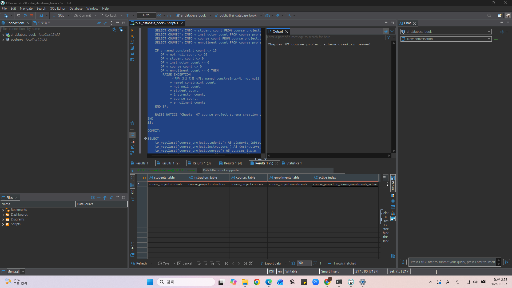
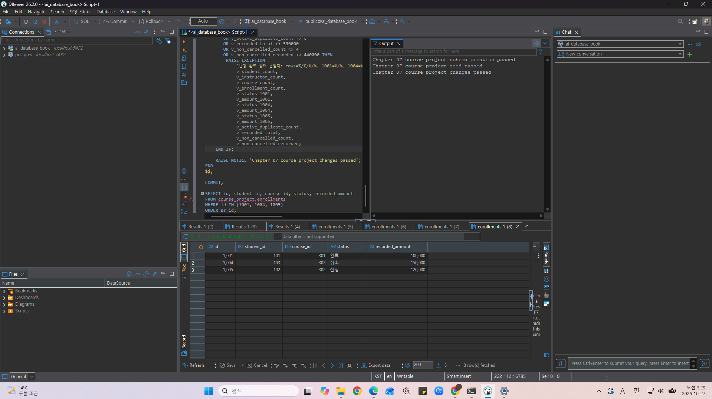
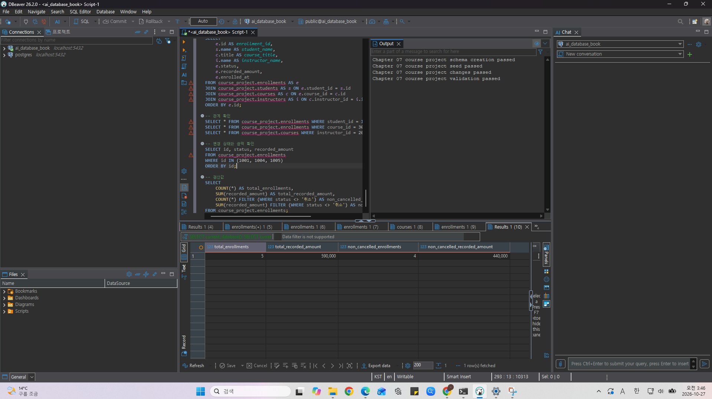
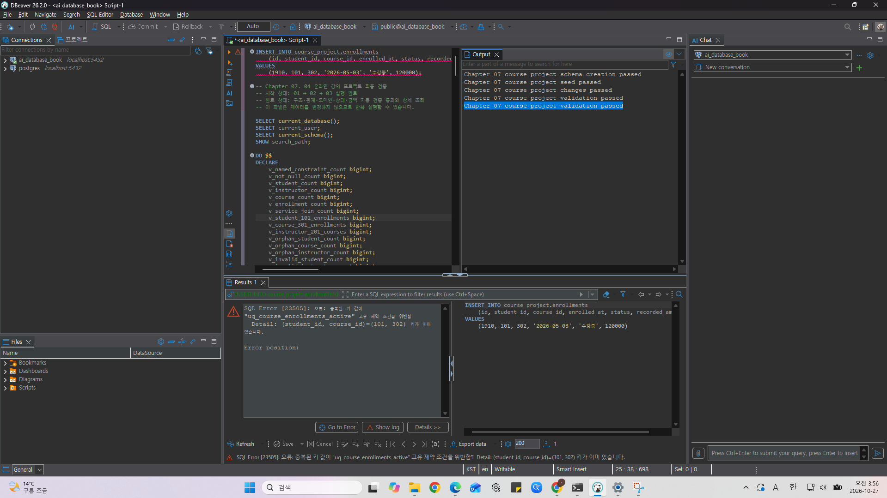
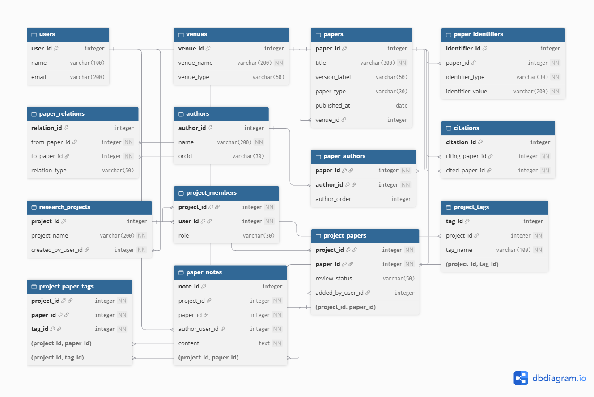

# Chapter 07 확장 실습 답안 템플릿

> **과제:** 실전 프로젝트 1 — 온라인 강의 수강신청 DB 완성하기  
> **사용 방법:** 이 파일을 내려받아 본인의 GitHub 저장소에 `chapter07_answer.md`라는 이름으로 저장한 뒤 실습하면서 바로 작성합니다.  
> **제출 방법:** LMS에는 파일을 직접 업로드하지 않고, **본인 GitHub 저장소의 `chapter07_answer.md` 파일 URL**을 제출합니다.

---

## 제출 전 주의

이 파일과 캡처 화면에는 실제 비밀번호, 전체 DB 접속 URL, API Key, 개인정보를 기록하지 않습니다.

```text
GitHub 계정 또는 별칭: youccode
과제 작성일: 2026.10.27
사용한 AI 도구: chatgpt
```

---

# 1. 시작 환경 확인

다음을 실행합니다.

```sql
SELECT current_database();
SELECT current_user;
SELECT current_schema();
SHOW search_path;
SHOW transaction_read_only;
```

| 확인 항목 | 실제 결과 | 의미 |
| --- | --- | --- |
| `current_database()` | `ai_database_book` | 이번 실습의 대상 데이터베이스에 연결되어 있다. |
| `current_user` | `postgres` | 현재 SQL을 실행하는 데이터베이스 사용자이다. |
| `current_schema()` | `public` | 스키마를 생략했을 때 기본으로 사용하는 현재 스키마이다. |
| `search_path` | `public, "$user"` | 스키마를 생략하면 public, 현재 사용자 이름의 스키마 순서로 객체를 탐색한다. |
| `transaction_read_only` | `off` | 현재 트랜잭션이 읽기 전용으로 제한되어 있지 않다. |

- [x] 현재 DB가 `ai_database_book`이다.
- [x] 쓰기 가능한 연결인지 확인했다.
- [x] 실행할 SQL 범위를 확인했다.
- [x] Auto-commit 상태를 확인했다.

### 프로젝트 SQL을 실행하기 전에 시작 상태를 확인해야 하는 이유

```text
잘못된 데이터베이스나 스키마에 객체를 생성하거나 기존 실습 데이터를 변경하지 않기 위해서이다. 쓰기 가능 여부와 Auto-commit 상태를 확인해야 파일의 BEGIN/COMMIT 및 오류 후 ROLLBACK을 올바르게 처리할 수 있다. 이번 실습은 ai_database_book 안의 course_project 전용 스키마에서 진행한다.
```

---

# 2. 프로젝트 범위와 요구사항 읽기

## 2-1. 포함 범위

본문을 그대로 복사하지 말고 자신의 말로 정리합니다.

```text
1. 학생과 강사의 기본 정보를 각각 관리한다.
2. 강의의 담당 강사, 제목, 난이도, 현재 기준 가격을 관리한다.
3. 학생이 특정 강의를 신청한 사건과 신청일, 현재 신청 상태를 저장한다.
4. 신청 당시의 기록 금액을 보존하고, 학생·강의·강사의 연결 및 상태 변경 결과를 검증한다.
```

## 2-2. 제외 범위

```text
1. 카드 결제 승인·실패·환불 및 회계 처리는 구현하지 않는다.
2. 강의 정원 제한과 대기열은 구현하지 않는다.
3. 신청의 모든 상태 변경 이력과 학습 진도·수료·콘텐츠 관리는 구현하지 않는다.
4. 쿠폰 및 할인 적용 이력은 관리하지 않는다.
```

### 범위를 명확하게 정해야 하는 이유

```text
포함 범위가 있어야 필요한 테이블과 완료 기준을 정할 수 있고, 제외 범위가 있어야 구현하지 않은 기능을 오류나 누락과 혼동하지 않는다. 특히 신청 기록 금액을 관리하는 것과 실제 결제 서비스를 구현하는 것은 검증 대상이 다르다.
```

## 2-3. 요구사항 / 프로젝트 결정 / 미확정 질문 구분

아래 항목 중 대표 항목을 정리합니다.

| ID | 종류 | 내용 요약 | DB 구조/규칙에 미치는 영향 |
| --- | --- | --- | --- |
| P07-R01 | 요구사항 | 학생 기본 정보를 관리한다. | students의 id·이름·이메일·가입일과 필수값 규칙. |
| P07-R05 | 요구사항 | 학생의 강의 신청 사건을 저장한다. | enrollments의 학생·강의 FK와 신청일·상태·기록 금액. |
| P07-R07 | 요구사항 | 학생·강사 이메일은 각 테이블 내부에서 고유하다. | students.email, instructors.email에 각각 UNIQUE 적용. |
| P07-D02 | 프로젝트 결정 | 신청 시점의 금액을 recorded_amount로 보존한다(SQL 동작 기준 정리). | 현재 가격과 분리하여 저장하며 상태 변경 시 금액은 유지한다. |
| P07-D03 | 프로젝트 결정 | 신청·수강중인 같은 학생·강의의 중복 신청을 금지한다. | 해당 상태에만 부분 고유 인덱스 적용. |
| P07-Q01 | 미확정 질문 | 학생과 강사 사이에서도 이메일을 전역 고유하게 할 것인가? | 현재는 테이블 간 중복을 금지하지 않는다. |

### 미확정 질문을 바로 제약조건으로 만들면 안 되는 이유

```text
미확정 질문은 아직 업무상 정답이 정해지지 않은 정책이다. 먼저 UNIQUE나 CHECK를 적용하면 정상적으로 허용되어야 할 입력을 차단할 수 있다. 예를 들어 학생·강사 사이의 이메일 전역 고유성은 미확정이므로 현재 SQL의 테이블별 UNIQUE와 구분해야 한다.
```

---

# 3. 네 테이블의 한 행 의미와 관계

## 3-1. 한 행 의미

```text
course_project.students 한 행 = 서비스에 등록된 학생 한 명의 현재 기본 정보이다.

course_project.instructors 한 행 = 강의를 담당하는 강사 한 명의 현재 기본 정보이다.

course_project.courses 한 행 = 한 강사가 담당하는 개설 강의 하나의 현재 정보이다.

course_project.enrollments 한 행 = 특정 학생이 특정 강의에 신청한 사건 한 건과 그 신청의 현재 상태 및 신청 당시 기록 금액이다.
```

## 3-2. 키와 중요 규칙

| 테이블 | PK | FK | 중요 규칙 |
| --- | --- | --- | --- |
| students | id | 없음 | 이름·이메일·가입일 필수, 이름·이메일 공백 금지, 이메일 UNIQUE. |
| instructors | id | 없음 | 이름·이메일·전문 분야 필수 및 공백 금지, 이메일 UNIQUE. |
| courses | id | instructor_id → instructors.id | 제목·강사·난이도·가격·개설일 필수, 가격≥0, 난이도 3종, 설명 NULL 허용. |
| enrollments | id | student_id → students.id; course_id → courses.id | 신청일·상태·금액 필수, 상태 4종, 금액≥0, 활성 신청 중복 금지, FK 삭제 RESTRICT. |

## 3-3. 관계를 양방향 문장으로 작성

```text
instructors ↔ courses: 강사 한 명은 강의를 0개 이상 담당할 수 있고, 각 강의는 반드시 강사 한 명을 참조한다.

students ↔ enrollments: 학생 한 명은 신청 사건을 0개 이상 가질 수 있고, 각 신청은 반드시 학생 한 명을 참조한다.

courses ↔ enrollments: 강의 하나에는 신청 사건이 0개 이상 연결될 수 있고, 각 신청은 반드시 강의 하나를 참조한다.
```

### 학생과 강의의 N:M 관계가 `enrollments`를 통해 어떻게 바뀌는지 설명

```text
학생은 여러 강의를 신청할 수 있고 하나의 강의에도 여러 학생이 신청할 수 있다. enrollments에 student_id와 course_id를 FK로 저장하여 students→enrollments와 courses→enrollments의 두 1:N 관계로 표현한다. 신청 자체는 id로 식별하므로 완료·취소 후 같은 조합의 신청 이력도 표현할 수 있다.
```

### `enrollments`가 단순 연결 테이블이 아니라 사건 테이블이라고 볼 수 있는 이유

```text
학생 ID와 강의 ID뿐 아니라 enrolled_at, status, recorded_amount가 신청 한 건에 속한다. 같은 학생·강의라도 다른 시점의 재신청은 별도 사건이다. 따라서 학생과 강의의 현재 정보와 분리하고, 완료·취소된 신청도 삭제하지 않고 보존한다. 다만 전체 상태 변경 이력을 별도 행으로 남기는 구조는 아니다.
```

---

# 4. `recorded_amount`의 의미 이해

```text
courses.price = 강의의 현재 기준 가격이다.

enrollments.recorded_amount = 해당 신청 시점에 기록한 금액이다. 신규 신청은 당시 courses.price를 조회하여 저장한다.
```

### 두 값이 처음에는 같아도 같은 의미가 아닌 이유

```text
현재 강의 가격과 과거 신청의 기록 금액은 서로 다른 시점의 사실이다. 강의 가격이 나중에 바뀌더라도 과거 신청의 금액까지 바뀌어서는 안 된다. 1005 신청은 강의 302의 당시 가격 120000을 복사하며, 이후 상태만 바꾸는 UPDATE에서는 recorded_amount를 수정하지 않는다.
```

### `recorded_amount`를 실제 결제 성공액이나 회계 매출로 해석하면 안 되는 이유

```text
결제 승인·실패·환불과 실제 입금 내역을 저장하지 않기 때문이다. 취소된 1004의 기록 금액 150000도 남아 있으므로 전체 합계 590000은 신청 기록의 합이다. 취소 제외 합계 440000 역시 조회 기준에 따른 합계이며 결제 성공액이나 회계 매출을 뜻하지 않는다.
```

---

# 5. STEP 01 — 스키마와 테이블 생성

실행 파일:

```text
code/chapter07/01_course_project_schema.sql
```

## 5-1. 실행 전 예상

```text
course_project 스키마 존재 여부: 실행 전에는 없어야 하며, 정상 실행 후 생성된다.
예상 테이블 수: 4개
예상 데이터 행 수: students/instructors/courses/enrollments = 0/0/0/0
예상되는 명명 제약조건 수: SQL에서 이름을 지정해 검증하는 15개(PK 제외)
예상되는 NOT NULL 열 수: 제공 SQL의 information_schema 집계 기준 20개
부분 고유 인덱스 존재 여부: uq_course_enrollments_active 생성 예상
```

## 5-2. 실행 결과

```text
실제 테이블 수: 4개
실제 명명 제약조건 수: 15개
실제 NOT NULL 열 수: 20개
부분 고유 인덱스: uq_course_enrollments_active 존재
네 테이블의 실제 행 수: students/instructors/courses/enrollments = 0/0/0/0
통과 메시지: Chapter 07 course project schema creation passed
```

### 예상과 실제 비교

```text
예상한 대로 네 테이블과 활성 신청 중복을 방지하는 부분 고유 인덱스가 생성되었다. 명명 제약조건 15개, NOT NULL 열 20개, 네 테이블의 행 수 0/0/0/0을 검사하는 검증 블록도 통과하여 실행 전 예상과 일치하였다.
```

### 증거 화면

권장 경로:

```text
assignments/chapter07/images/step05_schema.png
```



---

# 6. STEP 02 — Seed 데이터 입력

실행 파일:

```text
code/chapter07/02_course_project_seed.sql
```

## 6-1. 실행 전 예상

```text
students: 3행
instructors: 2행
courses: 3행
enrollments: 4행
recorded_amount 합계: 470000
학생 101 신청 건수: 2건
강의 301 신청 건수: 2건
강사 201 담당 강의 수: 2개
활성 중복 신청: 0개 조합
```

## 6-2. 실제 결과

```text
students: 3행
instructors: 2행
courses: 3행
enrollments: 4행
recorded_amount 합계: 470000
학생 101 신청 건수: 2건
강의 301 신청 건수: 2건
강사 201 담당 강의 수: 2개
활성 중복 신청: 0개 조합
1001 상태: 수강 중
1004 상태: 신청 
1005 존재 여부: 존재하지 않음 
통과 메시지: Chapter 07 course project seed passed
```

### Seed 데이터를 단순 예제가 아니라 검증 데이터라고 볼 수 있는 이유

```text
학생 101이 여러 강의를 신청하고 강의 301에는 여러 학생이 신청하도록 구성되어 있어 학생과 강의의 N:M 관계를 확인할 수 있다. 강사 201은 강의 두 개를 담당하므로 강사와 강의의 1:N 관계도 검증할 수 있다.

또한 신청 1001과 1004는 이후 상태 변경을 확인하기 위한 대상이며, 1005는 아직 존재하지 않아 신규 신청을 검증할 수 있다. 행 수와 기록 금액 합계가 정해져 있으므로 변경 전후의 결과를 비교하는 기준 데이터로 사용할 수 있다.
```

---

# 7. STEP 03 — 변경 시나리오 실행

실행 파일:

```text
code/chapter07/03_course_project_changes.sql
```

## 7-1. 실행 전에 상태 변화를 예상

| 신청 ID | 변경 전 예상 상태 | 변경 후 예상 상태 | 예상 recorded_amount |
| ---: | --- | --- | ---: |
| 1001 | 수강중 | 완료 | 100000 |
| 1004 | 신청 | 취소 | 150000 |
| 1005 | 행 없음 | 신청 | 120000 |

```text
변경 후 예상 enrollments 행 수: 5행
변경 후 예상 전체 recorded_amount 합계: 590000
변경 후 예상 취소 제외 건수: 4건
변경 후 예상 취소 제외 recorded_amount 합계: 440000
```

## 7-2. 실제 결과

```text
1001 상태 / recorded_amount: 완료 / 100000
1004 상태 / recorded_amount: 취소 / 150000
1005 상태 / recorded_amount: 신청 / 120000
최종 enrollments 행 수: 5행
전체 recorded_amount 합계: 590000
취소 제외 건수: 4건
취소 제외 recorded_amount 합계: 440000
활성 중복 신청: 0개 조합
통과 메시지: Chapter 07 course project changes passed
```

### 조건부 UPDATE에서 예상 이전 상태를 확인해야 하는 이유

```text
신청 ID만 조건으로 사용하면 이미 다른 상태로 변경된 신청도 덮어쓸 수 있기 때문이다. 따라서 신청 1001은 기존 상태가 수강중일 때만 완료로, 신청 1004는 기존 상태가 신청일 때만 취소로 변경하도록 조건을 지정한다.

이를 통해 예상한 시작 상태에 있는 행만 변경하고, RETURNING 결과와 변경 후 검증으로 의도한 변경이 이루어졌는지 확인할 수 있다. 상태 변경 시 recorded_amount는 수정하지 않아 신청 당시 기록 금액을 유지한다.
```

### 증거 화면

권장 경로:

```text
assignments/chapter07/images/step07_changes.png
```



---

# 8. STEP 04 — 최종 완료 게이트 실행

실행 파일:

```text
code/chapter07/04_course_project_validation.sql
```

## 8-1. 최종 검증 결과

```text
최종 행 수 students/instructors/courses/enrollments: 3/2/3/5
서비스 JOIN 결과 행 수: 5행
학생 101 신청 수: 2건
강의 301 신청 수: 2건
강사 201 강의 수: 2개
고아 관계 수: 학생·강의·강사 참조 모두 0건
활성 중복 신청 수: 0개 조합
전체 recorded_amount: 590000
취소 제외 recorded_amount: 440000
통과 메시지: Chapter 07 course project validation passed
```

### SQL 파일 4개가 모두 실행되었다는 사실과 프로젝트 검증 PASS가 다른 이유

```text
SQL 파일을 실행했다는 사실만으로는 최종 데이터가 요구사항을 만족하는지 보장할 수 없다. 실행 순서가 잘못되거나 일부 문장이 실패하거나 데이터가 예상과 다르게 변경되었을 수 있기 때문이다.

최종 검증은 테이블과 제약조건의 존재, 데이터 행 수, JOIN 결과, 참조 무결성, 허용된 값, 활성 중복 신청, 주요 신청의 상태와 기록 금액을 기준값과 비교한다. 따라서 검증 PASS는 단순한 실행 여부를 넘어 최종 상태가 정해진 완료 기준을 충족했다는 근거가 된다.
```

### 증거 화면

권장 경로:

```text
assignments/chapter07/images/step08_validation.png
```



---

# 9. 무결성 테스트

실행 파일:

```text
code/chapter07/05_course_project_integrity_tests.sql
```

> 오류 테스트는 파일 전체를 무작정 실행하지 않고 **한 테스트 구간씩** 실행합니다.

## 9-1. 허용되어야 하는 경계값 1개

```text
테스트 내용: 가격이 0이고 설명이 NULL인 무료 강의를 등록하고, 기록 금액이 0인 수강신청을 입력하였다.
기대 결과: 강의와 신청이 정상적으로 입력되어야 한다.
실제 결과: 입력에 성공하였으며 price=0, description_is_null=true, recorded_amount=0을 확인하였다.
왜 허용되어야 하는가: 가격과 신청 기록 금액은 0 이상을 허용하며, 강의 설명은 필수 항목이 아니기 때문이다.
```

## 9-2. 실패해야 하는 테스트 1 — 잘못된 참조 또는 값

```text
테스트 내용: 존재하지 않는 학생 999를 참조하는 수강신청을 입력하였다.
기대 결과: 외래키 제약조건 위반으로 입력이 거부되어야 한다.
실제 오류 핵심: SQLSTATE 23503. student_id=999가 students 테이블에 없어 입력이 거부되었다.
동작한 제약조건/규칙: fk_course_enrollments_student 외래키 제약조건.
왜 실패해야 하는가: 존재하지 않는 학생의 신청이 저장되면 참조 무결성이 깨지기 때문이다.
```

## 9-3. 실패해야 하는 테스트 2 — 활성 중복 신청

```text
테스트 내용: 학생 101이 강의 302에 활성 신청을 가진 상태에서 같은 조합의 수강중 신청을 추가하였다.
기대 결과: 활성 중복 신청을 제한하는 부분 고유 인덱스에 의해 입력이 거부되어야 한다.
실제 오류 핵심: SQLSTATE 23505. (student_id, course_id)=(101, 302)의 중복으로 입력이 거부되었다.
동작한 인덱스/규칙: uq_course_enrollments_active. 신청 또는 수강중 상태인 행에만 학생·강의 조합의 고유성을 적용한다.
왜 실패해야 하는가: 같은 학생이 같은 강의에 진행 중인 신청을 동시에 두 건 가질 수 없도록 해야 하기 때문이다.
```

## 9-4. 실패 후 기준 상태 재검증

```text
04 validation 재실행 결과: Chapter 07 course project validation passed
기준 데이터가 유지되었는가: 유지되었다. 최종 검증을 다시 통과하였으며, students/instructors/courses/enrollments의 행 수는 3/2/3/5, 전체 기록 금액은 590000, 취소 제외 신청은 4건, 취소 제외 기록 금액은 440000으로 유지되었다.
```

### 실패 테스트가 프로젝트 품질 검증에 필요한 이유

```text
정상 데이터가 입력되는 것만으로는 잘못된 데이터까지 차단되는지 확인할 수 없다. 존재하지 않는 학생을 참조하는 신청과 활성 중복 신청을 입력하여 외래키와 부분 고유 인덱스가 실제로 잘못된 입력을 거부하는지 검증해야 한다. 또한 실패 후 최종 검증을 다시 실행하여 기존 데이터와 관계가 유지되는지 확인해야 한다.
```

### 증거 화면

권장 경로:

```text
assignments/chapter07/images/step09_integrity.png
```



---

# 10. 재현성 실험

> 이 단계는 본인의 실습 환경이며 보존할 데이터가 없을 때만 수행합니다.

실행 순서:

```text
reset_course_project.sql
→ 01_course_project_schema.sql
→ 02_course_project_seed.sql
→ 03_course_project_changes.sql
→ 04_course_project_validation.sql
```

```text
처음 실행의 최종 결과:
students/instructors/courses/enrollments의 행 수는 3/2/3/5였다.
신청 1001은 완료/100000, 1004는 취소/150000, 1005는 신청/120000이었다.
전체 recorded_amount 합계는 590000, 취소 제외 신청은 4건이며 금액 합계는 440000이었다.
최종 검증에서 Chapter 07 course project validation passed가 출력되었다.

재실행의 최종 결과:
course_project 스키마를 초기화하고 01→02→03→04를 순서대로 다시 실행하였다.
행 수는 3/2/3/5, 신청 1001은 완료/100000, 1004는 취소/150000, 1005는 신청/120000이었다.
전체 recorded_amount 합계는 590000, 취소 제외 신청은 4건이며 금액 합계는 440000이었다.
최종 검증에서도 Chapter 07 course project validation passed가 다시  출력되는 것을 확인하였다.

두 결과가 일치했는가: 일치하였다. 테이블별 행 수, 주요 신청의 상태와 기록 금액, 전체 및 취소 제외 집계 결과가 모두 같았으며 최종 검증도 통과하였다.
중간에 수동 수정이 필요했는가: 필요하지 않았다. 스키마 초기화 후 제공된 SQL 파일을 순서대로 실행하는 것만으로 동일한 최종 결과를 얻었다.
```

### 다른 사람이 같은 순서로 실행해 같은 결과를 얻는 것이 중요한 이유

```text
다른 환경에서 같은 시작 상태와 순서로 같은 결과가 나와야 특정 사용자의 수동 수정에 의존하지 않는 프로젝트라고 볼 수 있다. 문제 발생 시 어느 단계에서 기준값이 달라졌는지 추적하고, 변경 후 회귀 검증에도 활용할 수 있다.
```

---

# 11. Chapter 01~06 개인 프로젝트를 중간 프로젝트 초안으로 확장

온라인 강의 예제를 이름만 바꾸지 않고 본인의 아이디어를 사용합니다.

## 11-1. 프로젝트 기본 정보

```text
프로젝트 이름: 논문 인용 관계 탐색 및 공동 문헌 조사 서비스

해결하려는 문제: 논문별로 흩어진 참고문헌·피인용 관계와 공개 판본을 함께 탐색하고, 연구팀의 공동 논문 목록과 검토 내용이 개인별로 분산되는 문제를 줄인다.

주요 사용자: 선행 연구를 조사하는 학부생·대학원생·연구자와 공동 문헌 목록을 관리하는 연구팀이다.
```

## 11-2. 포함 범위 / 제외 범위

```text
[포함]
1. 제한된 컴퓨터과학 분야 논문의 서지정보, 외부 식별자, 저자·출판처를 관리한다.
2. 개별 공개 판본을 구분하고 판본 관계와 직접 인용·피인용 관계를 각각 탐색한다.
3. 연구 프로젝트를 만들고 사용자 참여 관계와 공동 논문 목록을 관리한다.
4. 프로젝트별 논문 검토 상태, 태그, 메모를 관리한다.

[제외]
1. 구독 요금 결제와 구독별 기능 접근 제어.
2. 여러 단계의 인용 그래프 고급 탐색 및 미공개 원고 인용 시뮬레이션.
3. BibTeX 생성·내보내기와 전체 학술 논문의 대규모 수집.
```

## 11-3. 요구사항

최소 8개를 작성합니다.

| ID | 요구사항 | 관련 테이블/관계 | 검증 방법 후보 |
| --- | --- | --- | --- |
| P07-MR01 | 개별 공개 판본의 논문 제목·유형·공개일과 외부 식별자를 관리한다. | papers, paper_identifiers | 프리프린트와 출판본을 별도 행으로 조회하고 식별자 JOIN 확인. |
| P07-MR02 | 논문과 저자의 다대다 참여 및 저자 순서를 저장한다. | authors, paper_authors | 한 논문 복수 저자·한 저자 복수 논문 및 중복 복합키 거부 확인. |
| P07-MR03 | 논문이 다른 논문을 인용하는 방향을 구분한다. | citations → papers(두 역할) | A→B 등록 후 A의 참고문헌과 B의 피인용 목록에 연결되는지 확인. |
| P07-MR04 | 동일 연구의 판본 관계를 실제 인용과 분리한다. | paper_relations, citations | 판본 관계만 등록한 두 논문이 인용 조회에는 추가되지 않는지 확인. |
| P07-MR05 | 사용자와 프로젝트의 참여 관계 및 역할을 저장한다. | users, research_projects, project_members | 복수 참여 관계 조회 및 동일 참여 복합키 중복 거부 확인. 권한 세부값은 미확정. |
| P07-MR06 | 논문을 프로젝트별로 등록하고 검토 상태를 별도로 관리한다. | project_papers → research_projects, papers | 동일 논문의 두 프로젝트 등록과 한 프로젝트의 상태 변경 독립성 확인. |
| P07-MR07 | 프로젝트 논문에는 같은 프로젝트에 속한 태그만 연결한다. | project_tags, project_paper_tags, project_papers | 다른 프로젝트 태그 및 미등록 논문 연결이 복합 FK로 거부되는지 확인. |
| P07-MR08 | 프로젝트 논문 항목에 사용자별 메모를 저장한다. | paper_notes → project_papers, users | 하나의 논문 항목에 메모 여러 건 등록, 작성자 JOIN, 미등록 항목 참조 거부 확인. |

## 11-4. 프로젝트 결정

최소 3개를 작성합니다.

| ID | 이번 프로젝트에서 내린 결정 | 이유 | 구현 후보 |
| --- | --- | --- | --- |
| P07-MD01 | 논문의 공개 판본을 각각 papers의 별도 행으로 저장한다. | 판본마다 인용 대상과 서지정보가 달라질 수 있다. | paper_id PK, version_label 및 paper_type; 외부 식별자 UNIQUE는 미확정. |
| P07-MD02 | 인용 관계와 동일 연구의 판본 관계를 분리하고 검토 상태는 프로젝트 등록 관계에 둔다. | 서로 다른 관계와 정보의 소유 대상을 혼동하지 않기 위해서이다. | citations / paper_relations 분리; project_papers.review_status. |
| P07-MD03 | 프로젝트 등록·참여·저자 연결은 복합 PK를 사용하고 프로젝트별 태그는 복합 FK로 검사한다. | 관계 중복과 다른 프로젝트 태그의 잘못된 연결을 방지한다. | project_papers·project_members·paper_authors 복합 PK; project_tags(project_id,tag_id) UNIQUE와 복합 FK. |

## 11-5. 미확정 질문

최소 3개를 작성합니다.

```text
P07-MQ01. DOI·arXiv ID의 정규화 및 UNIQUE 범위는 무엇이며, 여러 판본에서 같은 식별자를 공유할 수 있는가?
P07-MQ02. 프로젝트 역할별 권한과 검토 상태 값·변경 규칙을 어떻게 정할 것인가?
P07-MQ03. 구성원 탈퇴와 프로젝트·논문 삭제 뒤 메모 및 검토 기록을 보존할 것인가?
P07-MQ04. 동일한 인용 쌍의 중복과 자기 인용, 사용자 이메일·ORCID·프로젝트 태그 이름의 고유성을 어떤 범위에서 제한할 것인가?
```

---

# 12. 개인 프로젝트 ERD와 한 행 의미

## 12-1. 테이블 후보

최소 4개를 권장합니다.

| 테이블 | 한 행의 의미 | PK 후보 | FK 후보 | 주요 규칙 |
| --- | --- | --- | --- | --- |
| users | 연구자 한 명 | user_id | 없음 | 이메일 고유성은 미확정 |
| research_projects | 공동 문헌 조사 프로젝트 하나 | project_id | created_by_user_id → users | 프로젝트명 필수 |
| project_members | 사용자 한 명의 프로젝트 참여 한 건 | (project_id, user_id) | project_id → research_projects; user_id → users | 동일 참여 중복 금지, 역할별 권한 미확정 |
| project_papers | 프로젝트의 논문 등록 한 건 | (project_id, paper_id) | project_id → research_projects; paper_id → papers; added_by_user_id → users | 검토 상태는 이 행에 속함, 상태값 정책 미확정 |
| papers | 공개 논문 판본 또는 출판 기록 하나 | paper_id | venue_id → venues(NULL 허용) | 제목 필수, 판본별 별도 행 |
| paper_identifiers | 논문에 연결된 외부 식별자 하나 | identifier_id | paper_id → papers | 종류·값 필수, UNIQUE 범위 미확정 |
| paper_relations | 동일 연구의 두 판본 사이 관계 한 건 | relation_id | from_paper_id / to_paper_id → papers | 실제 인용 관계와 분리 |
| authors | 논문 저자 한 명 | author_id | 없음 | 이름 필수, ORCID 고유성 미확정 |
| paper_authors | 논문과 저자의 참여 관계 한 건 | (paper_id, author_id) | paper_id → papers; author_id → authors | 동일 참여 중복 금지, author_order 저장 |
| venues | 학회 또는 학술지 하나 | venue_id | 없음 | 출판사 자체와 구분, 이름 필수 |
| citations | 논문 A가 논문 B를 인용하는 방향 관계 한 건 | citation_id | citing_paper_id / cited_paper_id → papers | 본문 인용 위치 제외, 중복·자기 인용 정책 미확정 |
| project_tags | 한 프로젝트에 속한 태그 하나 | tag_id | project_id → research_projects | (project_id, tag_id) UNIQUE; 이름 고유성 미확정 |
| project_paper_tags | 프로젝트 논문 항목에 태그를 연결한 관계 한 건 | (project_id, paper_id, tag_id) | (project_id,paper_id) → project_papers; (project_id,tag_id) → project_tags | 두 복합 FK로 동일 프로젝트 보장 |
| paper_notes | 프로젝트 논문 항목의 메모 한 건 | note_id | (project_id,paper_id) → project_papers; author_user_id → users | 내용 필수, 탈퇴 후 보존·구성원 참조 강제 미확정 |

## 12-2. 관계 문장

```text
1. 사용자 한 명은 여러 프로젝트에 참여할 수 있고, 프로젝트 하나에는 여러 사용자가 참여할 수 있다. project_members가 두 대상을 각각 참조한다.
2. 프로젝트 하나에는 여러 논문이 등록되고 논문 하나도 여러 프로젝트에 등록될 수 있다. project_papers가 등록 관계와 프로젝트별 검토 상태를 저장한다.
3. 논문 하나에는 여러 저자가 참여하고 저자 한 명도 여러 논문에 참여할 수 있다. paper_authors가 참여 관계와 저자 순서를 저장한다.
4. citations의 각 행은 papers를 인용하는 쪽과 인용되는 쪽으로 두 번 참조한다. paper_relations도 두 논문을 참조하지만 동일 연구의 판본 관계를 나타낸다.
5. project_paper_tags는 (project_id, paper_id)로 등록 논문을, (project_id, tag_id)로 같은 프로젝트의 태그를 참조한다.
6. paper_notes의 각 메모는 프로젝트 논문 항목 하나와 작성 사용자 한 명을 참조한다. 작성자의 현재 구성원 여부 강제는 탈퇴 정책 확정 후 검토한다.
```

## 12-3. ERD

권장 이미지 경로:

```text
assignments/chapter07/images/personal_project_erd.png
```



### Chapter 05~06 ERD에서 이번에 바꾼 점

```text
Chapter 06에서 개선한 프로젝트별 태그의 참조 무결성 구조를 유지하였다. project_tags의 (project_id, tag_id) 복합 UNIQUE와 project_paper_tags의 (project_id, paper_id), (project_id, tag_id) 복합 FK를 명시하여 프로젝트에 등록된 논문에 같은 프로젝트의 태그만 연결되도록 하였다.

이번에는 테이블을 추가하기보다 기존 14개 테이블의 한 행 의미와 관계를 다시 확인하고, 요구사항 및 완료 기준과 연결하여 정리하였다. 논문 판본 관계와 실제 인용 관계를 분리하고, 검토 상태를 프로젝트별 논문 등록 관계에 저장하는 기존 설계도 유지하였다.

외부 식별자의 고유성, 역할별 권한, 구성원 탈퇴 후 메모 보존 및 삭제 정책은 아직 미확정이므로 새로운 제약조건으로 강제하지 않았다.
```

---

# 13. 개인 프로젝트 완료 기준 만들기

“잘 동작한다”처럼 모호하게 쓰지 말고 검증 가능한 기준을 최소 6개 작성합니다.

| 번호 | 완료 기준 | 자동 SQL 검증 가능? | 검증 방법 |
| ---: | --- | --- | --- |
| 1 | 계획 Seed의 users/research_projects/papers/project_members/project_papers가 각각 3/2/4/4/5행이다. | 가능 | 향후 Seed에서 테이블별 COUNT를 비교. 추가 테이블 행 수는 해당 Seed 작성 시 확정. |
| 2 | 모든 확정 FK의 고아 참조가 0건이며 미존재 부모 입력은 거부된다. | 가능 | 각 FK LEFT JOIN 검사와 별도 실패 INSERT 후 ROLLBACK. |
| 3 | 동일 프로젝트·논문 중복 등록과 다른 프로젝트 태그 연결이 거부된다. | 가능 | 복합 PK 및 두 복합 FK 위반 테스트, 정상 조합 성공도 비교. |
| 4 | A→B 인용 1건만 있는 독립 테스트에서 A의 참고문헌과 B의 피인용 결과에 B와 A가 각각 1행 나온다. | 가능 | 반대 방향이 자동 생성되지 않는지 함께 확인. 테스트 격리 후 ROLLBACK. |
| 5 | 독립 테스트의 판본 관계 1건은 판본 조회에만 나오고 인용 조회 결과를 늘리지 않는다. | 가능 | paper_relations와 citations의 COUNT·JOIN 비교. |
| 6 | 같은 논문을 두 프로젝트에 등록하고 A의 검토 상태를 변경해도 B의 상태와 papers 제목은 유지된다. | 가능(상태 정책 확정 후) | 승인된 상태값으로 UPDATE 전후 SELECT 비교. 미확정 상태값은 임의 CHECK로 강제하지 않음. |
| 7 | 프로젝트 논문 항목 하나에 메모 2건을 저장하면 메모 조회·작성자 JOIN이 2행이고 미등록 항목 참조는 거부된다. | 가능 | 독립 테스트에서 정상 메모 2건 및 잘못된 복합 FK 입력 비교 후 ROLLBACK. |
| 8 | 깨끗한 개인 실습 스키마에서 생성→Seed→변경→검증을 재실행하면 같은 결과가 나온다. | 가능 | 완성된 개인 프로젝트 SQL로 재현 검증. 현재는 설계 목표이며 실행 완료 아님. |

예시 형식:

```text
Seed 실행 후 A/B/C/D 테이블의 행 수가 각각 5/3/8/12다.
존재하지 않는 부모를 참조하는 행은 0건이다.
허용되지 않은 상태 입력은 DB가 거부한다.
검증 SQL이 예상 결과를 반환한다.
```

---

# 14. AI를 프로젝트 리뷰어로 사용

AI에게 프로젝트를 대신 완성시키지 않고 누락과 위험을 찾게 합니다.

## 14-1. AI에게 전달한 핵심 자료

```text
요구사항: 논문의 개별 공개 판본과 외부 식별자를 관리하고, 직접 인용·피인용 관계와 동일 연구의 판본 관계를 구분하여 탐색하는 서비스이다. 
프로젝트 구성원은 공동 논문 목록과 프로젝트별 검토 상태, 태그, 메모를 관리한다. 이러한 요구사항을 프로젝트 개요와 기존 설계 설명으로 전달하였다.

테이블/ERD 설명: 기존 14개 테이블의 ERD와 주요 관계를 전달하였다. 특히 citations와 paper_relations의 분리, project_papers의 프로젝트별 검토 상태, project_tags의 복합 UNIQUE 및 project_paper_tags의 두 복합 FK를 설명하였다.

프로젝트 결정: 공개 판본마다 별도의 papers 행을 저장하고, 실제 인용과 동일 연구의 판본 관계를 분리한다. 
검토 상태는 프로젝트별 논문 등록 관계에 저장하며, 태그는 같은 프로젝트의 논문 항목에만 연결한다.

미확정 질문: 외부 식별자의 정규화와 고유성 범위, 사용자 이메일·ORCID·태그 이름의 고유성, 인용 중복과 자기 인용, 역할별 권한, 검토 상태 전이, 구성원 탈퇴 후 메모 보존 및 삭제 정책을 전달하였다.

완료 기준: SQL로 판정할 수 있는 완료 기준과 관계·방향·상태 변경 오류의 검토를 요청하였다. 다만 이번 요청에는 11~13장 원문을 실제로 붙여 넣지 않아 
AI가 기존 완료 기준의 각 문장을 직접 대조하지는 못하였다. 따라서 검토 결과를 프로젝트 설명과 ERD에 근거한 의견으로 구분하였다.
```

## 14-2. 내가 사용한 프롬프트

```text
나는 PostgreSQL을 사용하는 ‘논문 인용 관계 탐색 및 공동 문헌 조사 서비스’의 데이터베이스를 설계하고 있다.

아래에 첨부한 Chapter 07의 11~13장과 ERD를 검토해 줘.
프로젝트를 대신 완성하기보다 요구사항·설계·완료 기준의 누락과 위험을 찾는 리뷰어 역할을 해 줘.

[프로젝트 개요]

논문 사이의 직접 인용·피인용 관계와 동일 연구의 공개 판본을 탐색하고,
연구팀이 프로젝트 안에서 공동 논문 목록, 검토 상태, 태그, 메모를 관리하는 서비스다.

이번 학기에는 제한된 컴퓨터과학 분야의 논문 데이터를 대상으로 한다.
구독 결제, 여러 단계의 고급 인용 그래프 탐색, 미공개 원고 인용 시뮬레이션,
BibTeX 생성·내보내기는 구현 범위에서 제외한다.

[기존 설계의 핵심]

1. papers의 한 행은 공개 논문의 개별 판본 또는 출판 기록이다.
2. 실제 인용 관계는 citations, 동일 연구의 판본 관계는 paper_relations로 분리한다.
3. 논문과 저자, 사용자와 프로젝트, 프로젝트와 논문의 N:M 관계는 각각 연결 테이블로 표현한다.
4. 검토 상태는 papers가 아니라 project_papers에 저장한다.
5. project_tags에는 (project_id, tag_id) 복합 UNIQUE를 둔다.
6. project_paper_tags에는 다음 두 복합 FK를 둔다.
   - (project_id, paper_id) → project_papers
   - (project_id, tag_id) → project_tags
   이를 통해 프로젝트에 등록된 논문에 같은 프로젝트의 태그만 연결한다.
7. paper_notes는 프로젝트 논문 항목과 작성 사용자를 참조한다.

[미확정 정책]

- DOI·arXiv ID의 정규화 및 UNIQUE 적용 범위
- 사용자 이메일·저자 ORCID·프로젝트 태그 이름의 고유성
- 동일 인용 쌍의 중복 및 자기 인용 허용 여부
- 프로젝트 역할별 권한
- 검토 상태의 종류와 상태 변경 규칙
- 구성원 탈퇴 후 메모 보존 및 관련 데이터 삭제 정책

이 항목들은 임의로 확정하거나 즉시 제약조건으로 추가하지 말고,
추가 확인할 질문과 정책별 대안을 제시해 줘.

[검토 요청]

1. 요구사항이 명확하고 검증 가능한지 확인해 줘.
2. 요구사항, 프로젝트 결정, 미확정 질문이 적절히 구분되어 있는지 확인해 줘.
3. 테이블별 한 행 의미와 PK/FK 관계에서 누락이나 모순을 찾아 줘.
4. 프로젝트별 태그의 복합 FK가 의도한 참조 무결성을 보장하는지 확인해 줘.
5. 완료 기준이 실제 SQL 결과로 판정 가능한지 확인해 줘.
6. 행 수가 맞더라도 놓칠 수 있는 관계·방향·상태 변경 오류를 찾아 줘.
7. 이번 학기 범위 안에서 우선 검증할 항목을 제안해 줘.

[답변 형식]

구체적인 검토 의견을 최소 5개 제시하고 다음 표로 정리해 줘.

| 번호 | AI 제안 | 관련 요구사항 또는 설계 근거 | 발견한 위험 | 개선안과 검증 방법 | 정책 확정 여부 |

마지막으로 다음 세 가지도 답해 줘.

A. 미확정 정책 때문에 지금 확정할 수 없는 제안은 무엇인가?
B. 트리거·재귀 CTE 등 추가 학습이나 구현 범위 검토가 필요한 제안은 무엇인가?
   필요한 이유와 현재 단계에서 사용할 수 있는 단순한 대안도 설명해 줘.
C. 현재 설계에서 우선 검증할 가치가 높은 항목 3개는 무엇인가?

[주의사항]

- 이미 반영된 설계를 새로 발견한 누락처럼 설명하지 마.
- 자료에 없는 내용은 누락으로 단정하지 말고 확인 필요로 표시해 줘.
- 단순히 값이 반복된다는 이유만으로 테이블을 분리하지 마.
- UNIQUE, CHECK, NOT NULL, FK, CASCADE를 근거 없이 추가하지 마.
- 온라인 강의 실습의 실행 결과와 개인 프로젝트의 설계·검증 계획을 구분해 줘.
- 개인 프로젝트 SQL을 실제 실행하지 않았으므로 검증이 통과했다고 표현하지 마.
- 최종 수용·수정·보류·거절 판단은 내가 할 수 있도록 근거를 제공해 줘.
```

## 14-3. AI 제안 검토

| AI 제안 | 수용 / 수정 / 보류 / 거절 | 실제 근거 | 반영 내용 |
| --- | --- | --- | --- |
| 프로젝트별 태그의 두 복합 FK에 대해 정상 연결과 잘못된 연결을 각각 검증한다. | 수용 | P07-MR07과 Chapter 06의 개선 설계에서 같은 프로젝트의 태그만 연결하도록 정하였다. | 기존 복합 FK를 유지하고 정상 연결, 다른 프로젝트 태그, 미등록 논문 연결을 구분하여 검증하도록 정리하였다. 실제 개인 프로젝트 SQL 검증은 구현 단계에서 수행한다. |
| 인용 방향은 행 수뿐 아니라 실제 논문 ID 조합으로 확인한다. | 수용 | P07-MR03은 방향 있는 인용 관계를 요구한다. 방향이 반대여도 결과 행 수는 같을 수 있다. | A→B를 등록했을 때 A의 참고문헌에 B가, B의 피인용 목록에 A가 나타나는지 확인하는 기준을 유지하였다. |
| 동일 논문을 여러 프로젝트에 등록하여 검토 상태의 독립성을 확인한다. | 수용 | P07-MR06과 기존 설계에서 검토 상태는 project_papers에 속한다. | 한 프로젝트의 상태 변경이 다른 프로젝트의 상태와 papers의 공통 정보에 영향을 주지 않는지 확인하도록 정리하였다. |
| N:M 관계의 중복 방지 키는 실제 DDL을 확인해야 한다. | 수정 | 기존 Chapter 05 DDL과 이번 ERD에는 project_members, project_papers, paper_authors의 복합 PK가 이미 정의되어 있다. | 키 설계가 누락된 것으로 판단하지 않고 기존 복합 PK를 유지하였다. 실제 DB에 반영되었는지와 중복 INSERT 거부 여부는 구현 시 별도로 검증한다. |
| 외부 식별자의 정규화와 UNIQUE 적용 범위를 정한다. | 보류 | P07-MQ01에서 판본 간 식별자 공유와 고유성 범위가 미확정이다. | 표기 정규화와 판본 식별 기준을 먼저 확인하고, 확정 전에는 전역 UNIQUE를 추가하지 않는다. |
| 메모 작성자의 프로젝트 구성원 자격과 탈퇴 후 보존 방식을 결정한다. | 보류 | P07-MQ03에서 구성원 탈퇴 후 메모 보존 정책이 미확정이다. | users 및 프로젝트 논문 항목에 대한 기존 FK는 유지하고, project_members 복합 FK나 작성 권한 검사 방식은 정책 확정 후 결정한다. |
| 상태 전이·권한 강제에 트리거나 RLS를 검토하고, 다단계 탐색에 재귀 CTE를 검토한다. | 보류 | 상태·권한 정책이 미확정이며 고급 다단계 인용 탐색은 이번 구현 범위에서 제외하였다. | 현재는 기본 JOIN, 조건부 UPDATE, 트랜잭션과 정상·실패 테스트를 우선한다. 추가 기능의 필요성이 확정되면 도입을 검토한다. |
| 검토 준비 현황을 0/8로 표시하였다. | 거절 | AI는 11~13장 원문을 받지 못했으므로 해당 항목들의 작성 여부를 판정할 근거가 부족하다. | 0/8을 실제 미완료 개수나 평가 결과로 받아들이지 않고, 기존 답안과 직접 비교할 점검 목록으로만 활용하였다. |

### AI가 미확정 정책을 임의로 확정하려 한 부분이 있었나요?

```text
없었다. AI는 외부 식별자의 고유성, 태그 이름 중복, 인용 중복과 자기 인용, 역할별 권한, 검토 상태 전이, 탈퇴 후 메모 보존을 미확정 정책으로 구분하였다. UNIQUE나 추가 FK를 즉시 적용하기보다 정책별 대안을 비교하도록 제안하였다.

또한 메모 작성자가 users를 참조하더라도 프로젝트 구성원임을 보장하지는 않는다고 설명하면서, 이를 곧바로 설계 오류로 단정하지 않았다. 구성원 탈퇴 후 과거 메모를 보존할지에 따라 적절한 제약조건과 권한 검사 방식이 달라지기 때문이다.

다만 AI가 제시한 검토 준비 현황 0/8은 자료가 전달되지 않은 상태에서 작성 여부를 판단한 표시이므로 실제 평가 결과로 사용하지 않았다.
```

### AI가 제안한 규칙 중 아직 배우지 않은 기능이라 보류한 것이 있나요?

```text
AI가 추가 검토 기술로 제시한 트리거, 재귀 CTE, PostgreSQL RLS는 이번 단계의 적용 대상으로 확정하지 않고 보류하였다.

트리거를 통한 상태 전이와 구성원 자격 강제는 관련 정책을 먼저 정해야 한다. RLS 역시 실제 애플리케이션의 DB 접근 방식과 권한 요구사항을 확인한 뒤 필요성을 판단해야 한다.

재귀 CTE를 이용한 여러 단계의 인용 탐색은 이번 학기 구현 범위에서 제외한 고급 기능과 관련되므로 우선 적용하지 않는다. 현재는 직접 인용·피인용 조회와 명시된 판본 관계를 기본 JOIN으로 확인하고, 복합 FK와 트랜잭션을 이용한 검증을 우선한다.
```

### AI 활용 후 실제로 좋아진 부분

```text
단순히 행 수가 맞는지만 확인하는 것과 관계의 의미까지 검증하는 것의 차이를 구체적으로 정리할 수 있었다. 특히 인용 방향, 프로젝트별 검토 상태의 독립성, 프로젝트 경계를 넘는 태그 연결을 우선 검증 대상으로 확인하였다.

또한 이미 ERD에 반영된 복합 PK와 복합 FK를 새로운 누락으로 받아들이지 않고 기존 설계와 비교하였다. 참조 무결성과 사용자 권한 검사가 서로 다른 문제라는 점도 명확해졌다.

이번 검토는 개인 프로젝트 DB의 실제 실행 결과가 아니라 설계 검토이며, 온라인 강의 실습에서 확인한 PASS와 구분하였다. AI가 원문을 확인하지 못한 부분은 직접 대조가 필요한 항목으로 남겼다.
```

---

# 15. 최종 성찰

아래 문장은 반드시 본인의 말로 작성합니다.

```text
1. 데이터베이스 프로젝트가 완료되었다고 판단하려면
   SQL 파일의 존재보다 정해진 시작 상태에서 실행한 결과가 요구사항과 완료 기준을 만족하는 것이 중요하다.

2. Seed 데이터의 목적은 단순히 화면을 채우는 것이 아니라
   테이블 사이의 관계와 변경 시나리오를 반복해서 확인할 수 있는 기준 상태를 만드는 것이다.

3. 실패 테스트가 필요한 이유는
   정상 입력의 성공뿐 아니라 잘못된 값과 관계를 DB가 실제로 차단하는지 확인하고, 오류 뒤에도 기존 데이터가 유지되는지 검증하기 위해서이다.

4. 요구사항과 프로젝트 결정을 구분해야 하는 이유는
   서비스가 반드시 충족해야 할 목표와 이번 구현에서 선택한 해결 방법을 혼동하지 않고, 설계 방법을 바꾸더라도 요구사항이 충족되는지 판단하기 위해서이다.

5. 내가 만든 개인 프로젝트에서 가장 먼저 추가 확인해야 할 정책은
   공개 판본을 구분할 때 DOI·arXiv ID를 어떻게 정규화하고 어느 범위에서 고유하게 관리할 것인지이다.
```

---

# 16. 제출 체크리스트

- [x] `chapter07_answer.md`를 본인 저장소에 만들었다.
- [x] 시작 환경과 현재 DB를 확인했다.
- [x] 프로젝트 포함/제외 범위를 설명했다.
- [x] 요구사항/결정/미확정 질문을 구분했다.
- [x] 네 테이블의 한 행 의미와 관계를 설명했다.
- [x] `01_course_project_schema.sql`을 실행하고 결과를 확인했다.
- [x] `02_course_project_seed.sql`의 기준 상태를 확인했다.
- [x] `03_course_project_changes.sql` 전후 상태를 비교했다.
- [x] `04_course_project_validation.sql` PASS를 확인했다.
- [x] 허용 경계값 1개 이상을 확인했다.
- [x] 실패 테스트 2개 이상을 한 구간씩 실행했다.
- [x] 실패 후 validation을 다시 실행했다.
- [x] 개인 프로젝트 요구사항 8개 이상을 작성했다.
- [x] 프로젝트 결정 3개 이상과 미확정 질문 3개 이상을 작성했다.
- [x] 개인 프로젝트 ERD를 작성했다.
- [x] 검증 가능한 완료 기준 6개 이상을 작성했다.
- [x] AI 제안을 수용/수정/보류/거절로 구분했다.
- [x] 핵심 캡처는 3~4장 정도로 정리했다.
- [x] 캡처에 비밀번호나 개인정보가 없다.
- [x] GitHub 웹에서 Markdown과 이미지가 정상적으로 보인다.
- [x] 최종 파일을 commit/push했다.

---

# 17. LMS 제출 URL

아래 형식의 **본인 GitHub 파일 URL**을 LMS에 제출합니다.

```text
https://github.com/<본인-GitHub-ID>/<본인-저장소>/blob/main/assignments/chapter07/chapter07_answer.md
```

내 제출 URL:

```text
https://github.com/youccode/database-course-2026-2/blob/main/assignments/chapter07/chapter07_answer.md
```

> 저장소 메인 URL, 교수자 템플릿 URL, Raw URL이 아니라 **작성 완료된 본인 `chapter07_answer.md` 파일 화면 URL**을 제출합니다.
