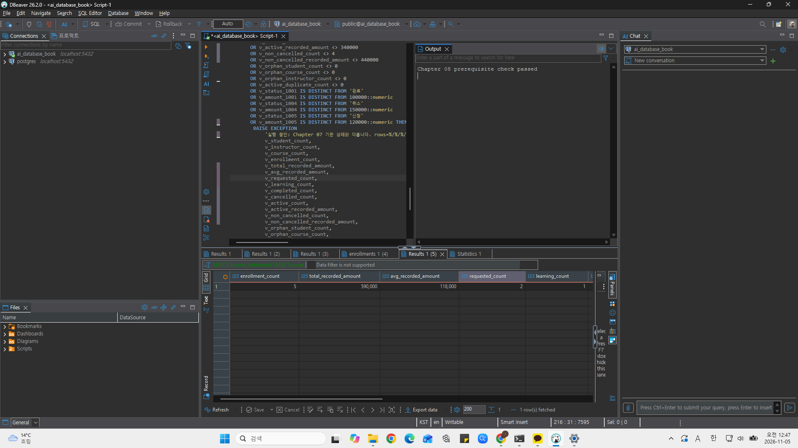
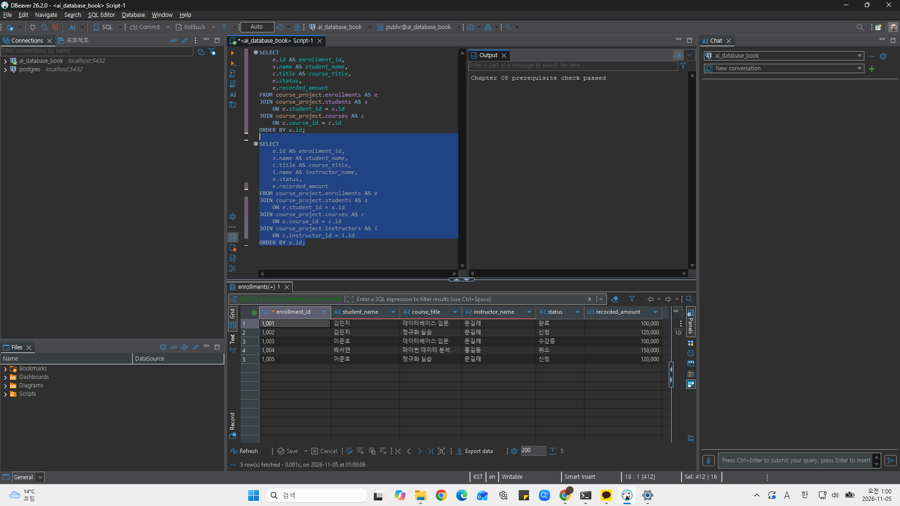
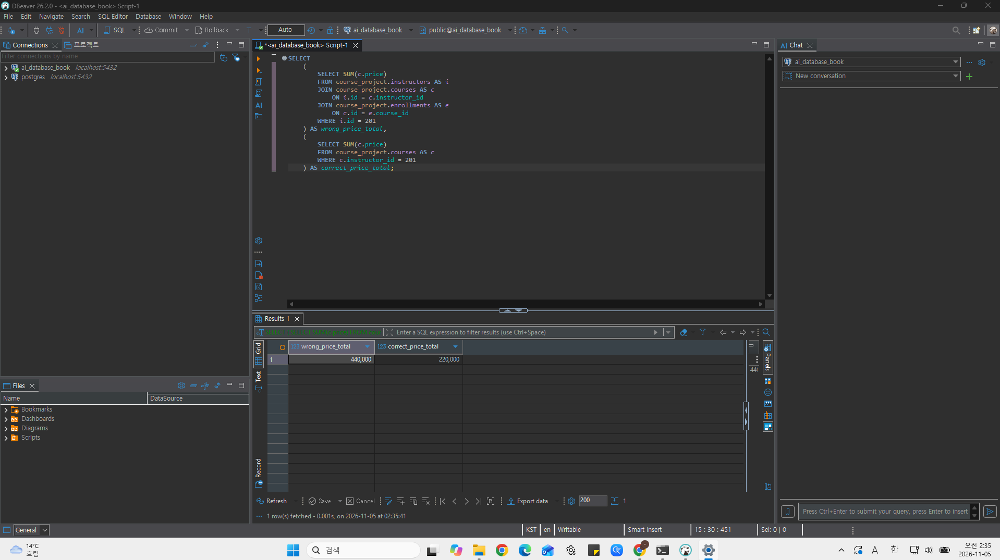

# Chapter 08 확장 실습 답안 템플릿

> **과제:** JOIN과 집계로 서비스 질문에 답하기  
> **사용 방법:** 이 파일을 내려받아 본인의 GitHub 저장소에 `chapter08_answer.md`라는 이름으로 저장한 뒤 실습하면서 바로 작성합니다.  
> **제출 방법:** LMS에는 파일을 직접 업로드하지 않고, **본인 GitHub 저장소의 `chapter08_answer.md` 파일 URL**을 제출합니다.

---

## 제출 전 주의

이 파일과 캡처 화면에는 실제 비밀번호, 전체 DB 접속 URL, API Key, 개인정보를 기록하지 않습니다.

```text
GitHub 계정 또는 별칭: youccode
과제 작성일: 2026.11.05
사용한 AI 도구: chatgpt
```

---

# 1. Chapter 07 기준 상태 확인

다음을 실행합니다.

```text
code/chapter08/00_check_course_project.sql
```

## 1-1. 사전 검사 결과

```text
검증 메시지: Chapter 08 prerequisite check passed

students 행 수: 3행 
instructors 행 수: 2행
courses 행 수: 3행
enrollments 행 수: 5행 

전체 신청 건수: 5건 
전체 recorded_amount: 590000
활성 신청 건수: 3건
활성 recorded_amount: 340000
취소 제외 신청 건수: 4건 
취소 제외 recorded_amount: 440000
```

기준값:

```text
students = 3
instructors = 2
courses = 3
enrollments = 5

전체 = 5 / 590000
활성 = 3 / 340000
취소 제외 = 4 / 440000
```

### 기준값이 다르면 그대로 진행하면 안 되는 이유

```text
이번 실습의 JOIN 결과와 집계 예상값은 Chapter 07의 최종 데이터를 기준으로 정해져 있기 때문이다. 시작 데이터의 행 수나 신청 상태, 기록 금액이 다르면 
SQL이 올바르더라도 예상과 다른 결과가 나올 수 있다. 따라서 먼저 기준 상태를 확인해야 데이터 차이와 SQL 작성 오류를 구분하고, 이후 상세 조회와 
집계 결과를 같은 기준으로 검산할 수 있다.
```

### 증거 화면

권장 경로:

```text
assignments/chapter08/images/step01_prerequisite.png
```



---

# 2. 업무 질문을 SQL보다 먼저 정의하기

다음 세 질문을 각각 SQL 작성 전에 먼저 정의합니다.

## 질문 A

```text
업무 질문: 각 수강신청의 학생 이름, 강의 제목, 담당 강사, 상태와 기록 금액은 무엇인가?
결과 한 행의 의미: 수강신청 한 건이다.
포함 상태: 신청, 수강중, 완료, 취소.
제외 상태: 없음.
JOIN할 테이블: enrollments, students, courses, instructors.
JOIN 경로: enrollments.student_id → students.id, enrollments.course_id → courses.id, courses.instructor_id → instructors.id.
INNER JOIN / LEFT JOIN 선택: INNER JOIN.
그 이유: 신청을 기준으로 연결된 학생·강의·강사 정보를 조회하며, 필수 FK로 연결 대상의 존재가 보장되기 때문이다.
예상 행 수: 5행.
```


## 질문 B

```text
업무 질문: 활성 신청이 있는 강의별로 활성 신청 건수와 기록 금액 합계는 얼마인가?
결과 한 행의 의미: 활성 신청이 있는 강의 한 개의 집계이다.
포함 상태: 신청, 수강중.
제외 상태: 완료, 취소.
JOIN할 테이블: courses, enrollments.
JOIN 경로: courses.id → enrollments.course_id.
집계 대상: 강의별 활성 신청 행 수와 recorded_amount 합계.
예상 결과: 강의 301은 1건/100000, 강의 302는 2건/240000이다. 활성 신청이 없는 강의 303은 제외된다. 합계는 3건/340000이다.
```

## 질문 C

```text
업무 질문: 모든 강의의 취소 제외 신청 건수와 기록 금액 합계는 얼마인가?
결과 한 행의 의미: 강의 한 개의 집계이다.
포함 상태: 신청, 수강중, 완료.
제외 상태: 취소.
0건인 부모도 보여야 하는가: 그렇다. 취소 제외 신청이 없는 강의도 결과에 남겨야 한다.
NULL을 어떻게 해석할 것인가: LEFT JOIN에서 조건에 맞는 신청이 없으면 신청 쪽 열이 NULL이 된다. 이는 강의가 없다는 뜻이 아니라 연결할 신청이 없다는 뜻이다. COUNT(e.id)로 신청을 세고, SUM 결과의 NULL은 COALESCE로 0으로 표시한다.
예상 결과: 강의 301은 2건/200000, 강의 302는 2건/240000, 강의 303은 0건/0이다. 강의는 총 3개이며 신청 합계는 4건/440000이다.
```

---

# 3. INNER JOIN과 다중 JOIN

## 3-1. 신청 한 건마다 학생 이름과 강의 제목 조회

실행 전 예상:

```text
결과 한 행 = 수강신청 한 건에 학생 이름과 강의 제목을 연결한 행이다.
예상 행 수 = 5행
JOIN 경로 = enrollments.student_id → students.id, enrollments.course_id → courses.id.
```

내가 실행한 SQL:

```sql
SELECT
    e.id AS enrollment_id,
    s.name AS student_name,
    c.title AS course_title,
    e.status,
    e.recorded_amount
FROM course_project.enrollments AS e
JOIN course_project.students AS s
    ON e.student_id = s.id
JOIN course_project.courses AS c
    ON e.course_id = c.id
ORDER BY e.id;
```

실제 결과:

```text
실제 행 수: 5행
예상과 일치 여부: 일치하였다. 신청 1001~1005가 각각 한 행으로 조회되었으며 학생 이름과 강의 제목이 올바르게 연결되었다.
```

### 학생 이름이 여러 번 보이는 것이 중복 오류가 아닐 수 있는 이유

```text
결과 한 행의 기준이 학생 한 명이 아니라 수강신청 한 건이기 때문이다. 한 학생이 여러 강의를 신청하면 서로 다른 신청 행에 같은 학생 이름이 반복해서 나타날 수 있다. 따라서 이름의 반복만으로 중복 오류라고 판단하지 않고, 신청 ID와 JOIN 관계를 기준으로 의도한 신청 한 건이 한 행으로 조회되는지 확인해야 한다.
```

## 3-2. 학생·강의·강사까지 연결

```text
결과 한 행 = 수강신청 한 건에 학생, 강의, 담당 강사 정보를 연결한 행이다.
강사까지 가는 JOIN 경로 = enrollments.course_id → courses.id → courses.instructor_id → instructors.id.
```

```sql
SELECT
    e.id AS enrollment_id,
    s.name AS student_name,
    c.title AS course_title,
    i.name AS instructor_name,
    e.status,
    e.recorded_amount
FROM course_project.enrollments AS e
JOIN course_project.students AS s
    ON e.student_id = s.id
JOIN course_project.courses AS c
    ON e.course_id = c.id
JOIN course_project.instructors AS i
    ON c.instructor_id = i.id
ORDER BY e.id;
```

실제 행 수:

```text
5행. 강사 정보를 추가로 연결한 뒤에도 신청 한 건당 한 행이 유지되어 예상과 일치하였다.
```

### 증거 화면

권장 경로:

```text
assignments/chapter08/images/step03_inner_join.png
```



---

# 4. LEFT JOIN과 0건 표현

## 4-1. 강의별 취소 제외 신청 수

신청이 없는 강의도 결과에 남도록 작성합니다.

실행 전:

```text
결과 한 행 = 강의 한 개
강의 303의 예상 실제 신청 수 = 취소 제외 기준 0건
강의 303의 예상 고유 학생 수 = 취소 제외 기준 0명
강의 303의 예상 recorded_amount = 취소 제외 기준 합계 0
```

내 SQL:

```sql
SELECT
    c.id AS course_id,
    c.title AS course_title,
    COUNT(e.id) AS enrollment_count,
    COUNT(DISTINCT e.student_id) AS student_count,
    COALESCE(SUM(e.recorded_amount), 0) AS recorded_amount_total
FROM course_project.courses AS c
LEFT JOIN course_project.enrollments AS e
    ON c.id = e.course_id
   AND e.status <> '취소'
GROUP BY c.id, c.title
ORDER BY c.id;
```

실제 결과:

```text
강의 301: 신청 2건, 고유 학생 2명, recorded_amount 합계 200000.
강의 302: 신청 2건, 고유 학생 2명, recorded_amount 합계 240000.
강의 303: 신청 0건, 고유 학생 0명, recorded_amount 합계 0.
```

## 4-2. `COUNT(*)`와 `COUNT(e.id)` 비교

강의 303을 기준으로 작성합니다.

```text
COUNT(*) 결과: 1
COUNT(e.id) 결과: 0
COUNT(DISTINCT e.student_id) 결과: 0
```

### 왜 `COUNT(*) = 1`인데 실제 신청 수는 0일 수 있나요?

```text
LEFT JOIN은 조건에 맞는 신청이 없어도 왼쪽의 강의 행을 결과에 남긴다. 강의 303은 취소 제외 조건을 만족하는 신청이 없으므로 신청 쪽 열이 NULL인 행 하나가 만들어진다. COUNT(*)는 이 결과 행도 세기 때문에 1이지만, 실제로 연결된 신청은 없으므로 COUNT(e.id)는 0이다.
```

### 자식 사건 수를 셀 때 `COUNT(child.id)`가 더 적절한 이유

```text
COUNT(child.id)는 NULL을 제외하고 실제로 연결된 자식 행의 ID만 세기 때문이다. 자식의 PK는 실제 행에서 NULL이 될 수 없으므로, LEFT JOIN에서 자식이 없어 만들어진 NULL 행과 실제 자식 행을 구분하여 사건 수를 계산할 수 있다.
```

---

# 5. `LEFT JOIN`에서 `ON`과 `WHERE` 조건 비교

취소 제외 신청만 연결한다고 가정합니다.

## 5-1. 조건을 `ON`에 둔 경우

```sql
SELECT
    s.id AS student_id,
    s.name AS student_name,
    COUNT(e.id) AS non_cancelled_count
FROM course_project.students AS s
LEFT JOIN course_project.enrollments AS e
    ON s.id = e.student_id
   AND e.status <> '취소'
GROUP BY s.id, s.name
ORDER BY s.id;
```

```text
결과 학생 수: 3명
박서연 포함 여부: 포함된다. 취소 제외 신청 수가 0으로 표시된다.
```

## 5-2. 조건을 `WHERE`에 둔 경우

```sql
SELECT
    s.id AS student_id,
    s.name AS student_name,
    COUNT(e.id) AS non_cancelled_count
FROM course_project.students AS s
LEFT JOIN course_project.enrollments AS e
    ON s.id = e.student_id
WHERE e.status <> '취소'
GROUP BY s.id, s.name
ORDER BY s.id;
```

```text
결과 학생 수: 2명
박서연 포함 여부: 포함되지 않는다.
```

## 5-3. 차이 설명

```text
ON 조건이 LEFT JOIN의 오른쪽 연결 대상을 제한하는 방식: 취소가 아닌 신청만 학생에게 연결한다. 조건에 맞는 신청이 없어도 왼쪽의 학생 행은 유지되며 신청 쪽 열은 NULL이 된다. 따라서 모든 학생을 표시하면서 취소 제외 신청 수를 셀 수 있다.

WHERE 조건이 JOIN 이후 결과 행을 제거하는 방식: 먼저 학생과 신청을 연결한 다음, 취소가 아닌 조건을 만족하는 행만 남긴다. 취소된 신청 행은 제거되며, 신청이 없어 상태가 NULL인 행도 조건을 만족하지 않아 제거된다.

이번 사례에서 ON = 3명, WHERE = 2명이 되는 이유: 박서연에게는 취소된 신청 1004만 있다. 조건을 ON에 두면 연결할 신청은 없지만 학생 행은 남아 신청 수 0으로 표시된다. 조건을 WHERE에 두면 박서연의 취소 신청 행이 제거되어 결과에서 학생 자체가 사라진다.
```

---

# 6. 신청이 없는 학생 찾기 — 두 방법 비교

## 방법 1. `LEFT JOIN ... IS NULL`

```sql
SELECT
    s.id AS student_id,
    s.name AS student_name
FROM course_project.students AS s
LEFT JOIN course_project.enrollments AS e
    ON s.id = e.student_id
   AND e.status <> '취소'
WHERE e.id IS NULL
ORDER BY s.id;
```

## 방법 2. `NOT EXISTS`

```sql
SELECT
    s.id AS student_id,
    s.name AS student_name
FROM course_project.students AS s
WHERE NOT EXISTS (
    SELECT 1
    FROM course_project.enrollments AS e
    WHERE e.student_id = s.id
      AND e.status <> '취소'
)
ORDER BY s.id;
```

```text
방법 1 결과: 학생 103 박서연 1행.
방법 2 결과: 학생 103 박서연 1행.
두 결과가 같은가: 같다.
찾아진 학생: 박서연. 취소된 신청만 있어 취소 제외 기준을 만족하는 신청은 없다.
```

### 두 방식의 공통 의미를 자신의 말로 설명

```text
두 방식 모두 학생별로 취소가 아닌 신청이 하나도 존재하지 않는 경우를 찾는다. LEFT JOIN 방식은 조건에 맞는 신청을 연결한 뒤 신청 ID가 NULL인 학생을 선택하고, NOT EXISTS 방식은 조건에 맞는 신청의 존재 여부를 검사하여 없는 학생을 선택한다. 표현 방식은 다르지만 동일한 학생 집합을 찾는다.
```

---

# 7. 기본 집계 검산

다음 결과를 직접 확인합니다.

| 분석 범위 | 예상 건수 | 실제 건수 | 예상 금액 | 실제 금액 | 일치? |
| --- | ---: | ---: | ---: | ---: | --- |
| 전체 신청 | 5 | 5 | 590000 | 590000 | 일치 |
| 활성 신청 | 3 | 3 | 340000 | 340000 | 일치 |
| 취소 제외 | 4 | 4 | 440000 | 440000 | 일치 |
| 취소 | 1 | 1 | 150000 | 150000 | 일치 |

## 7-1. 전체 평균 `recorded_amount`

```text
예상 평균: 118000
실제 평균: 118000
```

## 7-2. 취소 제외 평균

```text
예상 평균: 110000
실제 평균: 110000
```

### `recorded_amount`를 실제 회계 매출이라고 부르면 안 되는 이유

```text
recorded_amount는 신청 당시 기록한 금액이며 실제 결제 승인이나 입금, 환불 내역을 나타내지 않기 때문이다. 취소된 신청의 기록 금액도 그대로 남아 있어 전체 합계에는 포함된다. 취소 제외 금액 역시 신청 상태를 기준으로 계산한 합계일 뿐 실제 결제 성공액이나 회계 매출이 확인된 것은 아니다.
```

---

# 8. `GROUP BY`, `HAVING`, `FILTER`

## 8-1. 상태별 신청 건수

```sql
SELECT
    status,
    COUNT(*) AS enrollment_count
FROM course_project.enrollments
GROUP BY status
ORDER BY CASE status
    WHEN '신청' THEN 1
    WHEN '수강중' THEN 2
    WHEN '완료' THEN 3
    WHEN '취소' THEN 4
END;
```

결과:

```text
신청: 2건
수강중: 1건
완료: 1건
취소: 1건
상태별 합계: 5건
```

### 상태별 건수 합이 전체 신청 5건과 맞는지 검산

```text
신청 2건 + 수강중 1건 + 완료 1건 + 취소 1건 = 5건으로 전체 신청 건수와 일치한다. 각 신청은 하나의 상태를 가지므로 상태별 그룹의 건수를 더하면 전체 신청 건수가 된다.
```

## 8-2. 강의별 취소 제외 신청 수와 금액

```sql
SELECT
    c.id AS course_id,
    c.title AS course_title,
    COUNT(e.id) FILTER (
        WHERE e.status <> '취소'
    ) AS non_cancelled_count,
    COALESCE(
        SUM(e.recorded_amount) FILTER (
            WHERE e.status <> '취소'
        ),
        0
    ) AS non_cancelled_amount
FROM course_project.courses AS c
LEFT JOIN course_project.enrollments AS e
    ON c.id = e.course_id
GROUP BY c.id, c.title
ORDER BY c.id;
```

```text
강의 301: 취소 제외 신청 2건, recorded_amount 합계 200000.
강의 302: 취소 제외 신청 2건, recorded_amount 합계 240000.
강의 303: 취소 제외 신청 0건, recorded_amount 합계 0.
강의별 합계를 다시 더한 값: 신청 4건, recorded_amount 440000.
전체 취소 제외 기준 440000과 일치 여부: 일치한다.
```

## 8-3. `HAVING` 사용

취소 제외 신청이 2건 이상인 강의를 조회합니다.

```sql
SELECT
    c.id AS course_id,
    c.title AS course_title,
    COUNT(e.id) FILTER (
        WHERE e.status <> '취소'
    ) AS non_cancelled_count
FROM course_project.courses AS c
LEFT JOIN course_project.enrollments AS e
    ON c.id = e.course_id
GROUP BY c.id, c.title
HAVING COUNT(e.id) FILTER (
    WHERE e.status <> '취소'
) >= 2
ORDER BY c.id;
```

```text
예상 강의 수: 2개
실제 강의 수: 2개
```

---

# 9. 과대 집계 오류 직접 관찰

강사 201의 강의 가격 합계를 구한다고 가정합니다.

## 9-1. 신청까지 JOIN해서 잘못 집계한 결과

```sql
SELECT
    i.id AS instructor_id,
    i.name AS instructor_name,
    SUM(c.price) AS wrong_price_total
FROM course_project.instructors AS i
JOIN course_project.courses AS c
    ON i.id = c.instructor_id
JOIN course_project.enrollments AS e
    ON c.id = e.course_id
WHERE i.id = 201
GROUP BY i.id, i.name;
```

```text
강사 201 잘못된 가격 합계: 440000
```

본문 기준:

```text
440000
```

## 9-2. 강의 수준에서 올바르게 집계

```sql
SELECT
    i.id AS instructor_id,
    i.name AS instructor_name,
    SUM(c.price) AS correct_price_total
FROM course_project.instructors AS i
JOIN course_project.courses AS c
    ON i.id = c.instructor_id
WHERE i.id = 201
GROUP BY i.id, i.name;
```

```text
강사 201 올바른 가격 합계: 220000
```

본문 기준:

```text
220000
```

## 9-3. 왜 두 결과가 달라졌나요?

```text
JOIN 전 강의 행 수: 강사 201의 강의는 301과 302로 총 2행이다.
JOIN 후 강의가 반복된 이유: 강의 301에는 신청 1001과 1003이, 강의 302에는 신청 1002와 1005가 연결되어 있다. 신청까지 JOIN하면 각 강의가 신청 건수만큼 반복되어 총 4행이 된다.
SUM이 무엇을 반복해서 더했는가: 강의 301의 가격 100000을 두 번, 강의 302의 가격 120000을 두 번 더하였다. 따라서 잘못된 합계는 440000이지만, 강의별 가격을 한 번씩 더한 올바른 합계는 220000이다.
```

### `SUM(DISTINCT c.price)`를 일반적인 해결책으로 사용하면 안 되는 이유

```text
SUM(DISTINCT c.price)는 강의 ID가 아니라 가격 값의 중복을 제거하기 때문이다. 서로 다른 두 강의의 가격이 같으면 정상적으로 각각 더해야 할 금액도 한 번만 계산한다. 따라서 우연히 현재 데이터에서 정답이 나오더라도 일반적인 해결책이 될 수 없다. 강의 가격 합계를 구하려면 강의 한 개가 한 행인 수준에서 집계해야 한다.
```

### 증거 화면

권장 경로:

```text
assignments/chapter08/images/step09_over_aggregation.png
```



---

# 10. 상세 결과 ↔ 집계 결과 교차 검산

강의 하나를 선택합니다.

```text
선택한 course_id: 302
강의 제목: 정규화 실습
```

## 10-1. 상세 신청 행 조회

```sql
SELECT
    e.id AS enrollment_id,
    e.student_id,
    e.course_id,
    e.status,
    e.recorded_amount
FROM course_project.enrollments AS e
WHERE e.course_id = 302
  AND e.status <> '취소'
ORDER BY e.id;
```

```text
상세 행 수: 2행
상세 recorded_amount를 직접 더한 값: 240000
```

## 10-2. 집계 SQL

```sql
SELECT
    COUNT(*) AS enrollment_count,
    COALESCE(SUM(recorded_amount), 0) AS recorded_amount_total
FROM course_project.enrollments
WHERE course_id = 302
  AND status <> '취소';
```

```text
집계 건수: 2건
집계 금액: 240000
```

## 10-3. 비교

```text
상세 행 수와 COUNT 결과 일치 여부: 상세 2행과 COUNT 결과 2건이 일치한다.
상세 금액 합과 SUM 결과 일치 여부: 직접 더한 240000과 SUM 결과 240000이 일치한다.
다르다면 원인: 차이가 없다. 두 조회 모두 course_id=302와 취소 제외 조건을 동일하게 적용하였다.
```

---

# 11. 자동 완료 게이트

다음을 실행합니다.

```text
code/chapter08/03_join_aggregation_validation.sql
```

```text
최종 검증 메시지: Chapter 08 join and aggregation validation passed
```

기대 메시지:

```text
Chapter 08 join and aggregation validation passed
```

### 자동 검증이 통과했어도 사람이 SQL 의미를 설명해야 하는 이유

```text
자동 검증은 정해진 데이터와 기준값에 대해 결과가 일치하는지 확인하지만, SQL이 업무 질문의 의미를 올바르게 표현하는지까지 모두 보장하지는 않는다. 결과 한 행의 의미, 포함할 상태, JOIN 경로, 0건인 부모의 표시 여부, COUNT와 SUM의 대상을 사람이 설명할 수 있어야 한다.

특히 잘못된 SQL도 현재 데이터에서는 우연히 같은 결과를 낼 수 있다. 따라서 검증 PASS뿐 아니라 상세 행과 집계 결과를 비교하고, 조건이나 데이터가 달라져도 의도한 의미가 유지되는지 확인해야 한다.
```

---

# 12. 개인 프로젝트 업무 질문 3개 만들기

Chapter 07에서 작성한 개인 프로젝트를 사용합니다.

| 질문 ID | 업무 질문 | 결과 한 행 | 포함/제외 범위 | JOIN 경로 | 집계 대상 | 검산 방법 |
| --- | --- | --- | --- | --- | --- | --- |
| P08-Q01 | 프로젝트에 등록된 논문의 제목, 판본, 출판처와 검토 상태는 무엇인가? | 프로젝트별 논문 등록 한 건 | 모든 검토 상태와 출판처 미등록 논문을 포함. 프로젝트 미등록 논문은 제외 | research_projects → project_papers → papers → venues | 집계 없음. 등록 관계별 상세 조회 | 전체 결과 행 수를 project_papers 행 수와 비교하고, venue_id가 NULL인 논문도 유지되는지 확인 |
| P08-Q02 | 각 프로젝트에 등록된 논문은 몇 개인가? | 프로젝트 한 개 | 논문이 0건인 프로젝트도 포함. 검토 상태로 제한하지 않음 | research_projects → project_papers | 프로젝트별 논문 등록 건수 | 프로젝트별 건수 합을 project_papers 전체 행 수와 비교하고 빈 프로젝트는 0인지 확인 |
| P08-Q03 | 프로젝트의 논문 항목마다 연결된 태그와 작성된 메모는 각각 몇 개인가? | 프로젝트별 논문 등록 한 건 | 태그나 메모가 없는 등록 논문도 포함. 검토 상태로 제한하지 않음 | project_papers → papers, project_paper_tags의 사전 집계, paper_notes의 사전 집계 | 프로젝트·논문별 태그 연결 수와 메모 수 | 특정 항목의 태그·메모를 각각 직접 조회하여 집계와 비교하고, 여러 자식 관계에 의한 과대 집계 여부 확인 |


## 12-1. 질문 1 SQL

```sql
SELECT
    rp.project_id,
    rp.project_name,
    pp.paper_id,
    p.title,
    p.version_label,
    p.paper_type,
    v.venue_name,
    pp.review_status
FROM public.research_projects AS rp
JOIN public.project_papers AS pp
    ON rp.project_id = pp.project_id
JOIN public.papers AS p
    ON pp.paper_id = p.paper_id
LEFT JOIN public.venues AS v
    ON p.venue_id = v.venue_id
ORDER BY rp.project_id, pp.paper_id;
```

```text
예상 결과: 프로젝트별 논문 등록 한 건이 결과 한 행으로 나타난다. 동일 논문이 서로 다른 프로젝트에 등록되어 있으면 프로젝트별로 각각 표시된다. 출판처가 없는 논문도 유지되며 venue_name은 NULL로 나타난다. 검산용 가정으로 프로젝트 P1에 논문 A와 B가 등록되고 P2에는 등록 논문이 없다면 결과는 P1의 등록 관계 2행이다. 이 가정은 실제 Seed 데이터가 아니다.
실제 결과: 미실행. 개인 프로젝트 테이블과 검증용 데이터를 준비한 뒤 실행할 SQL 초안이다.
검산 결과: 미실행. 향후 결과 행 수가 project_papers 전체 행 수와 같은지 확인한다. 각 (project_id, paper_id)가 한 번씩 나타나는지 확인하고, venue_id가 NULL인 논문도 결과에서 누락되지 않는지 대조한다.
```

## 12-2. 질문 2 SQL

```sql
SELECT
    rp.project_id,
    rp.project_name,
    COUNT(pp.paper_id) AS registered_paper_count
FROM public.research_projects AS rp
LEFT JOIN public.project_papers AS pp
    ON rp.project_id = pp.project_id
GROUP BY rp.project_id, rp.project_name
ORDER BY rp.project_id;
```

```text
예상 결과: 프로젝트 한 개가 결과 한 행으로 나타나고, 등록 논문이 없는 프로젝트도 건수 0으로 표시된다. 검토 상태로 필터링하지 않으므로 모든 등록 관계를 센다. 검산용 가정으로 P1에 논문 2개, P2에 논문 0개가 등록되어 있다면 결과는 P1=2, P2=0의 두 행이다.
실제 결과: 미실행. 개인 프로젝트 테이블과 검증용 데이터를 준비한 뒤 실행할 SQL 초안이다.
검산 결과: 미실행. 향후 프로젝트별 건수를 모두 더한 값이 project_papers 전체 행 수와 일치하는지 확인한다. 결과 행 수는 research_projects 전체 행 수와 비교하고, 등록 논문이 없는 프로젝트의 건수가 1이 아닌 0인지 확인한다.
```

## 12-3. 질문 3 SQL

```sql
SELECT
    pp.project_id,
    pp.paper_id,
    p.title,
    COALESCE(t.tag_count, 0) AS tag_count,
    COALESCE(n.note_count, 0) AS note_count
FROM public.project_papers AS pp
JOIN public.papers AS p
    ON pp.paper_id = p.paper_id
LEFT JOIN (
    SELECT
        project_id,
        paper_id,
        COUNT(*) AS tag_count
    FROM public.project_paper_tags
    GROUP BY project_id, paper_id
) AS t
    ON pp.project_id = t.project_id
   AND pp.paper_id = t.paper_id
LEFT JOIN (
    SELECT
        project_id,
        paper_id,
        COUNT(*) AS note_count
    FROM public.paper_notes
    GROUP BY project_id, paper_id
) AS n
    ON pp.project_id = n.project_id
   AND pp.paper_id = n.paper_id
ORDER BY pp.project_id, pp.paper_id;
```

```text
예상 결과: 프로젝트별 논문 등록 한 건이 결과 한 행으로 나타나며 태그 연결 수와 메모 수가 각각 표시된다. 태그나 메모가 없으면 해당 건수는 0이다. 같은 논문이 다른 프로젝트에 등록되어 있어도 project_id와 paper_id를 함께 사용하므로 프로젝트별로 구분된다. 검산용 가정으로 P1의 논문 A에 태그 2개와 메모 3개가 있고 논문 B에는 둘 다 없다면, A는 tag_count=2/note_count=3, B는 0/0으로 나타나야 한다. A의 태그와 메모가 각각 6건으로 부풀려져서는 안 된다.
실제 결과: 미실행. 개인 프로젝트 테이블과 검증용 데이터를 준비한 뒤 실행할 SQL 초안이다.
검산 결과: 미실행. 향후 선택한 (project_id, paper_id)의 태그 연결 행과 메모 행을 각각 직접 조회하여 건수를 비교한다. 전체 결과 행 수가 project_papers 행 수와 같은지 확인하고, 태그와 메모가 여러 개인 항목에서도 과대 집계가 발생하지 않는지 검산한다.
```

> 아직 개인 프로젝트 테이블을 PostgreSQL로 완성하지 않았다면 SQL 초안과 예상 검산 방법까지만 작성하고 `미실행`이라고 명시합니다.

---

# 13. AI를 JOIN·집계 리뷰어로 활용

## 13-1. 내가 AI에게 전달한 질문

```text
나는 PostgreSQL 기반 ‘논문 인용 관계 탐색 및 공동 문헌 조사 서비스’를 설계하고 있다.
첨부한 Chapter 08의 12번 답안을 JOIN·집계 관점에서 검토해 줘.

[프로젝트와 설계]

- papers의 한 행은 공개 논문의 개별 판본 또는 출판 기록이다.
- project_papers의 PK는 (project_id, paper_id)이며 프로젝트별 논문 등록과 검토 상태를 관리한다.
- papers.venue_id는 venues를 참조하고 NULL을 허용한다.
- project_paper_tags의 PK는 (project_id, paper_id, tag_id)이다.
- project_paper_tags는 (project_id, paper_id)로 project_papers를 참조하고,
  (project_id, tag_id)로 project_tags를 참조한다.
- paper_notes의 PK는 note_id이며, (project_id, paper_id)로 project_papers를 참조한다.
- 프로젝트별 논문 항목에는 태그와 메모가 각각 여러 건 연결될 수 있다.
- 검토 상태의 허용 값과 상태 변경 정책은 아직 미확정이다.

[검토할 세 질문]

P08-Q01:
프로젝트에 등록된 논문의 제목, 판본, 출판처와 검토 상태를 조회한다.
결과 한 행은 프로젝트별 논문 등록 한 건이다.
모든 검토 상태를 포함하고, 출판처가 없는 논문도 유지해야 한다.

P08-Q02:
프로젝트별 등록 논문 수를 조회한다.
결과 한 행은 프로젝트 한 개이며, 등록 논문이 없는 프로젝트도 0건으로 표시해야 한다.

P08-Q03:
프로젝트의 논문 항목마다 태그 연결 수와 메모 수를 조회한다.
결과 한 행은 프로젝트별 논문 등록 한 건이다.
태그나 메모가 없는 항목도 포함하며, 두 자식 관계를 연결하면서 과대 집계가 발생하면 안 된다.

[실행 상태]

개인 프로젝트 DB와 검증용 데이터는 아직 준비하지 않았다.
첨부 SQL은 초안이며 실제 실행 결과와 검산 결과는 미실행이다.
답안에 사용한 P1/P2, 논문 A/B, 태그 2개·메모 3개는 검산용 가정이다.
이를 실제 데이터나 실행 성공 결과로 설명하지 마.

[검토 요청]

먼저 첨부된 질문·SQL·예상 결과를 읽고 다음을 확인해 줘.

1. SQL이 업무 질문에 답하며 결과 한 행의 의미를 유지하는가?
2. 포함·제외 범위와 검토 상태 조건이 질문과 일치하는가?
3. JOIN 경로와 복합키 연결 조건이 정확한가?
4. INNER JOIN과 LEFT JOIN의 선택이 적절한가?
5. COUNT 대상과 NULL 처리 방식이 적절한가?
6. 여러 1:N 관계 때문에 행이 늘어나거나 과대 집계될 위험이 있는가?
7. 상세 결과와 집계 결과를 어떤 방법으로 교차 검산해야 하는가?

특히 다음을 확인해 줘.

- 질문 1에서 출판처가 NULL인 논문이 누락되지 않는가?
- 질문 2에서 빈 프로젝트의 COUNT가 1이 아닌 0이 되는가?
- 질문 3에서 태그와 메모를 각각 먼저 집계한 뒤 연결하는 방식이 적절한가?
- 질문 3의 집계와 JOIN에서 project_id와 paper_id를 모두 사용하는가?
- 태그 2개·메모 3개인 항목이 각각 6건으로 잘못 집계되지 않는가?
- SUM(DISTINCT 값)이나 무조건적인 DISTINCT로 오류를 가리는 방식은 없는가?

[답변 형식]

A. SQL별 검토 결과
세 SQL을 각각 ‘유지 가능 / 수정 필요 / 추가 확인 필요’로 판단하고 근거를 설명해 줘.
수정이 필요하다면 수정 SQL과 변경 이유를 제시해 줘.
기존 SQL이 적절하면 불필요하게 바꾸지 말고 유지 이유를 설명해 줘.

B. 다음 표로 비교해 줘.

| 검토 항목 | 기존 SQL의 동작 | AI 제안 | 선택 근거 |
| --- | --- | --- | --- |
| 결과 한 행 | | | |
| 상태 범위 | | | |
| JOIN 경로 | | | |
| INNER/LEFT 선택 | | | |
| COUNT 대상 | | | |
| 과대 집계 위험 | | | |
| 상세 검산 방법 | | | |

C. 정상·경계 사례와 예상 결과
빈 프로젝트, 출판처 없는 논문, 태그·메모 없는 논문,
태그 2개·메모 3개인 논문, 동일 논문이 서로 다른 프로젝트에 등록된 경우를 포함해 줘.

D. 다음 질문에 답해 줘.
“AI SQL이 실행 성공했다고 바로 정답이라고 할 수 없는 이유는 무엇인가?”

[주의사항]

- 실제 실행하지 않은 SQL을 실행하거나 검증한 것처럼 말하지 마.
- 미확정 검토 상태 값을 임의로 만들거나 필터링하지 마.
- 기존 복합 PK와 FK를 누락된 설계로 오해하지 마.
- 없는 문제를 만들기 위해 SQL을 불필요하게 변경하지 마.
- 최종 선택은 내가 판단할 수 있도록 근거를 제공해 줘.
```

## 13-2. 내 SQL과 AI SQL 비교

| 검토 항목 | 내 판단/SQL | AI 제안 | 최종 선택 | 이유 |
| --- | --- | --- | --- | --- |
| 결과 한 행 | Q01·Q03은 프로젝트별 논문 등록 한 건, Q02는 프로젝트 한 개로 정의하였다. | 세 SQL 모두 정의한 결과 단위를 유지하므로 변경이 불필요하다고 판단하였다. | 기존 SQL 유지. | 상세 조회의 복합키와 집계의 GROUP BY 기준이 업무 질문과 일치한다. |
| 상태 범위 | 세 SQL 모두 검토 상태 필터를 사용하지 않았다. | 모든 검토 상태를 포함하는 현재 방식을 유지하도록 제안하였다. | 상태 필터를 추가하지 않음. | 특정 상태를 제외한다는 요구가 없으며 상태 정책도 미확정이다. |
| JOIN 경로 | 기존 FK를 따르며 Q03의 집계와 연결에는 project_id와 paper_id를 모두 사용하였다. | FK 경로와 복합키 연결이 적절하다고 판단하였다. | 기존 JOIN 경로 유지. | 프로젝트별 등록 관계를 구분하고 다른 프로젝트의 태그·메모가 섞이는 것을 방지한다. |
| INNER/LEFT 선택 | Q01의 필수 관계는 INNER JOIN, 출판처는 LEFT JOIN이다. Q02의 등록 관계와 Q03의 자식 집계도 LEFT JOIN으로 연결하였다. | 누락되면 안 되는 프로젝트와 등록 논문을 보존하는 선택이라고 평가하였다. | 기존 JOIN 종류 유지. | 출판처 없는 논문, 빈 프로젝트, 태그·메모 없는 등록 논문을 질문에 맞게 표시한다. |
| COUNT 대상 | Q02는 COUNT(pp.paper_id), Q03의 자식별 사전 집계는 COUNT(*)를 사용하였다. | NULL 확장 행과 실제 자식 행을 구분하는 적절한 방식이라고 판단하였다. | 기존 COUNT 대상 유지. | 빈 프로젝트는 0으로 세고, 사전 집계에서는 실제 태그 연결 행과 메모 행을 센다. |
| 과대 집계 위험 | 태그와 메모를 각각 프로젝트·논문별로 먼저 집계한 뒤 연결하였다. | 사전 집계가 2×3 행 증식을 방지하므로 수정이 불필요하다고 판단하였다. | 기존 사전 집계 유지. | 각 집계 결과가 등록 항목당 최대 한 행이므로 태그 2건과 메모 3건을 각각 정확히 표현한다. |
| 상세 검산 방법 | 전체 행 수와 선택한 항목의 태그·메모 직접 조회 결과를 비교하도록 계획하였다. | 복합키별 중복·누락, 프로젝트별 직접 집계, 자식 건수의 전체 합계 비교를 구체화하였다. | 기존 검산 계획을 보강함. | 전체 합계만으로 놓칠 수 있는 항목별 오류를 확인하기 위해서이다. 실제 실행과 검산은 미실행으로 유지한다. |

### AI가 만든 SQL에서 발견한 위험 또는 확인한 점

```text
실제 답안을 전달한 뒤 AI는 세 SQL 모두 업무 질문과 결과 한 행의 의미에 부합하며 구조를 유지할 수 있다고 판단하였다. 출판처의 LEFT JOIN, 빈 프로젝트에 대한 COUNT(pp.paper_id), 태그와 메모의 개별 사전 집계 및 복합키 연결이 적절하다는 점을 확인하였다.

AI가 추가한 검산 SQL은 그대로 실행할 수 있는 완성 코드와 구분해야 한다. Q01을 넣으라는 주석만 있는 서브쿼리 틀에는 실제 SELECT를 넣어야 하며, 가정용 식별자 'P1'과 'A'는 기존 integer 키에 맞는 실제 ID로 바꾸어야 한다.

또한 복합키별 중복 검사에서 0행이 나온다는 사실만으로 누락까지 없다고 판단할 수는 없다. 전체 행 수와 등록 관계별 키도 함께 대조해야 한다.

따라서 기존 SQL 세 개는 유지하고 검산 절차를 보강하였다. 이번 판단은 정적 SQL 검토 결과이며 실제 실행 성공이나 검산 통과를 의미하지 않는다.
```

### AI SQL이 실행 성공했다고 바로 정답이라고 할 수 없는 이유

```text
SQL 실행 성공은 문법과 참조 대상이 유효하여 DB가 쿼리를 처리했다는 의미이며, 업무 질문에 맞는 결과를 반환했다는 보장은 아니기 때문이다.

출판처가 없는 논문이 INNER JOIN으로 누락되거나, COUNT(*)로 빈 프로젝트가 1건으로 계산되거나, 태그와 메모의 동시 JOIN으로 건수가 부풀려져도 SQL은 실행될 수 있다. 복합키 연결에서 project_id를 빠뜨리면 다른 프로젝트의 데이터가 섞일 수도 있다.

따라서 결과 한 행의 의미, 포함 범위, JOIN 경로, NULL 처리와 집계 단위를 확인하고 정상·경계 사례의 상세 결과와 집계 결과를 교차 검산해야 한다. 현재 개인 프로젝트 SQL은 미실행이므로 실제 데이터에 대한 검증은 구현 이후 수행해야 한다.
```

---

# 14. 최종 성찰

아래 문장은 본인의 말로 작성합니다.

```text
1. JOIN SQL을 작성하기 전에 가장 먼저 정해야 하는 것은
   어떤 업무 질문에 답할 것인지와 결과 한 행이 무엇을 의미하는지이다.

2. LEFT JOIN에서 COUNT(*) 대신 COUNT(child.id)를 검토해야 하는 이유는
   연결된 자식이 없어도 부모를 유지하는 행이 만들어지므로, 실제 자식 수가 0인데 COUNT(*)는 1로 계산할 수 있기 때문이다.

3. ON과 WHERE 조건 위치가 중요한 이유는
   ON은 연결할 대상을 제한하면서 왼쪽 행을 유지하지만, WHERE는 JOIN 이후 조건에 맞지 않는 결과 행을 제거하여 0건인 부모까지 사라지게 할 수 있기 때문이다.

4. 여러 1:N 관계를 JOIN한 뒤 바로 SUM하면 위험한 이유는
   자식 행들의 조합으로 같은 값이 여러 번 나타나 실제보다 큰 합계가 계산될 수 있기 때문이다.

5. 집계 결과를 신뢰하기 전에 가장 좋은 검산 방법 중 하나는
   동일한 조건의 상세 행을 조회하여 직접 센 건수와 더한 금액을 COUNT 및 SUM 결과와 비교하는 것이다.
```

---

# 15. 제출 체크리스트

- [x] `chapter08_answer.md`를 본인 저장소에 만들었다.
- [x] `00_check_course_project.sql`이 통과했다.
- [x] 업무 질문마다 결과 한 행을 먼저 정의했다.
- [x] INNER JOIN과 다중 JOIN을 실행했다.
- [x] LEFT JOIN에서 0건 부모를 확인했다.
- [x] `COUNT(*)`와 `COUNT(child.id)` 차이를 설명했다.
- [x] ON과 WHERE 조건 위치 차이를 직접 비교했다.
- [x] `LEFT JOIN ... IS NULL`과 `NOT EXISTS`를 비교했다.
- [x] 전체/활성/취소 제외 기준값을 직접 검산했다.
- [x] `GROUP BY`, `HAVING`을 사용했다.
- [x] 과대 집계 오류와 수정 결과를 비교했다.
- [x] 상세 결과와 집계 결과를 교차 검산했다.
- [x] `03_join_aggregation_validation.sql`이 통과했다.
- [x] 개인 프로젝트 업무 질문 3개를 작성했다.
- [x] AI SQL을 실행 성공 여부가 아니라 의미와 검산 결과로 평가했다.
- [x] 핵심 캡처는 3~4장 정도만 사용했다.
- [x] 비밀번호·개인정보·비밀정보가 없다.
- [x] GitHub 웹에서 Markdown과 이미지가 정상적으로 보인다.
- [x] 최종 답안을 commit/push했다.

---

# 16. LMS 제출 URL

아래 형식의 **본인 GitHub 파일 URL**을 LMS에 제출합니다.

```text
https://github.com/<본인-GitHub-ID>/<본인-저장소>/blob/main/assignments/chapter08/chapter08_answer.md
```

내 제출 URL:

```text
https://github.com/youccode/database-course-2026-2/blob/main/assignments/chapter08/chapter08_answer.md
```

> 저장소 메인 URL, 교수자 템플릿 URL, Raw URL이 아니라 **작성 완료된 본인 `chapter08_answer.md` 파일 화면 URL**을 제출합니다.
