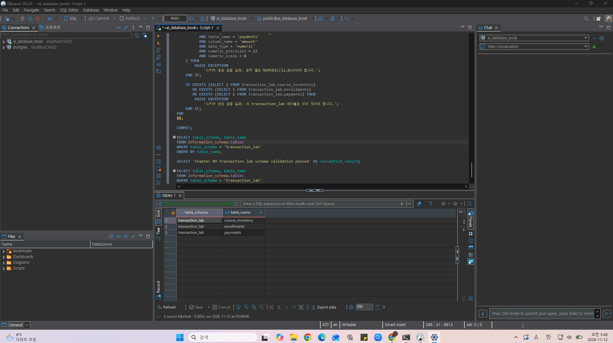
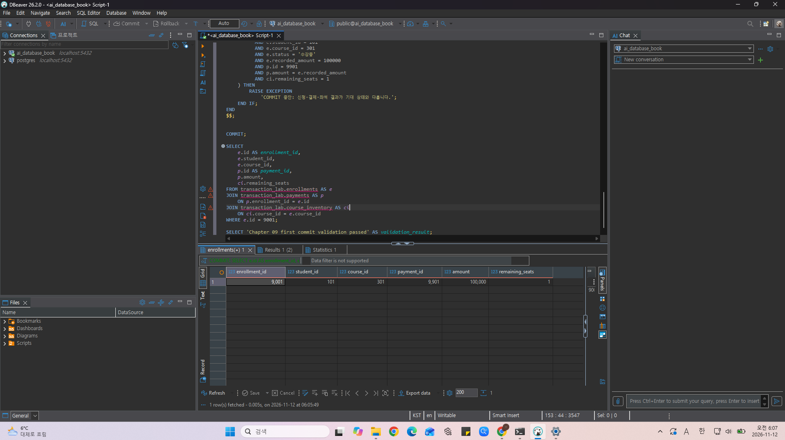
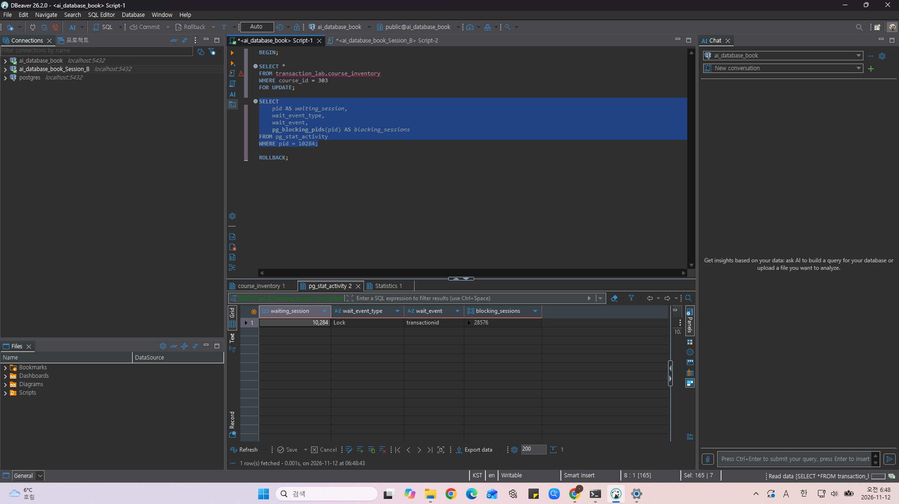

# Chapter 09 확장 실습 답안 템플릿

> **과제:** 트랜잭션으로 데이터 정합성 지키기  
> **사용 방법:** 이 파일을 내려받아 본인의 GitHub 저장소에 `chapter09_answer.md`라는 이름으로 저장한 뒤 실습하면서 바로 작성합니다.  
> **제출 방법:** LMS에는 파일을 직접 업로드하지 않고, **본인 GitHub 저장소의 `chapter09_answer.md` 파일 URL**을 제출합니다.

---

## 제출 전 주의

이 파일과 캡처 화면에는 실제 비밀번호, 전체 DB 접속 URL, API Key, 개인정보를 기록하지 않습니다.

```text
GitHub 계정 또는 별칭: youccode
과제 작성일: 2026.11.12
사용한 AI 도구: chatgpt
```

---

# 1. 시작 환경과 Chapter 07·08 기준 상태 확인

다음을 실행하거나 Chapter 09의 `01_transaction_lab_schema.sql` 사전 검사를 확인합니다.

```sql
SELECT current_database();
SELECT current_user;
SELECT current_schema();
SHOW search_path;
SHOW transaction_read_only;
```

| 확인 항목 | 실제 결과 | 의미 |
| --- | --- | --- |
| `current_database()` | `ai_database_book` | 현재 접속한 데이터베이스 |
| `current_user` | `postgres` | 현재 SQL을 실행하는 DB 역할 |
| `current_schema()` | `public` | 현재 검색 경로에서 우선 적용되는 스키마 |
| `search_path` | `public, "$user"` | public, 현재 사용자 이름의 스키마 순서로 객체를 검색함 |
| `transaction_read_only` | `off` | 현재 트랜잭션이 읽기 전용이 아니므로 데이터 변경 가능 |

Chapter 07·08 기준값:

```text
students = 3
instructors = 2
courses = 3
enrollments = 5
전체 recorded_amount = 590000
활성 = 3 / 340000
취소 제외 = 4 / 440000
```

### 기준 상태가 다르면 Chapter 09를 계속 진행하면 안 되는 이유

```text
Chapter 09는 Chapter 07·08에서 완성한 학생·강의·수강신청 데이터와 금액을 기준으로 진행한다. 기준 상태가 다르면 실습의 사전 조건과 예상 결과가 맞지 않아, 기존 데이터 문제와 트랜잭션 처리 문제를 구분하기 어렵다.

따라서 시작 전에 기존 데이터의 행 수와 상태별 금액을 확인해야 한다. 이후 transaction_lab에서 실습한 뒤에도 course_project의 기준값이 유지되는지 비교하여 기존 데이터가 변경되지 않았음을 확인한다.
```

---

# 2. `transaction_lab` 스키마 생성

실행 파일:

```text
code/chapter09/01_transaction_lab_schema.sql
```

## 2-1. 생성 전 예상

```text
생성될 스키마: transaction_lab
생성될 테이블 3개: course_inventory, enrollments, payments

course_inventory 한 행의 의미: 강의 하나의 전체 정원과 현재 남은 좌석 정보를 나타낸다.
enrollments 한 행의 의미: 학생 한 명이 강의 하나를 신청한 실습용 신청 기록을 나타낸다.
payments 한 행의 의미: 실습용 신청 한 건에 연결된 결제 기록을 나타낸다.
```

## 2-2. 생성 결과

```text
통과 메시지: Chapter 09 transaction lab schema validation passed
```

기대 메시지:

```text
Chapter 09 transaction lab schema validation passed
```

### Chapter 07·08의 `course_project`와 별도 `transaction_lab`을 사용하는 이유

```text
Chapter 07·08에서 완성한 course_project의 기준 데이터를 유지하면서, 좌석 차감·신청 생성·결제 생성을 묶는 트랜잭션을 실습하기 위해 별도의 transaction_lab 스키마를 사용한다.

실습용 신청과 결제는 transaction_lab에 저장하고, 학생과 강의는 FK로 course_project의 기존 데이터를 참조한다. 이를 통해 기존 신청 기록을 변경하지 않고 COMMIT과 ROLLBACK의 동작을 확인할 수 있다.
```

### 증거 화면

권장 경로:

```text
assignments/chapter09/images/step02_schema.png
```



---

# 3. 초기 좌석과 기준 데이터 입력

실행 파일:

```text
code/chapter09/02_transaction_lab_seed.sql
```

## 3-1. 실행 전 예상

```text
course 301 remaining_seats 예상: 2
course 302 remaining_seats 예상: 1
course 303 remaining_seats 예상: 1
lab enrollments 예상 행 수: 0
payments 예상 행 수: 0
```

## 3-2. 실제 결과

```text
course 301 remaining_seats: 2
course 302 remaining_seats: 1
course 303 remaining_seats: 1
lab enrollments 행 수: 0
payments 행 수: 0
통과 메시지: Chapter 09 transaction lab seed validation passed
```

기대 초기 상태:

```text
course 301 / 302 / 303 remaining_seats = 2 / 1 / 1
lab enrollments = 0
payments = 0
```

### 예상과 실제가 다른 경우 원인

```text
제공된 seed SQL을 기준으로 예상한 값과 실제 결과가 일치하였다.
답안 템플릿의 기대 초기 상태는 3 / 0 / 0으로 기재되어 있었으나,
seed SQL과 후속 실습의 사전 조건에 맞게 2 / 1 / 1로 정정하였다.
```

---

# 4. 첫 번째 정상 COMMIT 추적

실행 파일:

```text
code/chapter09/03_commit_transaction.sql
```

이 실습은 학생 101이 강의 301을 신청하는 하나의 업무 단위를 추적합니다.

## 4-1. 업무 단위 정의

```text
이 트랜잭션에서 함께 성공해야 하는 변경 1: 강의 301의 남은 좌석을 2에서 1로 차감한다.
변경 2: 학생 101의 강의 301 신청 기록 9001을 생성하고, 상태는 수강중이며 recorded_amount는 100000으로 기입한다.
변경 3: 신청 9001에 연결된 결제 기록 9901을 생성하고, 결제 금액은 100000이다.

하나라도 실패하면 전체를 취소해야 하는 이유: 좌석만 줄거나 신청·결제 중 일부만 생성되면 실제 좌석 사용량과 신청·결제 기록이 일치하지 않기 때문이다. 세 변경을 모두 반영하거나 모두 취소해야 한다.
```

## 4-2. 상태 변화 기록

| 시점 | course 301 남은 좌석 | lab enrollment 9001 | payment 9901 | 설명 |
| --- | ---: | --- | --- | --- |
| BEGIN 전 | 2 | 없음 | 없음 | 신청 처리 전 초기 상태 |
| 트랜잭션 내부 | 1 | 생성됨 | 생성됨 | 세 변경이 현재 트랜잭션에 반영되었으나 아직 미확정 |
| COMMIT 후 | 1 | 유지됨 | 유지됨 | 좌석·신청·결제 변경이 함께 확정됨 |

## 4-3. COMMIT 조건

```text
좌석 UPDATE 기대 영향 행 수: 1
실제 영향 행 수: 1, 대상 좌석이 2에서 1로 변경됨을 확인
신청 생성 기대 행 수: 1
결제 생성 기대 행 수: 1
recorded_amount와 payment.amount 일치 여부: 둘 다 100000으로 일치
최종 COMMIT 판단: 신청·결제 각 1행과 남은 좌석 1을 확인하고, COMMIT 전 검증을 통과하여 COMMIT하였다.
```

기대 메시지:

```text
Chapter 09 first commit validation passed
```

### SQL 오류가 없었다는 사실만으로 COMMIT하면 안 되는 이유

```text
SQL이 오류 없이 실행되어도 조건에 맞는 행이 없어 UPDATE가 0행일 수 있다. 또한 신청과 결제가 연결되었는지, 두 금액이 일치하는지, 좌석이 정확히 차감되었는지는 별도로 확인해야 한다.

따라서 각 변경의 영향 행 수와 최종 데이터의 관계가 업무 조건을 만족하는지 검증한 뒤 COMMIT해야 한다.
```

### 증거 화면

권장 경로:

```text
assignments/chapter09/images/step04_commit.png
```



---

# 5. ROLLBACK으로 전체 원상복구 확인

실행 파일:

```text
code/chapter09/04_rollback_transaction.sql
```

## 5-1. ROLLBACK 전 예상

```text
트랜잭션 안에서 임시로 바뀔 값: 강의 302의 남은 좌석이 1에서 0으로 줄어든다. 학생 102의 강의 302 신청 9002와 결제 9902가 생성된다. 신청 기록 금액과 결제 금액은 각각 120000이다.
ROLLBACK 후 다시 돌아와야 할 값: 강의 302의 남은 좌석이 1로 복구되고, 임시로 생성한 신청 9002와 결제 9902는 남지 않아야 한다.
이미 이전 파일에서 COMMIT된 9001/9901은 유지되어야 하는가: 유지되어야 한다. 이번 ROLLBACK은 현재 트랜잭션의 변경만 취소하며, 이전 트랜잭션에서 COMMIT한 변경은 취소하지 않는다.
```

## 5-2. 실제 결과

```text
ROLLBACK 후 course 301 상태: 남은 좌석 1로 이전 COMMIT 상태 유지 
ROLLBACK 후 lab enrollments 행 수: 1
ROLLBACK 후 payments 행 수: 1
9001 존재 여부: 존재함
9901 존재 여부: 존재함 
통과 메시지: Chapter 09 rollback validation passed
```

기대 메시지:

```text
Chapter 09 rollback validation passed
```

## 5-3. ROLLBACK과 IDENTITY

```text
ROLLBACK이 테이블 행 변경을 되돌리는 방식: 현재 트랜잭션에서 수행한 INSERT·UPDATE·DELETE를 취소한다. 이번 실습에서는 신청 9002와 결제 9902가 남지 않고,
강의 302의 남은 좌석이 1로 복구된다. 이전에 COMMIT한 신청 9001과 결제 9901은 유지된다.

IDENTITY 자동 번호가 반드시 이전 값으로 되돌아가지는 않는 이유: IDENTITY의 자동 번호를 발급하는 시퀀스에서 이미 사용한 값은
트랜잭션을 ROLLBACK하더라도 일반적으로 회수되지 않기 때문이다.

번호가 건너뛰었다고 데이터 손상이라고 단정할 수 없는 이유: 자동 번호는 행을 고유하게 식별하기 위한 값이며, 빈틈없는 연속 번호를 보장하는 값은 아니기 때문이다.
번호의 연속성보다 필요한 행과 관계가 올바른지 확인해야 한다.
```

---

# 6. 두 번째 COMMIT과 좌석 부족 0행 관찰

실행 파일:

```text
code/chapter09/05_commit_and_sold_out.sql
```

## 6-1. 두 번째 정상 COMMIT

```text
생성된 enrollment id: 9002
학생 id: 103
course id: 302
recorded_amount: 120000
payment id: 9902
payment amount: 120000
```

## 6-2. 좌석 부족 시도

```text
좌석 확보 UPDATE 기대 영향 행 수: 0
실제 영향 행 수: 0
후속 enrollment 생성 행 수: 0
후속 payment 생성 행 수: 0
```

기준상 좌석 부족 시 생성되지 않아야 하는 ID:

```text
9003
9903
```

### `UPDATE 0`이 SQL 실패가 아니라 업무상 실패일 수 있는 이유

```text
UPDATE 0은 SQL이 정상 실행되었지만 조건을 만족하여 변경된 행이 없다는 뜻이다. 이번 실습에서는 남은 좌석이 0이므로 remaining_seats > 0 조건을 만족하지 못한다. 문법이나 실행 오류는 없지만, 업무상으로는 좌석 확보에 실패한 것이다.
```

### 영향 행 수가 0인데 신청과 결제를 계속 생성하면 어떤 정합성 문제가 생기나요?

```text
좌석을 확보하지 못했는데 신청과 결제가 생성되어 정원을 초과한 신청이나 좌석 없는 결제가 발생할 수 있다. 또한 실제 좌석 사용량과 수강중 신청 수가 일치하지 않게 된다. 따라서 좌석 확보에 성공한 경우에만 후속 신청과 결제를 생성해야 한다.
```

---

# 7. 주 실습 최종 정합성 검증

실행 파일:

```text
code/chapter09/06_transaction_validation.sql
```

## 7-1. lab 최종 상태

| 항목 | 기대값 | 실제값 | 일치? |
| --- | ---: | ---: | --- |
| course_inventory 행 수 | 3 | 3 | 일치 |
| lab enrollments 행 수 | 2 | 2 | 일치 |
| payments 행 수 | 2 | 2 | 일치 |
| course 301 remaining | 1 | 1 | 일치 |
| course 302 remaining | 0 | 0 | 일치 |
| course 303 remaining | 1 | 1 | 일치 |

## 7-2. 주요 행

```text
9001 = student 101 / course 301 / amount 100000 / payment 9901
실제: student 101 / course 301 / recorded_amount 100000 / payment 9901 / payment amount 100000으로 기대값과 일치하였다.

9002 = student 103 / course 302 / amount 120000 / payment 9902
실제: student 103 / course 302 / recorded_amount 120000 / payment 9902 / payment amount 120000으로 기대값과 일치하였다.

9003·9903 = 존재하지 않아야 함
실제: 신청 9003과 결제 9903의 조회 건수가 각각 0건으로, 두 기록 모두 존재하지 않았다.
```

## 7-3. 보호 대상 확인

```text
course_project.enrollments 행 수: 5
전체 recorded_amount: 590000
활성 건수/금액: 3 / 340000
취소 제외 건수/금액: 4 / 440000
```

기대값:

```text
course_project.enrollments = 5
전체 = 590000
활성 = 3 / 340000
취소 제외 = 4 / 440000
```

최종 기대 메시지:

```text
Chapter 09 main transaction validation passed
```

### transaction_lab 실습 후에도 course_project 기준 상태를 다시 검사하는 이유

```text
트랜잭션 실습 과정에서 기존 course_project 데이터가 실수로 변경되지 않았는지 확인하기 위해서이다. transaction_lab의 결과가 올바르더라도 기존 데이터가 변경되었다면 보호 대상이 유지되었다고 볼 수 없다.

실습 후 기존 신청 행 수와 전체·활성·취소 제외 금액을 다시 조회한 결과, 실습 전 기준값과 모두 일치하여 해당 기준 상태가 유지되었음을 확인하였다.
```

---

# 8. ACID를 이번 실습으로 설명

교과서 정의를 그대로 복사하지 말고 이번 좌석·신청·결제 사례로 작성합니다.

```text
Atomicity: 좌석 차감·신청 생성·결제 생성을 하나의 트랜잭션으로 처리하여 모두 반영하거나 모두 취소한다. ROLLBACK 실습에서는 강의 302의 좌석이 복구되고
임시 신청 9002와 결제 9902가 모두 사라졌다.

Consistency: 트랜잭션 전후에 데이터가 업무 규칙과 제약조건을 만족해야 한다. 이번 실습에서는 남은 좌석이 허용 범위 안에 있고, 사용 좌석 수와 수강중 
신청 수가 같으며, 신청 기록 금액과 결제 금액이 일치하는지 검증하였다.

Isolation: 동시에 같은 강의를 신청하더라도 서로의 처리가 충돌하지 않도록 해야 한다. 이번 SQL은 SELECT ... FOR UPDATE로 해당 좌석 행을 잠가, 
다른 트랜잭션이 같은 행을 변경하려면 잠금이 해제될 때까지 기다리도록 한다.

Durability: COMMIT한 변경은 트랜잭션이 끝난 뒤에도 유지된다. 첫 번째 COMMIT으로 확정한 신청 9001과 결제 9901은 이후 다른 트랜잭션을 ROLLBACK한 뒤에도 그대로 남아 있었다.
```

### Atomicity와 Consistency가 같은 뜻이 아닌 이유

```text
Atomicity는 여러 변경을 전부 반영하거나 전부 취소하는 성질이고, Consistency는 변경 전후의 데이터가 제약조건과 업무 규칙을 만족하는 성질이다.

예를 들어 좌석을 차감하지 않고 신청과 결제만 하나의 트랜잭션으로 모두 저장하면, 작성한 변경은 원자적으로 처리되더라도 사용 좌석 수와 신청 수가 일치해야 한다는 규칙은 깨질 수 있다. 따라서 변경을 하나로 묶는 것뿐 아니라 필요한 변경이 빠짐없이 포함되었는지와 최종 상태가 올바른지도 검증해야 한다.
```

---

# 9. 선택 실습 — 두 세션 Lock 대기 관찰

실행 파일:

```text
code/chapter09/07_concurrency_two_sessions.sql
```

가능하면 DBeaver에서 **서로 다른 두 연결 세션**으로 수행합니다.

## 9-1. 내 환경

```text
실제 두 세션 실습 수행 / 절차 분석만 수행: 실제 두 세션 실습 수행
transaction_isolation: read committed
lock_timeout: Session B에서 SET LOCAL로 30s 설정
```

## 9-2. 시간 순서 기록

| 순서 | Session A | Session B | 관찰 |
| ---: | --- | --- | --- |
| 1 | BEGIN 후 강의 303을 FOR UPDATE로 조회 | 실행 전 | A가 해당 좌석 행의 잠금을 획득함 |
| 2 | 잠금 유지 | BEGIN 후 같은 행을 FOR UPDATE로 조회 | B가 A의 잠금 해제를 기다림 |
| 3 | 대기 상태 조회 | 잠금 대기 후 시간 초과 | B의 wait_event_type은 Lock, blocking_sessions는 A의 세션 번호 28576으로 확인됨. 이후 B에서 lock timeout 오류가 발생함 |
| 4 | ROLLBACK으로 잠금 해제 | ROLLBACK으로 오류 상태 종료 | 두 트랜잭션을 정리함 |

```text
먼저 Lock을 획득한 세션: Session A, 세션 번호 28576
대기한 세션: Session B, 세션 번호 10284
A가 COMMIT/ROLLBACK한 뒤 B에서 일어난 일: B는 A의 종료 전에 30초 제한을 초과하여 lock timeout 오류가 발생했다.
따라서 A가 ROLLBACK한 뒤에도 실패한 조회가 자동으로 재개되지는 않았으며, B에서도 ROLLBACK하여 오류 상태의 트랜잭션을 종료하였다.
```

### Lock 대기와 Deadlock의 차이

```text
Lock 대기는 다른 트랜잭션이 가진 잠금이 해제되기를 기다리는 상황이다. 이번에는 B가 A의 잠금 해제를 기다리다가 설정된 제한 시간을 초과하였다.

Deadlock은 여러 트랜잭션이 서로가 가진 잠금을 기다리는 순환 대기 상태이다. 이번에는 A가 B를 기다리지 않았으므로 Deadlock이 아니라 단순 잠금 대기와 시간 초과에 해당한다.
```

### `SELECT ... FOR UPDATE`가 모든 UPDATE 앞에 항상 필요한 것은 아닌 이유

```text
UPDATE 자체도 변경 대상 행에 잠금을 획득하기 때문이다. 조건부 UPDATE와 RETURNING을 사용하면 조건을 만족하는 행을 변경하면서 성공 여부를 확인할 수 있다.

SELECT ... FOR UPDATE는 행을 먼저 잠근 상태에서 값을 읽고 여러 후속 판단이나 변경을 수행해야 할 때 유용하다.
```

### 증거 화면

실제 수행했다면 권장 경로:

```text
assignments/chapter09/images/step09_lock.png
```



---

# 10. 선택 실습 — 취소와 좌석 복구

실행 파일:

```text
code/chapter09/08_cancel_and_restore.sql
```

```text
9001 취소 성공 행 수: 1
course 301 좌석 변화: 취소 시 1 → 2
같은 취소를 다시 시도한 행 수: 0
두 번째 좌석 복구 행 수: 0
payment 9901 유지 여부: 유지됨. 결제 금액 100000도 유지됨.
최종 ROLLBACK 후 원상복구 여부: 신청 9001은 수강중, 강의 301의 남은 좌석은 1로 복구됨.
통과 메시지: Chapter 09 cancel rollback validation passed
```

기대 흐름:

```text
9001 수강중 → 취소 1행
course 301 remaining 1 → 2
같은 취소 재시도 → 0행
추가 좌석 복구 → 0행
마지막 ROLLBACK → 주 실습 기준으로 복구
```

### 같은 취소를 두 번 처리해도 좌석이 두 번 증가하지 않아야 하는 이유

```text
신청 한 건이 사용한 좌석은 한 자리이므로, 같은 신청의 취소를 반복 처리해도 좌석은 한 번만 복구되어야 한다. 반복 요청마다 좌석을 증가시키면 실제보다 많은 좌석이 남은 것으로 기록된다.

따라서 수강중에서 취소로 상태가 변경된 행만 좌석 복구에 사용한다. 이미 취소된 신청은 상태 변경이 0행이므로 추가 좌석 복구도 0행이 된다.
```

---

# 11. 선택 실습 — 오류 상태와 SAVEPOINT

실행 파일:

```text
code/chapter09/09_error_and_savepoint.sql
```

## 11-1. 일반 오류 후 트랜잭션 상태

```text
발생시킨 오류: 이미 존재하는 학생 101·강의 301의 수강중 신청을 추가하여 uq_transaction_enrollments_active 고유성 위반 오류(23505)가 발생하였다.
오류 이후 다음 SQL 실행 결과: SELECT 1을 실행했지만, 현재 트랜잭션이 오류 상태이므로 명령을 실행할 수 없다는 오류(25P02)가 발생하였다.
전체 ROLLBACK이 필요한 이유: SAVEPOINT 없이 오류가 발생하여 현재 트랜잭션을 계속 사용할 수 없었기 때문이다. ROLLBACK으로 오류 상태를 종료하고 
오류 전에 수행한 임시 좌석 차감도 취소하였다.
```

## 11-2. SAVEPOINT 사용

```text
SAVEPOINT 이름: before_duplicate_enrollment
오류 발생 위치: SAVEPOINT 이후 좌석을 임시 차감한 다음, 신청 9003을 추가하는 INSERT 문 실행 단계에서 구문 오류(42601)가 발생하였다.
ROLLBACK TO SAVEPOINT 후 상태: 강의 301의 남은 좌석이 0에서 1로 복구되었고, 신청 9003의 조회 건수는 0건이었다.
이후 계속 실행할 수 있었는가: 가능하였다. ROLLBACK TO SAVEPOINT 이후 결과 확인 SELECT가 정상 실행되었다.
```

### SAVEPOINT가 전체 ROLLBACK과 다른 점

```text
전체 ROLLBACK은 현재 트랜잭션의 모든 변경을 취소하고 트랜잭션을 종료한다.

ROLLBACK TO SAVEPOINT는 지정한 SAVEPOINT 이후의 변경만 취소하고, 그 이전의 변경과 트랜잭션은 유지하여 작업을 계속할 수 있게 한다.
이번에는 SAVEPOINT 이후의 임시 좌석 차감을 취소하고 오류 상태를 복구하였다.
```

---

# 12. 개인 프로젝트 트랜잭션 시나리오 설계

Chapter 07에서 시작한 개인 프로젝트를 사용합니다.

둘 이상의 변경이 함께 성공해야 하는 업무를 **하나** 선택합니다.

예:

```text
예약 생성 + 좌석 차감
주문 생성 + 재고 차감
대여 생성 + 대여 가능 상태 변경
답변 등록 + 질문 상태 변경
```

## 12-1. 업무 정의

```text
시나리오 ID: P09-T01
업무 이름: 프로젝트 논문에 태그와 설명 메모 함께 저장
사용자 행동: 프로젝트 구성원이 등록된 논문 항목에서 해당 프로젝트의 태그 하나를 선택하고, 태그 지정 이유를 설명하는 메모를 입력한 뒤 함께 저장한다.
왜 하나의 트랜잭션이어야 하는가: 이번 저장 요청은 태그 연결과 설명 메모를 함께 등록하는 업무이다. 태그만 연결되거나 메모만 저장되면 사용자가 요청한 내용이 일부만 반영된다.
따라서 두 변경을 모두 반영하거나 모두 취소해야 한다.
```

## 12-2. 트랜잭션 설계표

| 항목 | 내 설계 |
| --- | --- |
| BEGIN 전 확인 상태 | 대상 논문이 프로젝트에 등록되어 있고, 사용자가 해당 프로젝트의 구성원이며, 선택한 태그도 같은 프로젝트에 속해야 한다. 해당 태그 연결은 아직 없어야 하고 메모 내용이 입력되어 있어야 한다. 사전 확인 결과는 BEGIN 이후 잠금을 획득한 상태에서 다시 검사한다. |
| 잠금/경쟁 가능 데이터 | 구성원 탈퇴, 논문 등록 관계 삭제, 태그 변경·삭제, 동일 태그 연결의 동시 추가가 가능하다. project_members 행은 FOR SHARE, project_papers 행은 FOR UPDATE, project_tags 행은 FOR SHARE로 순서대로 잠근다. 동일 업무에서는 같은 잠금 순서를 사용한다. |
| 변경 1 | project_paper_tags에 대상 프로젝트·논문·태그의 연결을 추가한다. |
| 기대 영향 행 수 | 태그 연결 INSERT 1행 |
| 변경 2 | paper_notes에 같은 프로젝트·논문에 대한 작성자의 설명 메모를 추가한다. |
| 기대 영향 행 수 | 메모 INSERT 1행 |
| 추가 변경 | 없음 |
| COMMIT 전 검증 | 두 INSERT의 반환 행 수가 각각 1인지 확인한다. 생성된 note_id로 메모를 식별하여 프로젝트·논문·작성자·내용을 확인하고, 태그 연결 및 태그의 프로젝트가 같은지 검증한다. |
| COMMIT 조건 | 구성원·등록 논문·동일 프로젝트 태그 확인을 통과하고, 태그 연결과 메모가 각각 1행 생성되며 최종 검증이 일치할 때 |
| ROLLBACK 조건 | 필수 대상 조회가 0행이거나, 태그의 프로젝트가 다르거나, 이미 연결된 태그이거나, INSERT 오류·반환 행 수 불일치·최종 검증 불일치가 발생할 때 |

## 12-3. 실패 시나리오

최소 두 개 작성합니다.

```text
실패 1: 다른 프로젝트에 속한 태그를 선택하였다.
어느 단계에서 발생: BEGIN 이후 선택한 태그를 project_id와 tag_id로 함께 조회하는 단계
남으면 안 되는 부분 상태: 다른 프로젝트 태그가 연결되거나, 태그 연결 없이 이번 설명 메모만 저장된 상태
ROLLBACK 후 기대 상태: 이번 요청으로 생성된 태그 연결과 메모가 없어야 하며 기존 데이터는 유지되어야 한다.

실패 2: 태그 연결은 추가되었지만 메모 저장에 실패하였다.
어느 단계에서 발생: 변경 2의 paper_notes INSERT 단계에서 해당 테이블의 INSERT 권한 부족으로 오류 발생
남으면 안 되는 부분 상태: 설명 메모 없이 이번 요청의 태그 연결만 남아 있는 상태
ROLLBACK 후 기대 상태: 앞서 추가한 태그 연결도 취소되고 이번 메모도 존재하지 않아야 한다. 기존 태그 연결과 메모는 유지되어야 한다.
```

## 12-4. SQL 초안

```sql
-- 아직 테이블 구현 전이라면 의사 SQL이어도 됩니다.
-- 미실행 의사 SQL이다. DBeaver에서 그대로 실행하지 않는다.
-- :project_id, :paper_id, :tag_id, :user_id, :content는 입력값이다.
-- ASSERT와 IF는 실행 계층의 판단을 표현한 의사 코드이다.
-- ASSERT 실패 또는 SQL 오류 시 즉시 전체 ROLLBACK 후 중단한다.
--
-- Chapter 07·08의 개선 설계를 전제로 한다.
-- project_paper_tags의 복합 FK:
--   (project_id, paper_id) → project_papers
--   (project_id, tag_id)   → project_tags

BEGIN;

-- 1. 작성 시점의 구성원 여부를 확인하고 탈퇴와의 경쟁을 제어한다.
SELECT project_id, user_id
FROM public.project_members
WHERE project_id = :project_id
  AND user_id = :user_id
FOR SHARE;

ASSERT 반환_행_수 = 1;

-- 2. 프로젝트별 논문 등록 관계를 확인하고 잠근다.
SELECT project_id, paper_id
FROM public.project_papers
WHERE project_id = :project_id
  AND paper_id = :paper_id
FOR UPDATE;

ASSERT 반환_행_수 = 1;

-- 3. 태그가 같은 프로젝트에 속하는지 확인하고 잠근다.
SELECT project_id, tag_id
FROM public.project_tags
WHERE project_id = :project_id
  AND tag_id = :tag_id
FOR SHARE;

ASSERT 반환_행_수 = 1;
ASSERT :content IS NOT NULL;

-- 4. 이번 업무는 새로운 태그 연결을 추가하는 요청이다.
SELECT COUNT(*)
FROM public.project_paper_tags
WHERE project_id = :project_id
  AND paper_id = :paper_id
  AND tag_id = :tag_id;

ASSERT 조회_건수 = 0;

-- 5. 태그 연결 추가
INSERT INTO public.project_paper_tags (
    project_id, paper_id, tag_id
)
VALUES (
    :project_id, :paper_id, :tag_id
)
RETURNING project_id, paper_id, tag_id;

ASSERT 반환_행_수 = 1;

-- 6. 설명 메모 추가
INSERT INTO public.paper_notes (
    project_id, paper_id, author_user_id, content
)
VALUES (
    :project_id, :paper_id, :user_id, :content
)
RETURNING note_id;

ASSERT 반환_행_수 = 1;
-- 반환된 note_id를 :new_note_id에 보관한다.

-- 7. 이번에 생성한 연결과 메모를 함께 검증한다.
SELECT
    ppt.project_id,
    ppt.paper_id,
    ppt.tag_id,
    n.note_id,
    n.author_user_id,
    n.content
FROM public.project_paper_tags AS ppt
JOIN public.project_tags AS t
    ON t.project_id = ppt.project_id
   AND t.tag_id = ppt.tag_id
JOIN public.paper_notes AS n
    ON n.project_id = ppt.project_id
   AND n.paper_id = ppt.paper_id
WHERE ppt.project_id = :project_id
  AND ppt.paper_id = :paper_id
  AND ppt.tag_id = :tag_id
  AND n.note_id = :new_note_id
  AND n.author_user_id = :user_id
  AND n.content = :content;

IF 최종_검증_결과가_입력과_일치하는_1행 THEN
    COMMIT;
ELSE
    ROLLBACK;
END IF;
```

---

# 13. AI를 트랜잭션 리뷰어로 활용

AI에게 완성 SQL부터 요구하지 않습니다.

## 13-1. 사용한 프롬프트

```text
나는 PostgreSQL 기반 ‘논문 인용 관계 탐색 및 공동 문헌 조사 서비스’를 설계하고 있다.

첨부한 chapter09_answer.md의 12번 ‘개인 프로젝트 트랜잭션 시나리오 설계’를 검토해 줘. 완성 SQL부터 제시하지 말고, 업무 단위와 정합성·동시 실행 위험을 먼저 검토한 뒤 필요한 경우 PostgreSQL 초안을 제안해 줘.

[검토 자료]

- chapter09_answer.md: 이번 트랜잭션 설계와 의사 SQL
- chapter07_answer.md: 기존 테이블·키·관계와 미확정 정책
- chapter08_answer.md: 최근 개인 프로젝트 설계와 SQL 검토 내용
- feedback_chap05.md: 기존 설계 피드백

먼저 실제 첨부 파일의 12번을 확인했는지 밝히고, 확인할 수 없는 자료가 있다면 추측하지 말고 알려 줘.

[검토할 업무]

P09-T01: 프로젝트 논문에 태그와 설명 메모 함께 저장

프로젝트 구성원이 이미 등록된 논문에 같은 프로젝트의 태그 하나를 새로 연결하면서, 태그 지정 이유를 설명하는 메모를 함께 저장한다.

이번 요청에서는 태그 연결과 설명 메모가 모두 생성되어야 하며, 하나라도 실패하면 이번 요청의 변경을 모두 취소한다.

[기존 설계와 정책]

1. project_papers의 PK는 (project_id, paper_id)이다.
2. project_members의 PK는 (project_id, user_id)이다.
3. project_paper_tags의 PK는 (project_id, paper_id, tag_id)이다.
4. Chapter 07·08의 개선 설계에서는 project_tags에 (project_id, tag_id) 복합 UNIQUE를 두고, project_paper_tags가 다음 두 복합 FK를 사용한다.
   - (project_id, paper_id) → project_papers
   - (project_id, tag_id) → project_tags
5. paper_notes는 (project_id, paper_id)로 project_papers를 참조하며, author_user_id로 users를 참조한다.
6. 이번 시나리오는 메모 작성 시점의 프로젝트 구성원 여부를 트랜잭션 안에서 확인한다.
7. 역할별 세부 권한, 검토 상태의 허용값, 구성원 탈퇴 후 메모 보존 정책은 미확정이다.
8. 기존 FK 설계와 이번에 제안한 작성 시점 검사를 구분하고, 미확정 정책을 임의로 확정하지 마.

[실행 상태]

개인 프로젝트 DB와 검증용 데이터는 아직 준비되지 않았다.
12-4는 ASSERT·IF·입력 변수와 실행 계층의 처리를 포함한 의사 SQL이며 미실행이다.
실제로 실행하거나 검증한 것처럼 설명하지 마.

[검토 항목]

1. 하나의 업무 단위
   - 태그 연결과 설명 메모를 함께 성공시켜야 한다는 업무 정의가 명확한가?
   - 실패 시 이번 요청 이전의 데이터가 보존되는가?

2. BEGIN 전 확인할 상태
   - 구성원 여부, 프로젝트 논문 등록 여부, 동일 프로젝트 태그 여부, 기존 태그 연결 여부를 적절히 확인하는가?
   - 사전 조회만 믿지 않고 트랜잭션 안에서 다시 검사하는가?

3. 경쟁 가능 데이터와 잠금
   - project_members FOR SHARE, project_papers FOR UPDATE, project_tags FOR SHARE의 목적과 범위가 적절한가?
   - 구성원 탈퇴, 등록 관계 삭제, 태그 변경·삭제와의 경쟁을 어떻게 처리하는가?
   - 동일 요청의 동시 실행과 잠금 순서에 따른 위험은 무엇인가?

4. 각 변경의 기대 영향 행 수
   - 태그 연결 INSERT 1행과 메모 INSERT 1행을 각각 확인하는가?
   - 필수 조회 0행, 기존 연결 발견, 제약조건 오류를 성공으로 오해할 가능성이 있는가?

5. 여러 테이블의 최종 정합성
   - project_id와 paper_id를 함께 사용하여 다른 프로젝트 데이터가 섞이지 않는가?
   - RETURNING으로 받은 note_id로 이번에 생성한 메모를 정확히 식별하는가?
   - 태그·메모·작성자·내용의 최종 검증이 충분한가?

6. COMMIT 조건
   - 모든 사전 조건과 변경 결과가 일치할 때만 COMMIT하는가?
   - 의사 SQL의 ASSERT와 조건 분기를 실제 구현할 때 필요한 처리는 무엇인가?

7. ROLLBACK 조건
   - 오류나 검증 불일치가 발생하면 전체 ROLLBACK 후 실행을 중단하는가?
   - 메모 저장 실패 시 앞서 생성한 태그 연결도 취소되는가?

8. 동시 실행 위험
   - 같은 프로젝트·논문·태그를 동시에 저장할 때 어떤 결과가 예상되는가?
   - 잠금과 PK·FK가 각각 보장하는 범위를 구분하여 설명해 줘.

[답변 형식]

A. 기존 설계 검토
위 8개 항목을 ‘유지 가능 / 수정 필요 / 추가 확인 필요’로 평가하고, 기존 코드의 구체적인 부분을 근거로 설명해 줘.

B. 제안별 판단 근거
각 제안의 변경 내용, 수용·수정·보류·거절 권고와 이유, 실제 검증인지 논리 검토인지 구분해 줘. 최종 선택은 내가 할 수 있도록 근거를 제공해 줘.

C. SQL 초안
검토 후 필요한 경우 PostgreSQL 초안 또는 개선한 의사 SQL을 제시해 줘. 실제 실행 가능한 부분과 실행 계층이 구현해야 할 부분을 구분해 줘. 기존 설계가 적절한 부분은 불필요하게 변경하지 마.

D. 다음 질문에 답해 줘.
- 이 트랜잭션 초안에서 가장 중요하게 확인해야 할 위험은 무엇인가?
- “오류가 없으면 COMMIT”만으로 부족한 이유는 무엇인가?

실제 실행 결과를 만들어 내거나, 기존 복합 PK·FK가 누락되었다고 가정하거나, 미확정 정책을 임의로 추가하지 마.
```

권장 질문 요소:

```text
1. 하나의 업무 단위가 어디까지인지
2. BEGIN 전 확인할 상태
3. 경쟁 가능 데이터와 잠금 필요성
4. 각 변경의 기대 영향 행 수
5. 여러 테이블 최종 정합성 검증
6. COMMIT 조건
7. ROLLBACK 조건
8. 동시 실행 위험
을 먼저 검토한 뒤 PostgreSQL 초안을 제안하도록 요청
```

## 13-2. AI 제안 검토

| AI 제안 | 수용 / 수정 / 보류 / 거절 | 실제 또는 논리 검증 | 판단 이유 |
| --- | --- | --- | --- |
| 태그 연결과 설명 메모를 하나의 트랜잭션으로 유지한다. | 수용 | 논리 검토. 두 INSERT가 함께 성공하거나 함께 취소되어야 업무 정의를 만족한다. | 태그만 연결되거나 메모만 저장되는 부분 반영을 방지하기 위해서이다. |
| 기존 복합 PK·FK와 project_id·paper_id를 함께 사용하는 조건을 유지한다. | 수용 | 기존 설계 자료와 의사 SQL을 대조하였다. 실제 DB 적용 여부는 미검증이다. | 중복 연결과 다른 프로젝트의 태그·메모 혼입을 방지하는 기존 설계를 유지하기 위해서이다. |
| 현재 잠금 순서를 유지하면서 각 잠금의 목적과 보장 범위를 명확히 설명한다. | 수용 | 논리 검토. project_papers의 FOR UPDATE는 같은 등록 논문을 처리하는 요청의 직렬화 지점이다. 실제 동시 실행은 미검증이다. | 행 잠금이 모든 읽기와 관련 작업을 차단한다고 오해하지 않고, 관련 업무의 잠금 순서와 교착 가능성도 확인해야 하기 때문이다. |
| 기존 연결 0건 조회뿐 아니라 실제 INSERT의 PK 충돌도 실패로 처리한다. | 수용 | 논리 검토. 사전 조회만으로 이후 INSERT 성공까지 보장할 수는 없다. | 동시 요청이나 다른 저장 경로에서 발생하는 중복 오류도 전체 ROLLBACK으로 처리해야 하기 때문이다. |
| 두 INSERT의 RETURNING과 각각 1행 검사, note_id 기반 최종 검증을 유지한다. | 수용 | 의사 SQL에서 반환 행 수 검사와 이번 메모의 식별 조건을 확인하였다. 실제 실행은 미실행이다. | 기존 메모와 이번에 생성한 메모를 구분하고 두 변경이 정확히 이루어졌는지 확인하기 위해서이다. |
| ASSERT·IF를 실제 실행 계층의 조건 검사와 예외 처리로 구체화한다. | 수용 | 현재 초안은 의사 SQL이다. 실제 구현에서는 검사 실패 또는 SQL 오류 시 전체 ROLLBACK 후 즉시 중단해야 한다. | 주석이나 의사 표기만으로 실제 오류 처리와 COMMIT 차단이 구현되는 것은 아니기 때문이다. |
| paper_notes에 project_members를 참조하는 복합 FK를 추가한다. | 보류 | 구성원 탈퇴 후 메모 보존 정책이 미확정이다. | 작성 시점의 구성원 검사와 메모가 유지되는 동안의 구성원 참조 강제는 서로 다른 요구이기 때문이다. |
| 정상·실패·동시 실행 사례를 실제 DB에서 검증한다. | 수용 | 향후 검증 계획이다. 개인 프로젝트 DB와 검증 데이터가 없어 아직 수행하지 않았다. | 정적 검토만으로 실제 잠금 대기, 제약조건 동작과 실패 후 데이터 보존을 확인할 수 없기 때문이다. |

### AI SQL에서 확인한 가장 중요한 위험

```text
가장 중요한 위험은 사전 조건을 확인한 뒤 동시 실행으로 상태가 달라지거나 저장 단계에서 오류가 발생했을 때, 실패 처리가 부분 저장으로 이어지는 것이다.

기존 복합 PK·FK는 중복 연결과 잘못된 참조를 제한하지만, 태그 연결과 설명 메모를 하나의 업무로 함께 저장하는 책임까지 대신하지는 않는다. 따라서 필수 조회 0행, 기존 연결 발견, INSERT 오류 또는 최종 검증 불일치가 발생하면 전체 ROLLBACK 후 즉시 중단해야 한다.

AI 개선안도 실행 계층의 의사 코드를 포함하므로 그대로 실행 가능한 PostgreSQL 스크립트로 취급해서는 안 된다. 이번 검토는 논리 검토이며 실제 실행과 동시성 검증은 미실행이다.
```

### “오류가 없으면 COMMIT”만으로 부족한 이유

```text
SQL이 오류 없이 실행되어도 업무의 성공 조건을 만족하지 못할 수 있기 때문이다. 구성원이나 등록 논문 조회가 0행이거나, 이미 연결된 태그가 발견되거나, 최종 검증 결과가 0행이어도 SELECT 자체는 정상 실행될 수 있다.

따라서 구성원·등록 논문·동일 프로젝트 태그의 존재, 기존 연결 0건, 태그 연결과 메모의 INSERT 각각 1행, 반환된 note_id와 최종 데이터의 일치를 모두 확인해야 한다. 모든 조건을 통과한 경우에만 COMMIT하고, 하나라도 실패하면 전체 ROLLBACK해야 한다.
```

---

# 14. 최종 성찰

아래 문장은 본인의 말로 작성합니다.

```text
1. 트랜잭션은 여러 SQL을 단순히 묶는 것이 아니라
   하나의 업무에 필요한 변경을 모두 반영하거나 모두 취소하여 부분 처리 상태가 남지 않도록 하는 단위이다.

2. ROLLBACK이 필요한 대표 상황은
   처리 도중 SQL 오류가 발생하거나, 필요한 영향 행 수와 최종 검증 결과가 업무의 성공 조건을 만족하지 못한 경우이다.

3. 조건부 UPDATE의 영향 행 수가 중요한 이유는
   SQL이 정상 실행되어도 변경된 행이 0개라면 좌석 확보와 같은 업무에는 실패했을 수 있기 때문이다.

4. 제약조건이 있어도 트랜잭션이 필요한 이유는
   PK·FK·CHECK가 각각의 무결성 규칙을 검사하더라도, 좌석 차감·신청·결제처럼 여러 변경을 함께 확정하거나 취소하는 업무 단위까지 대신 보장하지는 않기 때문이다.

5. Lock이 필요한 이유는
   여러 트랜잭션이 같은 데이터를 동시에 처리할 때 충돌하는 작업의 순서를 조정하기 위해서이다.

6. AI가 만든 트랜잭션 SQL을 검토할 때 가장 먼저 확인할 것은
   하나의 업무에 포함되어야 할 변경이 빠짐없이 들어 있고, 성공과 실패의 기준이 명확하게 정의되어 있는지이다.
```

---

# 15. 제출 체크리스트

- [x] `chapter09_answer.md`를 본인 저장소에 만들었다.
- [x] Chapter 07·08 기준 상태를 확인했다.
- [x] `transaction_lab` 스키마와 초기 데이터를 만들었다.
- [x] 정상 COMMIT의 전·중·후 상태를 기록했다.
- [x] ROLLBACK 후 부분 변경이 남지 않는지 확인했다.
- [x] ROLLBACK과 IDENTITY 번호의 차이를 설명했다.
- [x] 좌석 부족 시 영향 행 수 0을 관찰했다.
- [x] 영향 행 수 0일 때 후속 행이 생성되지 않음을 확인했다.
- [x] `06_transaction_validation.sql` 최종 검증을 통과했다.
- [x] `course_project`가 변경되지 않았음을 확인했다.
- [x] ACID를 이번 실습 사례로 설명했다.
- [x] Lock 실습 또는 두 세션 절차 분석을 수행했다.
- [x] 개인 프로젝트 트랜잭션 시나리오를 작성했다.
- [x] AI 제안의 COMMIT/ROLLBACK/영향 행 수 검증을 확인했다.
- [x] 핵심 캡처는 3~4장 정도로 정리했다.
- [x] 캡처에 비밀번호·개인정보가 없다.
- [x] GitHub 웹에서 Markdown과 이미지가 정상적으로 보인다.
- [x] 최종 파일을 commit/push했다.

---

# 16. LMS 제출 URL

아래 형식의 **본인 GitHub 파일 URL**을 LMS에 제출합니다.

```text
https://github.com/<본인-GitHub-ID>/<본인-저장소>/blob/main/assignments/chapter09/chapter09_answer.md
```

내 제출 URL:

```text
https://github.com/youccode/database-course-2026-2/blob/main/assignments/chapter09/chapter09_answer.md
```

> 교수자 템플릿 URL, 저장소 메인 URL, Raw URL이 아니라 **작성 완료된 본인의 `chapter09_answer.md` 파일 화면 URL**을 제출합니다.
