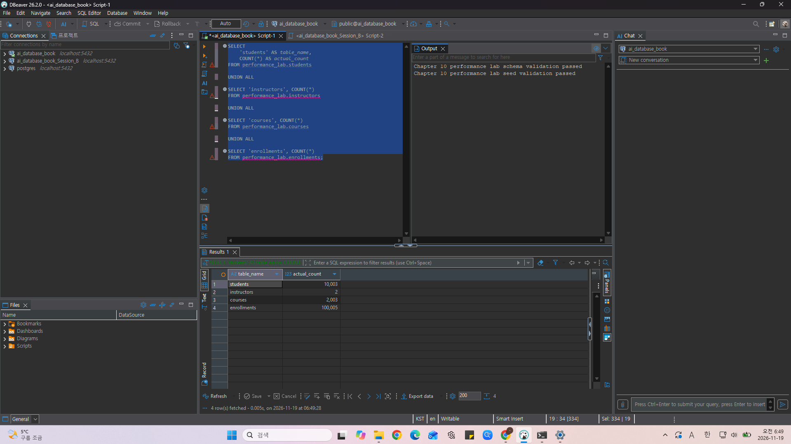
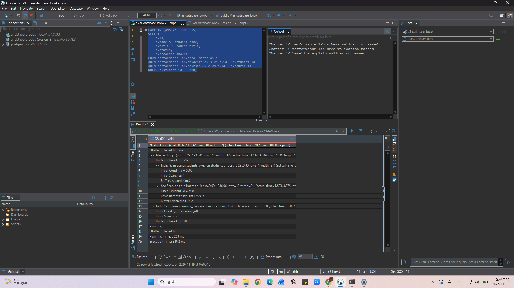
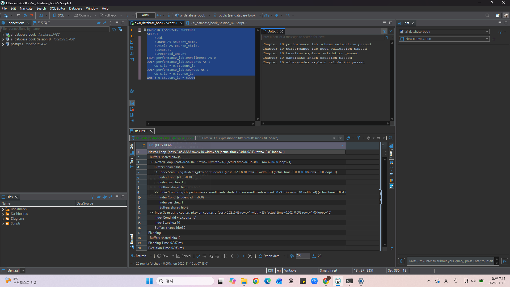

# Chapter 10 확장 실습 답안 템플릿

> **과제:** 실행 계획으로 인덱스 효과 검증하기  
> **사용 방법:** 이 파일을 내려받아 본인의 GitHub 저장소에 `chapter10_answer.md`라는 이름으로 저장한 뒤 실습하면서 바로 작성합니다.  
> **제출 방법:** LMS에는 파일을 직접 업로드하지 않고, **본인 GitHub 저장소의 `chapter10_answer.md` 파일 URL**을 제출합니다.

---

## 제출 전 주의

이 파일과 캡처 화면에는 실제 비밀번호, 전체 DB 접속 URL, API Key, 개인정보를 기록하지 않습니다.

```text
GitHub 계정 또는 별칭: youccode
과제 작성일: 2026.11.19
사용한 AI 도구: chatgpt
```

---

# 1. PostgreSQL 버전과 시작 환경 확인

다음을 실행합니다.

```sql
SELECT version();
SELECT current_database();
SELECT current_user;
SELECT current_schema();
SHOW search_path;
```

| 확인 항목 | 실제 결과 | 의미 |
| --- | --- | --- |
| PostgreSQL 버전 | PostgreSQL 18.6 on x86_64-windows, compiled by msvc-19.44.35228, 64-bit | PostgreSQL 버전에 따라 쿼리 최적화 기능과 실행 계획이 달라질 수 있다. |
| `current_database()` | `ai_database_book` | 현재 SQL을 실행하는 데이터베이스이다. |
| `current_user` | `postgres` | 현재 SQL을 실행하는 PostgreSQL 사용자이다. |
| `current_schema()` | `public` | 현재 기본으로 사용하는 스키마이다. |
| `search_path` | `public, "$user"` | 스키마 이름을 생략했을 때 객체를 검색하는 경로이다. |

### PostgreSQL 버전을 기록해야 하는 이유

```text
PostgreSQL 버전에 따라 사용할 수 있는 최적화 기능과 실행 계획이 달라질 수 있기 때문이다. 같은 SQL과 데이터라도 버전이 다르면 선택되는 계획이 달라질 수 있으므로, 실행 환경을 기록해야 비교 결과를 올바르게 해석할 수 있다.

이번 실습의 검증 기준은 PostgreSQL 16이므로, 실제 사용 버전을 확인하고 강의 자료와 계획이 다를 때 버전 차이도 함께 검토한다.
```

> 이 장의 자동 검증 기준은 PostgreSQL 16입니다. PostgreSQL 18 이상에서는 B-tree Skip Scan 등으로 동일 SQL의 실행 계획이 달라질 수 있습니다.

---

# 2. Chapter 07·08 기준 상태 확인

Chapter 10은 기존 `course_project`를 변경하지 않습니다.

확인 기준:

```text
students = 3
instructors = 2
courses = 3
enrollments = 5

전체 recorded_amount = 590000
활성 = 3건 / 340000
취소 제외 = 4건 / 440000
```

```text
1001 = 완료 / 100000
1004 = 취소 / 150000
1005 = 신청 / 120000
```

### 실제 확인 결과

```text
students: 3
instructors: 2
courses: 3
enrollments: 5
전체 recorded_amount: 590000
활성 신청 건수/금액: 3건 / 340000
취소 제외 건수/금액: 4건 / 440000
```

### 성능 실험을 기존 `course_project`에 대량 데이터를 넣지 않고 별도 스키마에서 하는 이유

```text
Chapter 07·08에서 완성한 course_project의 기존 데이터와 검증 기준을 유지하면서
인덱스 성능을 실험하기 위해서이다.

기존 테이블에 대량 데이터를 추가하면 행 수와 데이터 분포가 달라져 이전 실습의
조회 결과와 집계 기준이 변경될 수 있다. 또한 실험 과정에서 생성하는 인덱스가
기존 프로젝트의 데이터베이스 구조와 조회 성능에 영향을 줄 수 있다.

따라서 performance_lab이라는 별도 스키마를 사용하여 기존 데이터를 보호하고,
성능 실험에 필요한 대량 데이터를 독립적으로 생성한다. 이를 통해 기존 프로젝트에
영향을 주지 않으면서 동일한 데이터와 조회 조건에서 인덱스 적용 전후의 실행 계획과
성능을 비교할 수 있다.
```

---

# 3. `performance_lab` 생성과 대량 데이터 확인

다음 파일을 순서대로 실행합니다.

```text
code/chapter10/01_performance_lab_schema.sql
code/chapter10/02_performance_lab_seed.sql
```

## 3-1. 생성 후 행 수

| 테이블 | 기대 행 수 | 실제 행 수 | 일치? |
| --- | ---: | ---: | --- |
| `performance_lab.students` | 10003 | 10003 | 일치 |
| `performance_lab.instructors` | 2 | 2 | 일치 |
| `performance_lab.courses` | 2003 | 2003 | 일치 |
| `performance_lab.enrollments` | 100005 | 100005 | 일치 |

## 3-2. 데이터 분포 확인

| 조건 | 기대 행 수 | 실제 행 수 | 대략적 비율 |
| --- | ---: | ---: | ---: |
| `performance5000@example.com` | 1 | 1 | 약 0.010% |
| `student_id = 5000` | 10 | 10 | 약 0.010% |
| `course_id = 1500` | 50 | 50 | 약 0.050% |
| `course_id = 1500 AND status='수강중'` | 15 | 15 | 약 0.015% |
| 전체 `status='수강중'` | 30001 | 30001 | 약 30.0% |

### 선택도가 낮은 조건과 많은 행을 반환하는 조건은 인덱스 판단에서 어떻게 다르게 볼 수 있나요?

```text
검색 조건을 만족하는 행이 전체 데이터에서 차지하는 비율과 실제 반환 행 수를 함께 고려해야 한다.

예를 들어 이메일 정확 일치 검색처럼 전체 데이터 중 극히 일부만 반환하는 조건은
인덱스를 이용하면 필요한 행을 빠르게 찾을 수 있어 효율적일 가능성이 높다.

반면 status = '수강중'처럼 전체 신청 데이터의 약 30%를 반환하는 조건은
인덱스를 사용하더라도 많은 행을 읽어야 하므로, 테이블을 순차적으로 읽는
Seq Scan이 더 효율적일 수 있다.

따라서 인덱스의 효과는 단순히 WHERE 조건에 사용된 컬럼인지로 판단하지 않고,
데이터 분포와 반환 행 수, 실행 계획 및 실제 실행 비용을 함께 비교해야 한다.
```

### 증거 화면

권장 경로:

```text
assignments/chapter10/images/step03_data_scale.png
```



---

# 4. 인덱스 생성 전 기준 계획 기록

다음 파일을 실행합니다.

```text
code/chapter10/03_baseline_explain.sql
```

> **중요:** `04_create_candidate_indexes.sql`을 먼저 실행하지 않습니다. 기준 계획을 잃으면 같은 조건의 전후 비교가 어려워집니다.

최소 3개 SQL의 실행 계획을 기록합니다.

## Query A

```text
업무 질문: 제목이 '성능 테스트 강의 00500'인 강의의 ID, 제목, 난이도, 가격은 무엇인가?
WHERE / JOIN / ORDER BY / LIMIT: WHERE title = '성능 테스트 강의 00500' / JOIN 없음 / ORDER BY 없음 / LIMIT 없음
예상 반환 행 수: 1
실제 반환 행 수: 1
```

```sql
-- 대상 SQL
SELECT id, title, level, price
FROM performance_lab.courses
WHERE title = '성능 테스트 강의 00500';
```

| 관찰 항목 | 기록 |
| --- | --- |
| 주요 Scan/계획 노드 | Seq Scan on courses |
| estimated rows | 1 |
| actual rows | 1 |
| Filter | `(title)::text = '성능 테스트 강의 00500'::text` |
| Index Cond | 없음 |
| Buffers hit/read | shared hit=34 / read=0 |
| Planning Time | 0.070 ms |
| Execution Time | 0.159 ms |

## Query B

```text
업무 질문: 학생 ID가 5000인 학생의 신청 내역과 학생 이름, 강의 제목, 신청 상태, 기록 금액은 무엇인가?
WHERE / JOIN / ORDER BY / LIMIT: WHERE e.student_id = 5000 / enrollments와 students, courses INNER JOIN / ORDER BY 없음 / LIMIT 없음
예상 반환 행 수: 10
실제 반환 행 수: 10
```

| 관찰 항목 | 기록 |
| --- | --- |
| 주요 Scan/계획 노드 | Nested Loop JOIN, Seq Scan on enrollments, Index Scan using students_pkey, Index Scan using courses_pkey |
| estimated rows | 10 |
| actual rows | 10 |
| Filter | `student_id = 5000` (enrollments Seq Scan) |
| Index Cond | `id = 5000` (students), `id = e.course_id` (courses) |
| Buffers hit/read | shared hit=769 / read=0 (전체 계획 기준) |
| Execution Time | 3.942 ms |

## Query C

```text
업무 질문: 강의 ID가 1500이고 신청 상태가 '수강중'인 신청 내역은 무엇인가?
WHERE / JOIN / ORDER BY / LIMIT: WHERE course_id = 1500 AND status = '수강중' / JOIN 없음 / ORDER BY 없음 / LIMIT 없음
예상 반환 행 수: 15
실제 반환 행 수: 15
```

| 관찰 항목 | 기록 |
| --- | --- |
| 주요 Scan/계획 노드 | Seq Scan on enrollments |
| estimated rows | 15 |
| actual rows | 15 |
| Filter | `(course_id = 1500) AND ((status)::text = '수강중'::text)` |
| Index Cond | 없음 |
| Buffers hit/read | shared hit=736 / read=0 |
| Execution Time | 4.100 ms |

### `cost`와 실제 실행 시간이 같은 개념이 아닌 이유

```text
cost는 PostgreSQL의 쿼리 플래너가 실행 계획을 비교하기 위해 추정하는 상대적인 비용이며,
실제 실행에 걸리는 시간을 밀리초 단위로 나타낸 값이 아니다.

cost는 예상 데이터 행 수, 디스크 페이지 접근, CPU 처리 비용 등을 바탕으로 계산되지만,
실제 실행 시간은 캐시 상태, 시스템 부하, 데이터 분포와 실행 환경 등에 영향을 받는다.

따라서 cost가 낮다고 반드시 실행 시간이 짧은 것은 아니며,
EXPLAIN ANALYZE를 통해 실제 실행 시간과 처리 행 수, 버퍼 사용량 등을 함께 확인해야 한다.
```

### `EXPLAIN ANALYZE`는 실제 SQL을 실행한다는 점을 왜 기억해야 하나요?

```text
EXPLAIN은 SQL을 실제로 실행하지 않고 예상 실행 계획을 보여주지만,
EXPLAIN ANALYZE는 SQL을 실제로 실행한 뒤 측정한 결과를 함께 보여준다.

따라서 SELECT에서는 실제 조회가 수행되며, INSERT, UPDATE, DELETE 같은 변경 SQL에
EXPLAIN ANALYZE를 사용하면 데이터가 실제로 변경될 수 있다.

그러므로 데이터 변경 SQL의 실행 계획을 측정할 때는 트랜잭션을 사용하고,
필요한 경우 ROLLBACK하여 실습 데이터의 변경을 통제한다. 
```

### 증거 화면

권장 경로:

```text
assignments/chapter10/images/step04_before_plan.png
```



---

# 5. 후보 인덱스를 만들기 전에 이유 작성

본문 실험 후보는 다음 세 개입니다.

```text
idx_performance_courses_title
idx_performance_enrollments_student_id
idx_performance_enrollments_course_status
```

각 인덱스의 이유를 먼저 작성합니다.

| 후보 인덱스 | 대응 조회 패턴 | 예상 이점 | 컬럼 순서 이유 | 예상 비용/단점 |
| --- | --- | --- | --- | --- |
| `idx_performance_courses_title` | `WHERE title = ...`, `ORDER BY title`, `ORDER BY title LIMIT 20` | 제목 정확 일치 검색에서 불필요한 전체 탐색을 줄이고, 정렬 및 LIMIT 조회에서 인덱스 순서를 활용할 수 있다. | title을 기준으로 검색하고 정렬하므로 단일 컬럼 인덱스로 구성한다. | 인덱스 저장 공간이 추가되고 강의 INSERT, UPDATE, DELETE 시 인덱스 유지 비용이 발생한다. |
| `idx_performance_enrollments_student_id` | `WHERE e.student_id = 5000`을 사용하는 신청 내역 JOIN 조회 | 특정 학생의 신청 10건을 찾을 때 전체 신청 테이블을 탐색하지 않고 필요한 행에 접근할 수 있다. | 학생별 신청 조회의 핵심 조건이 student_id이므로 해당 컬럼을 인덱스 키로 사용한다. | 신청 데이터 변경 시 인덱스 갱신 비용이 발생하고 별도 저장 공간이 필요하다. |
| `idx_performance_enrollments_course_status` | `WHERE course_id = 1500`, `WHERE course_id = 1500 AND status = '수강중'` | 강의별 신청 조회와 특정 강의의 상태별 신청 조회에서 검색 범위를 줄일 수 있다. | course_id 단독 조건과 course_id + status 복합 조건을 모두 고려하여 course_id를 선행 컬럼으로 배치한다. | 복합 인덱스의 저장 및 갱신 비용이 발생하며, status 단독 조건에서는 효과가 제한적일 수 있다. |

### “중요한 컬럼이므로 인덱스를 만든다”는 설명이 부족한 이유

```text
컬럼이 업무적으로 중요하다는 사실과 해당 컬럼에 인덱스가 필요하다는 것은
서로 다른 문제이기 때문이다.

인덱스의 필요성은 해당 컬럼이 실제 조회의 WHERE, JOIN, ORDER BY 등에
얼마나 자주 사용되는지, 조건에 맞는 행이 얼마나 되는지, 기존 인덱스로
충분히 처리할 수 있는지 등을 기준으로 판단해야 한다.

또한 인덱스를 생성하면 저장 공간이 추가로 필요하고 데이터 변경 시
인덱스를 유지하는 비용도 발생한다.

따라서 중요한 컬럼이라는 이유만으로 인덱스를 생성하는 것이 아니라,
실제 조회 패턴과 데이터 분포, 실행 계획을 근거로 필요성을 판단해야 한다.
```

### `(course_id, status)`와 `(status, course_id)`가 항상 같은 효과가 아닌 이유

```text
복합 B-tree 인덱스는 컬럼의 순서에 따라 효율적으로 탐색할 수 있는
조회 조건이 달라지기 때문이다.

(course_id, status) 인덱스는 course_id를 선행 컬럼으로 사용하므로
course_id 단독 조회와 course_id + status 복합 조건에 활용하기 적합하다.

반면 (status, course_id) 인덱스는 status를 선행 컬럼으로 사용하므로
status 중심의 조회에 상대적으로 적합할 수 있다.

이번 실습에서는 특정 강의의 신청 내역을 조회하거나 특정 강의에서
수강중인 신청을 찾는 패턴을 고려하여 course_id를 앞에 배치하였다.

다만 PostgreSQL 18에서는 B-tree Skip Scan 등의 최적화로 선행 컬럼이
조건에 없는 경우에도 복합 인덱스를 활용할 수 있으므로,
실제 효과는 실행 계획과 데이터 분포를 확인하여 판단해야 한다.
```

---

# 6. 후보 인덱스 생성

다음을 실행합니다.

```text
code/chapter10/04_create_candidate_indexes.sql
```

생성 후 확인:

```text
후보 인덱스 수: 3
전체 인덱스 수: 9
```

본문 기준:

```text
자동 인덱스 = 6
후보 인덱스 = 3
전체 인덱스 = 9
```

### PRIMARY KEY나 UNIQUE가 이미 인덱스를 만들 수 있는데 같은 목적의 인덱스를 또 만들면 어떤 문제가 생기나요?

```text
PostgreSQL은 PRIMARY KEY와 UNIQUE 제약조건을 생성할 때 해당 제약조건을
유지하기 위한 고유 인덱스를 자동으로 생성한다.

따라서 이미 같은 목적을 수행하는 인덱스가 존재하는데 동일한 인덱스를
추가하면 불필요한 저장 공간과 인덱스 유지 비용이 발생할 수 있다.

INSERT, UPDATE, DELETE가 실행될 때 중복된 인덱스도 함께 관리해야 하므로
쓰기 성능이 저하될 수 있다.

따라서 새로운 인덱스를 생성할 때는 기존 인덱스의 키 컬럼과 순서,
제약조건 역할을 먼저 검토하는 기준을 적용한다.
```

---

# 7. 같은 SQL로 인덱스 후 재측정

다음 파일을 실행합니다.

```text
code/chapter10/05_after_index_explain.sql
```

Chapter 4에서 기록한 **동일 SQL**을 비교합니다.

## Query A 전후 비교

| 항목 | Before | After | 해석 |
| --- | --- | --- | --- |
| 주요 계획 노드 | Seq Scan on courses | Index Scan using idx_performance_courses_title | 전체 테이블을 탐색하던 방식에서 title 인덱스를 이용하는 방식으로 변경되었다. |
| actual rows | 1 | 1 | 인덱스 적용 전후에 동일하게 1행을 반환하였다. |
| Buffers hit/read | hit=34 / read=0 | hit=3 / read=0 | 디스크 read는 모두 0이지만 버퍼 접근 횟수가 34에서 3으로 감소하였다. |
| Execution Time | 0.159 ms | 0.080 ms | 실행 시간이 감소하여 이번 측정에서는 인덱스 적용 후 성능이 개선되었다. |
| Index Cond | 없음 | `(title)::text = '성능 테스트 강의 00500'::text` | 기존에는 Filter로 조건을 검사했지만, 이후에는 인덱스 탐색 조건으로 사용하였다. |

```text
결과 행이 동일했는가: Before와 After 모두 1행을 반환하여 동일했다.
읽은 버퍼가 줄었는가: shared read는 전후 모두 0으로 동일했으며, shared hit은 34에서 3으로 감소하였다.
계획이 바뀌었는가: Seq Scan에서 idx_performance_courses_title을 사용하는 Index Scan으로 변경되었다.
실행 시간 한 번만으로 결론낼 수 있는가: 결론낼 수 없다. 캐시 상태와 시스템 부하 등의 영향을 받을 수 있으므로 반복 측정이 필요하다.
```

## Query B 전후 비교

| 항목 | Before | After | 해석 |
| --- | --- | --- | --- |
| 주요 계획 노드 | Nested Loop, Seq Scan on enrollments, Index Scan on students/courses | Nested Loop, Index Scan on enrollments/students/courses | enrollments의 Seq Scan이 student_id 인덱스를 사용하는 Index Scan으로 변경되었다. |
| actual rows | 10 | 10 | 인덱스 적용 전후 모두 학생 5000의 신청 내역 10행을 반환하였다. |
| Buffers hit/read | hit=769 / read=0 | hit=36 / read=0 | 버퍼 접근 횟수가 크게 감소하여 불필요한 테이블 탐색이 줄어들었다. |
| Execution Time | 3.942 ms | 0.065 ms | 실행 시간이 크게 감소하여 이번 측정에서는 학생별 신청 조회 성능이 개선되었다. |
| Index Cond | `id = 5000` (students), `id = e.course_id` (courses) | `id = 5000` (students), `student_id = 5000` (enrollments), `id = e.course_id` (courses) | 기존 PK 인덱스에 더해 enrollments의 student_id 조건에도 후보 인덱스를 활용하였다. |

## Query C 전후 비교

| 항목 | Before | After | 해석 |
| --- | --- | --- | --- |
| 주요 계획 노드 | Seq Scan on enrollments | Bitmap Heap Scan + Bitmap Index Scan using idx_performance_enrollments_course_status | 전체 테이블을 순차 탐색하던 방식에서 복합 인덱스로 필요한 행의 위치를 찾는 방식으로 변경되었다. |
| actual rows | 15 | 15 | 인덱스 적용 전후 모두 조건에 맞는 신청 내역 15행을 반환하였다. |
| Buffers hit/read | hit=736 / read=0 | hit=19 / read=0 (Heap 17 + Index 2) | 인덱스와 테이블 접근에 사용한 버퍼 수의 합계가 기존보다 크게 감소하였다. |
| Execution Time | 4.100 ms | 0.119 ms | 실행 시간이 크게 감소하여 이번 측정에서는 복합 인덱스 적용 효과가 나타났다. |
| Index Cond | 없음 | `(course_id = 1500) AND ((status)::text = '수강중'::text)` | 기존 Filter 조건이 Bitmap Index Scan의 인덱스 탐색 조건으로 사용되었다. |

### `Index Scan`으로 바뀌었다는 사실만으로 성공이라고 할 수 없는 이유

```text
Index Scan을 사용하더라도 실제 실행 시간이나 데이터 접근 비용이
반드시 감소하는 것은 아니기 때문이다.

인덱스를 이용해 행을 찾은 뒤 테이블에 추가로 접근해야 할 수 있고,
조회하는 행이 많다면 Seq Scan보다 더 많은 비용이 발생할 수도 있다.

따라서 인덱스 적용 전후의 실제 반환 행 수와 Buffers hit/read,
Execution Time 및 전체 실행 계획을 함께 비교해야 한다.

또한 실행 시간은 캐시 상태와 시스템 부하에 따라 달라질 수 있으므로
한 번의 측정 결과만으로 인덱스의 효과를 확정해서는 안 된다.
```

### 증거 화면

권장 경로:

```text
assignments/chapter10/images/step07_after_plan.png
```



---

# 8. `status` 단독 조회와 Seq Scan 해석

전체 `status = '수강중'`은 약 30%의 행을 반환합니다.

```text
예상 행 수 = 30001
실제 행 수 = 30001
주요 계획 노드 = Seq Scan on enrollments
```

### 인덱스가 존재해도 PostgreSQL이 Seq Scan을 선택할 수 있는 이유

```text
PostgreSQL은 인덱스의 존재 여부만으로 실행 계획을 결정하는 것이 아니라,
예상되는 데이터 접근 비용을 비교하여 상대적으로 효율적인 계획을 선택하기 때문이다.

이번 실습에서 status = '수강중' 조건은 전체 신청 데이터 100005건 중
약 30%인 30001건을 반환한다. 실제 실행 계획에서도 Seq Scan이 선택되었으며,
70004행이 Filter 조건에 의해 제외되었다.

이처럼 많은 행을 조회하는 경우에는 인덱스를 통해 개별 행에 접근하는 것보다
테이블을 순차적으로 읽는 것이 효율적일 수 있다.

또한 생성한 복합 인덱스는 (course_id, status) 순서로 구성되어 있으므로,
status 단독 조건에 대한 활용 효율은 데이터 분포와 예상 비용에 따라 달라진다.
```

### “Seq Scan = 나쁜 계획”이라고 단정하면 안 되는 이유

```text
Seq Scan은 테이블 전체를 순차적으로 읽는 방식이지만,
모든 상황에서 비효율적인 실행 방법은 아니기 때문이다.

테이블 크기가 작거나 조회 조건을 만족하는 행이 많을 때는
인덱스를 탐색하고 테이블의 개별 행에 접근하는 것보다
전체 테이블을 순차적으로 읽는 편이 효율적일 수 있다.

이번 실습에서도 status = '수강중' 조건은 전체 데이터의 약 30%를
반환하며, 실제로 Seq Scan을 통해 30001행을 조회하였다.

따라서 Seq Scan이라는 노드 이름만으로 성능이 나쁘다고 판단하지 않고,
반환 행 수와 데이터 분포, Buffers, Execution Time 및
다른 실행 계획의 예상 비용을 함께 검토해야 한다.
```

### PostgreSQL 16과 18 이상에서 복합 B-tree 후행 컬럼 조건의 계획이 다를 수 있는 이유

```text
PostgreSQL 버전에 따라 쿼리 최적화 기능이 달라지기 때문이다.

PostgreSQL 16에서는 (course_id, status) 복합 B-tree 인덱스에서
선행 컬럼인 course_id 없이 후행 컬럼인 status만 조건으로 사용하는 경우,
효율적인 인덱스 탐색이 어려울 수 있다.

반면 PostgreSQL 18에서는 B-tree Skip Scan 최적화가 추가되어
선행 컬럼에 조건이 없더라도 데이터 분포와 비용 조건에 따라
복합 인덱스를 활용할 수 있다.

그러나 이번 PostgreSQL 18.6 환경에서는 status = '수강중' 조건이
전체 데이터의 약 30%를 반환하므로 실제 실행 계획에서 Seq Scan이 선택되었다.

따라서 PostgreSQL 18에서 Skip Scan을 지원한다고 해서 항상
해당 최적화가 적용되는 것은 아니며, 실제 실행 계획을 확인해야 한다.
```

---

# 9. `ORDER BY`와 `LIMIT`에서 인덱스 관찰

`ORDER BY title`과 `ORDER BY title LIMIT 20` 계획을 비교합니다.

```text
ORDER BY title 계획:

Index Scan using idx_performance_courses_title on courses
실제 반환 행 수: 2003행
Buffers: shared hit=49
Execution Time: 0.904 ms
별도의 Sort 노드 없음

ORDER BY title LIMIT 20 계획:

Limit → Index Scan using idx_performance_courses_title on courses
실제 반환 행 수: 20행
Buffers: shared hit=3
Execution Time: 0.037 ms
별도의 Sort 노드 없음
```

### LIMIT이 있을 때 PostgreSQL이 전체 정렬보다 인덱스 순서를 활용하는 것이 유리할 수 있는 이유

```text
ORDER BY title LIMIT 20은 전체 강의를 제목순으로 정렬한 결과에서
상위 20행만 필요하다는 의미이다.

title 컬럼에 생성된 B-tree 인덱스는 제목순으로 정렬된 탐색 순서를 제공할 수 있으므로,
PostgreSQL은 인덱스 순서대로 데이터를 읽으면서 필요한 20행을 확보하면
추가 탐색을 종료할 수 있다.

실제 실행 결과에서도 ORDER BY title은 2003행을 반환하며
shared hit=49, Execution Time=0.904 ms를 기록한 반면,
LIMIT 20을 적용한 조회는 20행만 반환하며
shared hit=3, Execution Time=0.037 ms를 기록하였다.

따라서 이번 실험에서는 인덱스 순서를 활용하면서 필요한 행만 읽는 방식이
전체 행을 조회하는 방식보다 적은 버퍼 접근과 짧은 실행 시간을 보였다.
다만 실제 성능은 데이터 분포와 실행 환경에 따라 달라질 수 있다.
```

### 실제 계획에서 Sort 노드 또는 Index Scan을 어떻게 확인했나요?

```text
DBeaver에서 EXPLAIN (ANALYZE, BUFFERS)를 실행한 결과,
ORDER BY title 조회에서는 idx_performance_courses_title을 사용하는
Index Scan 노드가 나타났으며, 별도의 Sort 노드는 확인되지 않았다.

ORDER BY title LIMIT 20 조회에서는 최상위에 Limit 노드가 나타났고,
그 아래에 동일한 인덱스를 사용하는 Index Scan 노드가 나타났다.
이 경우에도 별도의 Sort 노드는 없었다.

전체 정렬 조회는 2003행을 읽었지만 LIMIT 20 조회는
인덱스 순서를 활용하여 20행만 반환하였다.

이를 통해 PostgreSQL이 두 조회 모두 title 인덱스의 정렬 순서를
활용했으며, LIMIT이 있는 경우에는 필요한 행을 확보한 뒤
탐색을 종료하는 실행 계획을 선택했음을 확인하였다.
```

---

# 10. 인덱스 검토

다음을 실행합니다.

```text
code/chapter10/06_index_review.sql
```

## 10-1. 인덱스별 판단

| 인덱스 | 크기/사용 관찰 | 유지 / 보류 / 제거 | 판단 근거 |
| --- | --- | --- | --- |
| `idx_performance_courses_title` | 120 kB, idx_scan=7, idx_tup_read=4049, idx_tup_fetch=4048 | 유지 | 제목 정확 일치 조회에서 Seq Scan이 Index Scan으로 변경되었고, ORDER BY 및 LIMIT 조회에서도 인덱스를 활용하였다. 실제 버퍼 접근과 실행 시간이 감소했으며 저장 공간 부담도 상대적으로 작으므로 유지한다. |
| `idx_performance_enrollments_student_id` | 936 kB, idx_scan=3, idx_tup_read=30, idx_tup_fetch=20 | 유지 | 특정 학생의 신청 내역 JOIN에서 기존 Seq Scan이 Index Scan으로 변경되었고, Buffers hit이 769에서 36으로, Execution Time이 3.942 ms에서 0.065 ms로 감소하였다. 학생별 신청 조회에 효과가 확인되어 유지한다. |
| `idx_performance_enrollments_course_status` | 960 kB, idx_scan=10, idx_tup_read=30150, idx_tup_fetch=0 | 유지 | course_id와 status 복합 조건 조회에서 Bitmap Index Scan이 사용되었으며, Buffers hit이 736에서 19로, Execution Time이 4.100 ms에서 0.119 ms로 감소하였다. 다만 status 단독 조회에서는 Seq Scan이 선택되었으므로 활용 범위를 고려하여 유지한다. |

### `idx_scan = 0`이라는 이유 하나만으로 인덱스를 삭제하면 안 되는 이유

```text
idx_scan은 통계 수집 기간 동안 관찰된 인덱스 사용 횟수를 나타내지만,
그 값이 0이라고 해서 해당 인덱스가 불필요하다는 의미는 아니다.

통계가 최근 초기화되었거나 특정 조회가 아직 실행되지 않았을 수 있고,
사용 빈도는 낮더라도 중요한 업무에서 필요한 인덱스일 수 있다.

이번 실습에서는 stats_reset이 NULL로 조회되어 통계 초기화 시각을
확인할 수 없었으며, idx_scan 값만으로 장기간의 사용 빈도를 판단하기 어렵다.

또한 PRIMARY KEY와 UNIQUE 제약조건을 유지하는 인덱스는
조회 사용 횟수와 별개로 데이터 무결성을 보장하는 역할을 한다.

따라서 인덱스 제거 여부는 통계 초기화 시점과 실제 조회 패턴,
제약조건 역할 및 저장·유지 비용을 함께 검토하여 판단해야 한다.
```

### 외래키 자식 컬럼 인덱스가 무결성 자체의 필수 조건은 아니지만 성능상 필요할 수 있는 이유

```text
외래키는 자식 테이블의 참조 값이 부모 테이블의 유효한 키를 참조하도록
보장하는 제약조건이며, 자식 테이블에 별도의 인덱스가 없어도
외래키 무결성 자체는 유지할 수 있다.

그러나 외래키 컬럼은 부모 테이블과 자식 테이블을 JOIN하거나
특정 부모에 연결된 자식 행을 조회할 때 자주 사용될 수 있다.

이번 실습에서도 enrollments.student_id에 인덱스를 생성한 뒤,
특정 학생의 신청 내역 JOIN에서 전체 테이블을 탐색하던 방식이
인덱스를 활용하는 방식으로 변경되어 실행 성능이 개선되었다.

또한 부모 행을 삭제하거나 참조되는 키를 변경할 때 연결된 자식 행을
확인해야 하므로 자식 테이블의 외래키 컬럼에 인덱스가 있다면
해당 작업의 성능을 개선할 수 있다.

따라서 외래키 인덱스는 무결성 유지를 위한 필수 구조와 구분하여
실제 조회 및 데이터 변경 패턴에 따라 필요성을 판단해야 한다.
```

### 인덱스를 많이 만들었을 때 생기는 쓰기·저장 비용

```text
인덱스는 테이블과 별도의 저장 공간을 사용하므로 인덱스가 많아질수록
데이터베이스의 저장 공간 사용량이 증가한다.

이번 실습에서 생성한 후보 인덱스 3개의 크기는 각각 120 kB,
936 kB, 960 kB로 확인되었으며, 총 2016 kB의 추가 저장 공간을 사용한다.

또한 INSERT로 새로운 행을 추가하거나 DELETE로 행을 삭제하면
관련 인덱스도 함께 갱신해야 하므로 추가적인 처리 비용이 발생한다.

UPDATE에서도 인덱스 키가 변경되거나 새로운 인덱스 항목을 기록해야 하는
경우 인덱스 유지 비용이 발생할 수 있다.

따라서 인덱스를 많이 생성하는 것이 항상 좋은 것은 아니며,
실제 조회 성능 개선 효과와 쓰기 성능 및 저장 공간 비용을
함께 고려하여 필요한 인덱스를 선택해야 한다.
```

---

# 11. 자동 완료 게이트

다음을 실행합니다.

```text
code/chapter10/07_result_validation.sql
```

```text
최종 검증 결과: Chapter 10 performance result validation passed
```

검증할 핵심 내용:

```text
performance_lab 기준 행 수 유지
조회 결과 행 수 유지
후보 인덱스 3개 존재
course_project 기준 상태 유지
```

### 실행 계획 비교와 별도로 결과 행 동일성을 검증해야 하는 이유

```text
실행 계획이 변경되거나 실행 시간이 감소했다고 하더라도,
SQL이 반환하는 결과의 정확성까지 자동으로 보장되는 것은 아니기 때문이다.

인덱스는 데이터의 조회 방법을 효율적으로 개선하기 위한 구조이므로,
동일한 데이터에 동일한 SQL을 실행했다면 인덱스 적용 전후의
조회 결과는 논리적으로 동일해야 한다.

이번 실습에서도 인덱스 적용 전후 Query A, B, C의 실행 계획과
버퍼 접근 횟수, 실행 시간은 달라졌지만 실제 반환 행 수는
각각 1행, 10행, 15행으로 동일하게 유지되었다.

또한 최종 검증 SQL을 실행한 결과,
performance_lab의 기준 행 수와 조회 결과가 유지되었으며,
후보 인덱스 3개가 정상적으로 존재하고 기존 course_project의
기준 상태도 변경되지 않았음을 확인하였다.

따라서 실행 계획과 성능 지표를 비교하는 것뿐 아니라
조회 결과와 기존 데이터 상태가 유지되는지도 별도로 검증해야
정확성을 유지하면서 성능이 개선되었다고 판단할 수 있다.
```

---

# 12. 인덱스 만능론 반박

다음 주장 중 **두 개**를 골라 본문과 실제 실행 계획을 근거로 반박합니다.

```text
A. 인덱스는 많을수록 좋다.
B. 인덱스를 만들었는데 Seq Scan이면 실패다.
C. 모든 FK에는 무조건 같은 방식의 인덱스를 만든다.
D. 실행 시간이 한 번이라도 빨라졌으면 효과가 입증됐다.
E. 선택도가 낮으면 무조건 Index Scan이 나온다.
```

## 주장 1

```text
선택한 주장: B. 인덱스를 만들었는데 Seq Scan이면 실패다.

나의 반박: 
인덱스가 존재하더라도 Seq Scan이 선택되었다는 이유만으로 실패라고 판단할 수 없다.
PostgreSQL은 인덱스의 존재 여부뿐 아니라 데이터 분포, 예상 반환 행 수,
데이터 접근 비용 등을 고려하여 효율적인 실행 계획을 선택하기 때문이다.

특히 조회 조건을 만족하는 행이 많다면 인덱스를 통해 개별 행에 접근하는 것보다
테이블 전체를 순차적으로 읽는 방식이 효율적일 수 있다.

따라서 Seq Scan 자체를 잘못된 계획으로 판단하기보다는 실제 반환 행 수,
Buffers, Execution Time 등을 함께 확인하여 성능을 평가해야 한다.

실행 계획에서 확인한 근거:
이번 실습에서는 (course_id, status) 복합 인덱스를 생성했지만,
status = '수강중' 단독 조회에서는 Seq Scan on enrollments가 선택되었다.

해당 조건은 전체 100005건 중 30001건으로 약 30%의 데이터를 반환하였으며,
실제 실행 계획에서는 Rows Removed by Filter=70004,
Buffers shared hit=736, Execution Time=7.897 ms로 측정되었다.

PostgreSQL 18.6에서 Skip Scan 최적화를 지원하더라도
이번 조회에서는 Seq Scan이 선택되었다는 점을 확인하였다.

이는 인덱스가 존재한다고 항상 Index Scan이 선택되는 것은 아니며,
데이터 분포와 예상 비용에 따라 다른 실행 계획이 사용될 수 있음을 보여준다.
```

## 주장 2

```text
선택한 주장: D. 실행 시간이 한 번이라도 빨라졌으면 효과가 입증됐다.

나의 반박:
EXPLAIN ANALYZE에서 실행 시간이 한 번 감소했다는 사실만으로
인덱스의 성능 개선 효과가 충분히 입증되었다고 판단할 수 없다.

실제 실행 시간은 데이터 캐시 상태, 시스템 부하, 실행 시점,
하드웨어 환경 등에 영향을 받을 수 있기 때문이다.

따라서 인덱스 적용 효과를 평가할 때는 실행 시간뿐 아니라
실행 계획의 변화, Buffers hit/read, 실제 반환 행 수 등을 함께 비교해야 한다.

또한 동일한 조건에서 여러 번 측정하여 일관된 성능 개선이 나타나는지
확인하는 과정이 필요하다.

실행 계획에서 확인한 근거:
이번 실습에서 Query A의 Execution Time은 0.159 ms에서 0.080 ms로,
Query B는 3.942 ms에서 0.065 ms로,
Query C는 4.100 ms에서 0.119 ms로 감소하였다.

또한 Buffers shared hit도 Query A는 34에서 3으로,
Query B는 769에서 36으로, Query C는 736에서 19로 감소하였다.

Query A는 Seq Scan에서 Index Scan으로,
Query B는 enrollments의 Seq Scan에서 Index Scan으로,
Query C는 Seq Scan에서 Bitmap Heap Scan과 Bitmap Index Scan으로 변경되었다.

세 쿼리 모두 실제 반환 행 수는 각각 1행, 10행, 15행으로 유지되었다.

따라서 이번 측정에서는 인덱스 적용 후 실행 계획과 버퍼 접근,
실행 시간 측면에서 개선이 관찰되었다고 판단할 수 있다.

그러나 이는 제한된 횟수의 측정 결과이므로 장기적이고 일관된
성능 개선 효과를 확정하려면 추가적인 반복 측정이 필요하다.
```


---

# 13. 개인 프로젝트 조회 패턴과 인덱스 후보

Chapter 07~09에서 발전시킨 개인 프로젝트를 사용합니다.

최소 2개의 **실제 반복 조회 질문**을 먼저 만듭니다.

| ID | 반복 조회 질문 | WHERE | JOIN | ORDER BY/LIMIT | 예상 반환 비율 | 후보 인덱스 |
| --- | --- | --- | --- | --- | --- | --- |
| P10-Q01 | 특정 논문의 피인용 목록 조회 | `cited_paper_id = :paper_id` | `citations` → `papers` | `citing_paper_id` 기준 상위 20건 | 소수 행 예상, 실측 전 | `(cited_paper_id, citing_paper_id)` |
| P10-Q02 | 프로젝트별 검토 상태 논문 조회 | `project_id`, `review_status` 조건 | `project_papers` → `papers` | `paper_id` 기준 상위 20건 | 일부 행 예상, 실측 전 | `(project_id, review_status, paper_id)` |

## 후보 1

```text
후보 인덱스: idx_citations_cited_citing ON citations(cited_paper_id, citing_paper_id)
컬럼 순서: cited_paper_id를 선행 컬럼으로, citing_paper_id를 후행 컬럼으로 배치한다.
이 조회에 도움이 될 것으로 예상한 이유: 논문 인용 관계 탐색 서비스에서는 특정 논문을 인용한 후속 논문을 찾는
피인용 조회가 반복적으로 발생할 수 있다. citations 테이블에서 cited_paper_id 조건을 사용하면 특정 논문을
인용하는 관계만 검색할 수 있으며, citing_paper_id를 통해 실제로 인용한 논문의 정보를 papers 테이블과 JOIN할 수 있다.
따라서 (cited_paper_id, citing_paper_id) 순서의 복합 인덱스를 사용하면
특정 논문의 피인용 관계를 탐색할 때 불필요한 전체 테이블 탐색을
줄일 수 있을 것으로 예상한다. 또한 같은 cited_paper_id에 대해 citing_paper_id 순서로 결과를
조회할 때 인덱스의 정렬 순서를 활용할 가능성이 있다. 다만 기존 설계에서 검토한 (citing_paper_id, cited_paper_id)
UNIQUE 후보와는 선행 컬럼이 다르므로, 실제 인덱스 구성을 확인하고 중복 여부와 조회 패턴을 함께 검토해야 한다.
쓰기/저장 비용: 인용 관계가 추가되거나 삭제될 때 인덱스도 갱신해야 하므로
INSERT, DELETE 과정에서 추가적인 처리 비용이 발생한다. 또한 인용 관계 데이터가 증가하면 인덱스의 저장 공간 사용량도
증가하므로 조회 성능 개선 효과와 유지 비용을 비교해야 한다.
현재 바로 적용 / 후보로 보류: 후보로 보류한다. 현재 개인 프로젝트의 실제 데이터 규모와 인용 관계 분포가 확정되지 않았으며,
해당 인덱스에 대한 EXPLAIN ANALYZE 결과도 확보하지 못했기 때문이다. 실제 데이터와 조회 SQL을 준비한 후 기존 인덱스 및 실행 계획을 비교하여
최종 생성 여부를 판단한다.
```

## 후보 2

```text
후보 인덱스: idx_project_papers_project_status_paper
             ON project_papers(project_id, review_status, paper_id)
컬럼 순서: project_id를 선행 컬럼으로, review_status를 두 번째 컬럼으로, paper_id를 세 번째 컬럼으로 배치한다.
이 조회에 도움이 될 것으로 예상한 이유:
공동 문헌 조사 서비스에서는 연구팀이 특정 프로젝트에 등록한 논문 중
지정한 검토 상태에 해당하는 논문 목록을 반복적으로 조회할 수 있다.

검토 상태는 논문 자체의 공통 속성이 아니라 프로젝트별 논문 등록 관계에
속하므로 papers가 아닌 project_papers의 조회 조건으로 사용한다.

project_id를 먼저 배치하면 특정 프로젝트의 논문 등록 관계를
검색할 수 있고, review_status 조건을 함께 사용하여
해당 프로젝트에서 지정한 검토 상태의 논문을 찾을 수 있다.

또한 paper_id를 마지막에 배치하면 두 선행 컬럼의 동등 조건 아래에서
paper_id 순서로 결과를 조회하는 데 도움이 될 수 있다.

다만 project_papers에는 이미 (project_id, paper_id) 복합 PK가
설계되어 있으므로, 기존 PK 인덱스와 새 후보 인덱스의 효과 및
추가 비용을 비교해야 한다.

쓰기/저장 비용:
프로젝트에 논문을 추가하거나 삭제할 때 인덱스 유지 비용이 발생하며,
검토 상태가 변경될 때도 인덱스 항목 갱신이 필요할 수 있다.

또한 기존 복합 PK 인덱스 외에 별도의 인덱스를 추가하므로
저장 공간 사용량과 데이터 변경 비용이 증가한다.

현재 바로 적용 / 후보로 보류: 후보로 보류한다.
review_status 컬럼은 기존 설계에 포함되어 있으나,
허용 상태값과 상태 변경 정책은 아직 확정되지 않았으며,
실제 데이터 분포와 반복 조회 빈도도 측정하지 않았다.

```

### 개인 프로젝트 데이터가 너무 적어 성능 검증이 어렵다면

```text
필요한 데이터 규모:
이번 학기에는 AI·자연어처리 등 제한된 컴퓨터과학 분야의 논문을 대상으로
소규모 시제품을 구현한다.

전체 학술 논문을 대규모로 수집하지 않고, 기존에 계획한 초기 Seed 데이터와
선정한 분야에서 확보한 논문 데이터를 중심으로 검증한다.

성능 비교를 위해 불필요하게 데이터 규모를 확대하지 않으며,
현재 데이터 규모에서 인덱스의 효과가 명확하게 나타나지 않는다면
이를 실험의 한계로 기록한다.

필요한 데이터 분포:
논문별 직접 인용·피인용 관계 수가 서로 다른 사례를 포함한다.
또한 하나의 논문이 여러 프로젝트에 등록되는 경우와
프로젝트별 등록 논문 수 및 검토 상태가 다른 경우를 포함한다.

실제 수집한 데이터의 분포를 기준으로 조회 조건별 반환 비율을 확인하고,
인덱스 적용 효과를 비교할 수 있는 조회 사례를 선정한다.

비교할 SQL:
1. citations에서 특정 cited_paper_id에 해당하는 인용 관계를 조회하고,
   papers와 JOIN하여 해당 논문을 인용한 후속 논문 목록을 확인한다.

2. project_papers에서 특정 project_id와 review_status를 조건으로
   papers와 JOIN하여 프로젝트별 검토 상태에 해당하는 논문을 조회한다.

두 SQL에 EXPLAIN (ANALYZE, BUFFERS)를 적용하여
인덱스 생성 전후의 실행 계획을 비교한다.

비교할 지표:
Seq Scan, Index Scan, Bitmap Scan 등의 주요 실행 계획 노드와
estimated rows, actual rows, Buffers hit/read,
Planning Time, Execution Time, 실제 반환 행 수를 비교한다.

추가로 인덱스의 저장 공간과 데이터 변경 시 발생하는 유지 비용을 검토한다.

현재 판단 상태: 후보로 보류

현재 개인 프로젝트 DB에 대한 실제 성능 측정을 수행하지 않았으므로
인덱스 생성 여부를 확정하지 않는다.

향후 소규모 시제품 데이터를 구축한 뒤 실제 조회 패턴과 실행 계획을
비교하여 인덱스의 필요성을 판단한다.
```

> 작은 데이터에서 Index Scan이 나오지 않는다고 억지로 설정을 바꾸어 특정 계획을 강제하지 않습니다.

---

# 14. AI를 실행 계획 리뷰어로 활용

AI에게 인덱스를 바로 추천하게 하지 않고 실제 실행 계획과 조회 문맥을 제공합니다.

## 14-1. AI에게 전달한 정보

```text
업무 질문:
1. 강의 제목이 정확히 일치하는 강의 정보를 효율적으로 조회할 수 있는가?
2. 특정 학생의 수강신청 내역을 학생 및 강의 정보와 JOIN하여 효율적으로 조회할 수 있는가?
3. 특정 강의에서 '수강중' 상태인 신청 내역을 효율적으로 조회할 수 있는가?
4. status 단독 조회와 ORDER BY/LIMIT 조회에서 인덱스 사용 여부를 어떻게 판단해야 하는가?

PostgreSQL 버전: PostgreSQL 18.6 on x86_64-windows, compiled by msvc-19.44.35228, 64-bit
테이블 행 수: 
performance_lab.students = 10003
performance_lab.instructors = 2
performance_lab.courses = 2003
performance_lab.enrollments = 100005

데이터 분포:
email 정확 일치 = 1행 / 10003행
student_id = 5000 = 10행 / 100005행
course_id = 1500 = 50행 / 100005행
course_id = 1500 AND status = '수강중' = 15행 / 100005행
status = '수강중' = 30001행 / 100005행 (약 30%)

기존 인덱스:
PRIMARY KEY 및 UNIQUE 관련 자동 인덱스 6개
idx_performance_courses_title ON courses(title)
idx_performance_enrollments_student_id ON enrollments(student_id)
idx_performance_enrollments_course_status ON enrollments(course_id, status)
전체 인덱스 수 = 9개

SQL:
Query A: courses에서 title = '성능 테스트 강의 00500' 조건으로 조회
Query B: enrollments, students, courses를 JOIN하고 e.student_id = 5000 조건으로 조회
Query C: enrollments에서 course_id = 1500 AND status = '수강중' 조건으로 조회
추가 관찰: status = '수강중' 단독 조회
추가 관찰: ORDER BY title과 ORDER BY title LIMIT 20 비교

EXPLAIN (ANALYZE, BUFFERS) 핵심 결과:
Query A:
Before = Seq Scan, actual rows=1, shared hit=34, Execution Time=0.159 ms
After = Index Scan, actual rows=1, shared hit=3, Execution Time=0.080 ms

Query B:
Before = Nested Loop + enrollments Seq Scan, actual rows=10,
shared hit=769, Execution Time=3.942 ms
After = Nested Loop + enrollments Index Scan, actual rows=10,
shared hit=36, Execution Time=0.065 ms

Query C:
Before = Seq Scan, actual rows=15,
shared hit=736, Execution Time=4.100 ms
After = Bitmap Heap Scan + Bitmap Index Scan, actual rows=15,
shared hit=19, Execution Time=0.119 ms

status 단독 조회:
Seq Scan, estimated rows=30262, actual rows=30001,
Rows Removed by Filter=70004,
shared hit=736, Execution Time=7.897 ms

ORDER BY title:
Index Scan, actual rows=2003,
shared hit=49, Execution Time=0.904 ms

ORDER BY title LIMIT 20:
Limit → Index Scan, actual rows=20,
shared hit=3, Execution Time=0.037 ms

위 수치는 개별 실행에서 측정한 값이며, 반복 측정을 통한
장기적인 성능 개선 효과까지 검증한 것은 아니다.
```

## 14-2. AI 제안 검토

| AI 제안 | 수용 / 수정 / 보류 / 거절 | 실제 계획/데이터 근거 | 최종 판단 |
| --- | --- | --- | --- |
| `idx_performance_courses_title`을 유지한다. | 수용 | Query A에서 Seq Scan이 Index Scan으로 변경되었고, shared hit은 34에서 3으로, 실행 시간은 0.159 ms에서 0.080 ms로 감소하였다. ORDER BY title과 LIMIT 20에서도 동일한 인덱스가 사용되었다. | 제목 정확 일치 검색과 정렬 조회에 모두 활용되므로 유지한다. 다만 반복 측정과 쓰기 비용 검증은 수행하지 않았으므로 장기적인 성능 개선까지 확정하지 않는다. |
| `idx_performance_enrollments_student_id`를 유지한다. | 수용 | Query B에서 enrollments의 Seq Scan이 Index Scan으로 변경되었다. 실제 반환 행 수는 10행으로 유지되었고, shared hit은 769에서 36으로, 실행 시간은 3.942 ms에서 0.065 ms로 감소하였다. | 특정 학생의 신청 내역을 조회하는 JOIN에서 개선 효과가 관찰되었으므로 유지한다. 실제 서비스의 조회 빈도와 데이터 변경 비용은 추가 검토 대상으로 남긴다. |
| `idx_performance_enrollments_course_status`를 유지하고, status 단독 인덱스 추가와 컬럼 순서 변경은 보류한다. | 수용 | Query C에서 Bitmap Index Scan이 사용되었으며 shared hit은 736에서 19로, 실행 시간은 4.100 ms에서 0.119 ms로 감소하였다. 반면 status 단독 조회는 전체 100005행 중 30001행을 반환하며 Seq Scan이 선택되었다. | 현재 복합 인덱스의 효과가 확인되었으므로 기존 컬럼 순서를 유지한다. status 단독 인덱스와 역순 복합 인덱스는 실제 성능 개선 근거가 부족하고 저장·쓰기 비용이 추가되므로 생성하지 않고 보류한다. |

### AI가 제안한 인덱스 중 만들지 않기로 한 것이 있다면 이유

```text
AI는 기존 인덱스 외에 enrollments(status) 단독 인덱스,
enrollments(course_id) 단독 인덱스,
enrollments(status, course_id) 역순 복합 인덱스의 추가 또는 변경을
검토 대상으로 제시하였다.

이 중 status 단독 인덱스는 현재 생성하지 않기로 판단하였다.
status = '수강중' 조건은 전체 100005행 중 30001행으로 약 30%를
반환하며, 실제 실행 계획에서도 Seq Scan이 선택되었다.

이 결과만으로 새로운 status 인덱스가 비효율적이라고 확정할 수는 없지만,
현재 측정 자료에서는 별도 인덱스의 성능 개선 효과가 입증되지 않았다.
따라서 저장 공간과 INSERT, UPDATE, DELETE의 유지 비용을 고려하여 보류한다.

course_id 단독 인덱스도 현재 생성하지 않는다.
기존 (course_id, status) 복합 인덱스가 course_id를 선행 컬럼으로
사용하므로 course_id 단독 조건에도 활용될 가능성이 있기 때문이다.
별도 인덱스의 추가 이점이 확인되지 않은 상태에서 중복성이 높은
인덱스를 생성할 필요는 없다고 판단하였다.

(status, course_id) 순서의 복합 인덱스로 변경하는 제안 역시 보류한다.
현재 (course_id, status) 인덱스는 Query C에서 실제로 사용되었으며,
해당 조회의 버퍼 접근 횟수와 실행 시간이 감소하였다.
status 단독 조회에서 Seq Scan이 선택되었다는 이유만으로
이미 효과가 확인된 복합 인덱스의 컬럼 순서를 변경하지 않는다.

또한 기존 PRIMARY KEY와 UNIQUE 제약조건이 지원하는 키에
동일한 인덱스를 추가하는 것은 중복 저장 및 갱신 비용이 발생하므로
추가하지 않기로 판단하였다.
```

### AI가 PostgreSQL 버전이나 데이터 분포를 무시하고 단정한 내용이 있었나요?

```text
이번 AI 검토에서는 PostgreSQL 18.6 버전과 실제 데이터 분포를
함께 고려하였으며, 이를 무시하고 인덱스 사용 여부를 단정한 내용은
확인되지 않았다.

AI는 PostgreSQL 18에서 B-tree Skip Scan 최적화를 지원한다는 점과
실제 실행 계획에서 해당 최적화가 선택되었는지를 구분하였다.

이번 실습의 (course_id, status) 복합 인덱스에서
status 단독 조건은 선행 컬럼인 course_id를 제한하지 않으며,
실제 실행 계획에서는 Seq Scan이 선택되었다.
따라서 PostgreSQL 18에서 Skip Scan을 지원한다는 사실만으로
이번 조회에 해당 최적화가 적용되었다고 판단하지 않았다.

또한 status = '수강중' 조건이 전체 데이터의 약 30%를 반환한다는
점을 근거로 Seq Scan이 합리적인 선택일 가능성을 설명하였다.
다만 다른 인덱스 경로와 직접 비교하지 않았으므로
Seq Scan이 반드시 가장 빠른 방법이라고 확정하지는 않았다.

AI는 데이터 분포와 PostgreSQL 버전, 통계 및 실행 환경이 달라지면
같은 SQL에서도 다른 실행 계획이 선택될 수 있다는 한계를 제시하였다.

이러한 검토 내용은 실제 측정 결과와 모순되지 않았으므로 수용하였다.
```

### AI가 만든 인덱스 제안을 실제 계획 없이 채택하면 위험한 이유

```text
AI가 제안한 인덱스가 일반적인 조회 패턴에 적합하더라도
현재 데이터베이스에서 실제 성능을 개선한다는 보장은 없기 때문이다.

인덱스 사용 여부는 조회 조건뿐 아니라 테이블 행 수,
조건별 반환 비율, 기존 인덱스의 구성, PostgreSQL 버전,
통계 정보와 데이터 접근 비용에 따라 달라진다.

이번 실습에서도 (course_id, status) 복합 인덱스는
두 컬럼을 함께 사용하는 Query C에서 활용되었지만,
status 단독 조회에서는 Seq Scan이 선택되었다.

따라서 AI가 status 단독 인덱스를 제안하더라도
실제 실행 계획과 데이터 분포를 확인하지 않고 생성하면
조회 성능 개선 없이 저장 공간과 쓰기 비용만 증가할 수 있다.

또한 기존 PRIMARY KEY, UNIQUE 또는 복합 인덱스와
기능이 중복되는 인덱스를 추가할 위험도 있다.

이번 검토에서는 AI의 제안을 그대로 적용하지 않고
실제 Scan 노드, actual rows, Buffers, Execution Time을 비교하였다.
그 결과 기존 후보 인덱스 3개는 유지하고,
추가 인덱스 생성과 기존 복합 인덱스의 순서 변경은 보류하였다.

다만 현재 판단은 제한된 횟수의 실행 결과에 근거하므로
향후 반복 측정과 실제 조회 빈도, 쓰기 비용을 확인하여
최종적인 인덱스 구성을 다시 검토할 필요가 있다.
```

---

# 15. 최종 성찰

아래 문장은 본인의 말로 작성합니다.

```text
1. 인덱스가 필요한지 판단할 때 가장 먼저 확인할 것은
   실제 반복 조회 SQL의 조건과 데이터 분포, 기존 실행 계획이다.

2. 같은 SQL의 인덱스 전후를 비교할 때 통제해야 할 조건은
   동일한 SQL과 데이터 규모·분포, PostgreSQL 환경 및 캐시 상태이다.

3. Seq Scan이 항상 나쁜 것이 아닌 이유는
   반환 행이 많거나 테이블이 작을 때 전체 탐색이 더 효율적일 수 있기 때문이다.

4. 실행 시간 한 번보다 계획과 Buffers를 함께 보는 이유는
   실행 시간은 환경에 따라 달라지므로 Scan 방식과 버퍼 접근량을 함께 확인해야 하기 때문이다.

5. 내 개인 프로젝트에서 아직 인덱스를 보류한 후보가 있다면 그 이유는
   소규모 시제품의 실제 데이터 분포와 실행 계획을 아직 검증하지 않았기 때문이다.
```

---

# 16. 제출 체크리스트

- [x] `chapter10_answer.md`를 본인 저장소에 만들었다.
- [x] PostgreSQL 버전을 기록했다.
- [x] Chapter 07·08 기준 상태를 확인했다.
- [x] `performance_lab`의 10003 / 2 / 2003 / 100005 기준을 확인했다.
- [x] `03_baseline_explain.sql`을 후보 인덱스 생성 전에 실행했다.
- [x] 기준 실행 계획을 최소 3개 기록했다.
- [x] 후보 인덱스 3개의 근거를 먼저 작성했다.
- [x] 동일 SQL의 인덱스 전후 계획을 비교했다.
- [x] 실행 시간뿐 아니라 Scan, actual rows, Buffers, Index Cond를 확인했다.
- [x] `status` 단독 조건의 계획을 해석했다.
- [x] `ORDER BY`와 `LIMIT` 계획을 확인했다.
- [x] 인덱스 만능론 주장 2개를 반박했다.
- [x] `07_result_validation.sql`로 최종 상태를 확인했다.
- [x] 개인 프로젝트의 반복 조회 2개와 인덱스 후보를 작성했다.
- [x] AI 제안을 실제 실행 계획과 비교했다.
- [x] 핵심 캡처 3~4장만 넣었다.
- [x] 캡처에 비밀번호·개인정보가 없다.
- [x] GitHub 웹에서 Markdown과 이미지가 정상적으로 보인다.
- [x] 최종 답안을 commit/push했다.

---

# 17. LMS 제출 URL

아래 형식의 **본인 GitHub 파일 URL**을 LMS에 제출합니다.

```text
https://github.com/<본인-GitHub-ID>/<본인-저장소>/blob/main/assignments/chapter10/chapter10_answer.md
```

내 제출 URL:

```text
https://github.com/youccode/database-course-2026-2/blob/main/assignments/chapter10/chapter10_answer.md
```

> 저장소 메인 URL, 교수자 템플릿 URL, Raw URL이 아니라 **작성 완료된 본인 `chapter10_answer.md` 파일 화면 URL**을 제출합니다.
